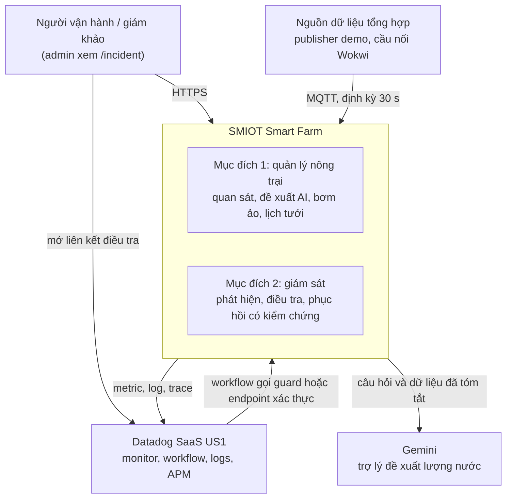
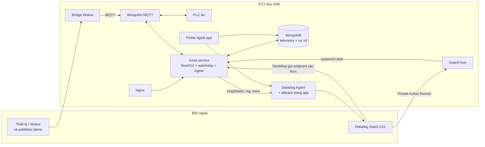
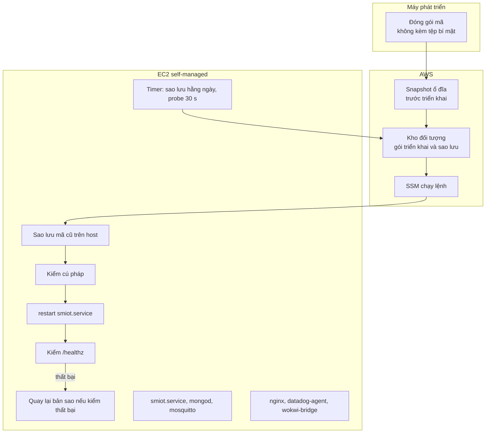
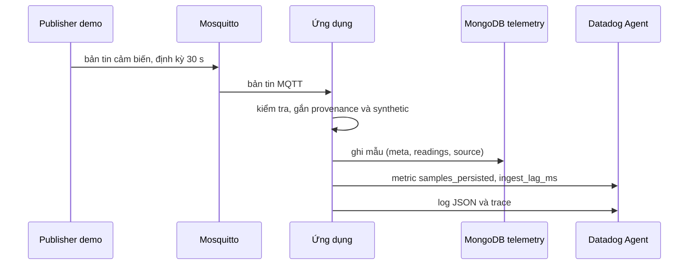
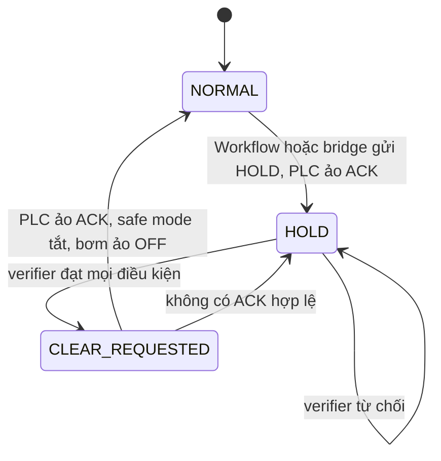
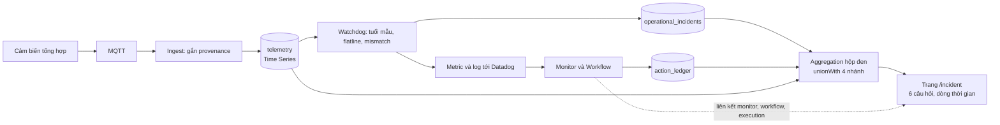
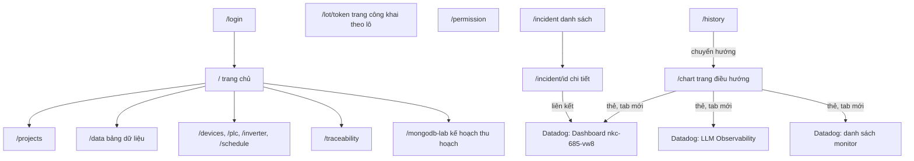
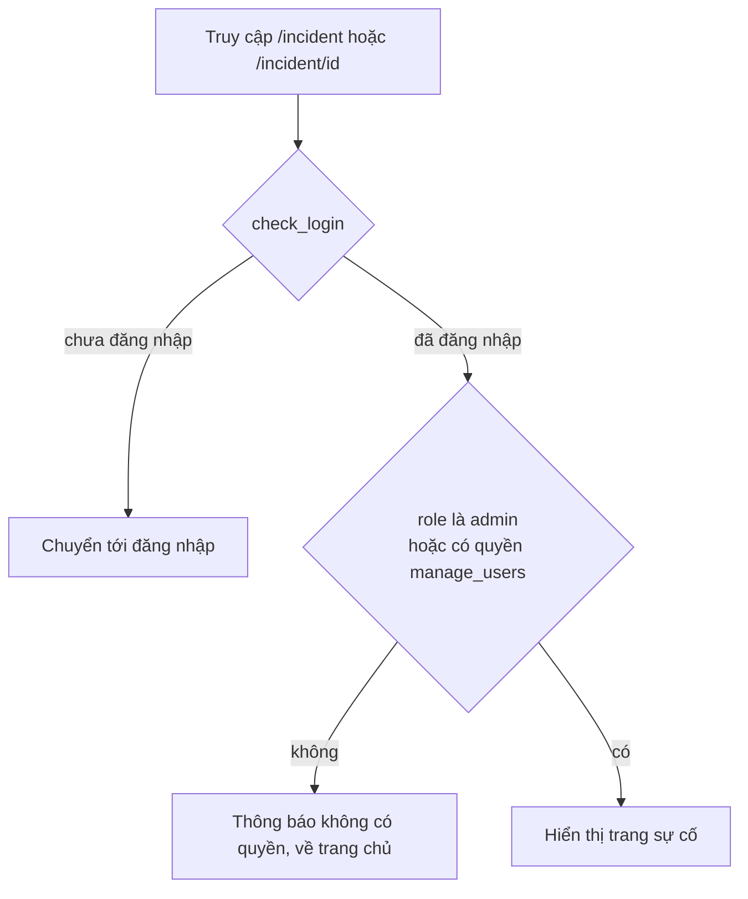
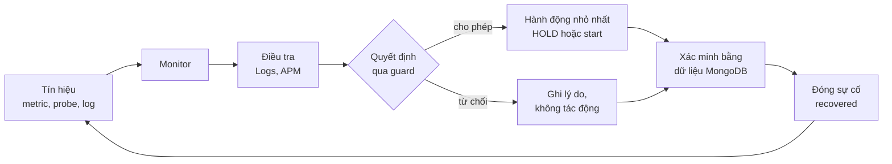

# Kiến trúc giải pháp và ứng dụng

## Tóm tắt

Nhà kính dưa lưới ra quyết định tưới và lịch thu hoạch dựa trên chuỗi số đo định kỳ 30 s, nên câu hỏi vận hành đầu tiên là dữ liệu còn đủ tin cậy hay không. Nhóm xây dựng SMIOT, gồm ứng dụng NiceGUI, MQTT, MongoDB Community tự quản và Datadog US1, để phân biệt ba lớp lỗi khác bản chất (hiển thị sai, đứng số đo, tiến trình app dừng) và gắn mỗi lớp với một phản ứng riêng. Hệ thống đã được diễn tập trên dữ liệu tổng hợp: Ca 2 có hai hồ sơ đầy đủ ngày 03/11/2026 [E-40, E-41], Ca 3 có một lần dừng và phục hồi xác minh bằng HTTP 200 cùng mẫu MongoDB mới trong 418 s (đo một lần, 06/11/2026) [E-59], và 162 test đơn vị đạt [E-30]. Giới hạn chính: một EC2 chung cho app và MongoDB, dữ liệu tổng hợp, PLC ảo, Ca 1 chưa có execution ghi nhận và tác nhân start của Ca 3 ngày 06/11 đang bổ sung (C-3, C-4).

## Mục tiêu dự án

SMIOT được xây dựng để quản lý một nhà màng trồng dưa lưới cụ thể (farm greenhouse_a, hai node cảm biến). Bài toán cốt lõi là quyết định tưới và lịch thu hoạch dưa chỉ có giá trị khi dữ liệu cảm biến còn đáng tin. Mục tiêu của nhóm là thiết kế và hiện thực một hệ thống giám sát nông nghiệp có khả năng tự nhận ra khi dữ liệu hoặc dịch vụ không còn đáng tin, điều tra nguyên nhân bằng bằng chứng, và phục hồi có kiểm chứng, thay vì để người vận hành tin vào một con số trên màn hình.

Nhóm đặt ba tiêu chí cho mục tiêu này: (i) bài toán được xác định từ vận hành thực tế, không từ công nghệ; (ii) mọi phản ứng tự động đều có bước bảo vệ và được xác minh bằng dữ liệu đọc lại, không bằng việc lệnh đã chạy xong; (iii) hệ thống chạy được, kiểm chứng được và có thể bàn giao cho người khác vận hành.

MongoDB và Datadog là hai nền tảng giúp nhóm đạt các tiêu chí trên. MongoDB lưu trữ và đo tác động của sự cố lên từng lô cây; Datadog cung cấp cảnh báo và điều tra. Thiết kế, hiện thực và tích hợp hai nền tảng này, cùng luồng sự cố trọn vẹn từ phát hiện đến phục hồi, là đóng góp của nhóm; các nền tảng là điều kiện để đóng góp đó được đo và kiểm chứng.

## Mục đích hệ thống

SMIOT phục vụ các mục đích sau; các kịch bản người dùng tương ứng nằm ở Tài liệu 05.

1. **Quản lý nông trại và thiết bị.** Người vận hành quan sát trạng thái farm, xem đề xuất của trợ lý AI, điều khiển bơm và lập lịch tưới, theo chuỗi quan sát → quyết định → lịch → tưới. Bơm và thiết bị điều khiển là PLC ảo và dữ liệu là luồng tổng hợp; chức năng lịch tưới (UC-06) hiện còn "đang bổ sung" (Tài liệu 05).
2. **Giám sát phần mềm và thiết bị.** Phát hiện phần mềm hoặc thiết bị có lỗi, điều tra và phục hồi có kiểm chứng bằng dữ liệu đọc lại. Ca 1, 2, 3 là ba minh họa cho ba lớp lỗi (§1.3).
3. **Mục đích thứ ba:** «ĐANG BỔ SUNG: mục đích thứ ba» (đang chốt nội dung).

## Đóng góp chính

1. **Ba lớp lỗi, ba phản ứng khác nhau**, trong đó có phản ứng từ chối restart khi mẫu vẫn đến MongoDB nhưng giao diện báo offline (Ca 1) [E-16, E-55].
2. **Hành động duy nhất trên host** là `systemctl start smiot.service`, có allowlist, khóa chống chạy chồng, cooldown 300 s, kiểm đĩa dưới 85% và kiểm dependency [E-24, E-43].
3. **Phục hồi được định nghĩa bằng dữ liệu đọc lại**: unit active, HTTP 200 và mẫu MongoDB mới có tuổi không quá 180 s [E-59, E-43].
4. **Chia vai**: Datadog điều tra, MongoDB đo tác động, ứng dụng điều hướng giữa hai bên [E-17].
5. **Nhãn dữ liệu tổng hợp nằm trong từng document** (`source.synthetic`, `meta.source`) [E-13].

## Bảng 0. Đọc nhanh

| Mục | Nội dung |
|---|---|
| Mục đích | (1) Quản lý nông trại và thiết bị: quan sát, đề xuất AI, bơm ảo, lịch tưới; (2) giám sát phần mềm và thiết bị: phát hiện, điều tra, phục hồi có kiểm chứng; (3) «ĐANG BỔ SUNG: mục đích thứ ba» |
| Bài toán | Quản lý nhà màng dưa lưới: xác định dữ liệu cảm biến còn đủ tin cậy để quyết định tưới và lịch thu hoạch hay không (kịch bản người dùng: xem Tài liệu 05) |
| Giải pháp | NiceGUI + MQTT + MongoDB Community; watchdog trong app; probe ngoài app; Datadog monitor và Workflow; guard trên host; bộ xác minh phục hồi [E-10, E-14, E-22, E-23, E-24] |
| MongoDB dùng gì | Time Series `telemetry`; `$unionWith`; `$setWindowFields`/`$shift`; chỉ mục một phần; `$jsonSchema` chế độ cảnh báo (Tài liệu 02) [E-16] |
| Datadog dùng gì | Agent, DogStatsD, log JSON, APM, monitor, Workflow + Private Action Runner, LLM Observability, dashboard `nkc-685-vw8` (Tài liệu 03) [E-50, E-71, E-72] |
| Ba ca | Ca 1 — Báo offline sai; Ca 2 — Độ ẩm đất Node 2 đứng yên; Ca 3 — `smiot.service` dừng (Tài liệu 04) |
| Giới hạn | Một EC2; dữ liệu tổng hợp; PLC ảo; SLO chưa đủ 7 ngày dữ liệu |
| Thứ tự đọc | 01 → 05 → 04 → 02 → 03 |

## Mục lục

Tóm tắt; Đóng góp chính; Bảng 0; 1 Đặt vấn đề; 2 Nguyên tắc thiết kế; 3 Kiến trúc tổng thể; 4 Kiến trúc ứng dụng; 5 Luồng phát hiện–điều tra–xử lý; 6 Độ tin cậy; 7 Đánh giá; 8 Hạn chế và phạm vi; 9 Kết luận; Phụ lục A, B; Phụ lục C (mục cần bổ sung); Tài liệu tham khảo.

## Danh sách hình

| Hình | Nội dung | Mục |
|---|---|---|
| 3.1 | Ngữ cảnh hệ thống (C4 mức 1) | §3.1 |
| 3.2 | Container và thành phần (C4 mức 2) | §3.1 |
| 3.3 | Triển khai trên EC2 và luồng triển khai | §3.1 |
| 4.1 | Luồng ingest | §4.2 |
| 4.2 | Máy trạng thái an toàn HOLD/CLEAR | §4.4 |
| 4.3 | Luồng dữ liệu từ cảm biến đến `/incident` | §4.6 |
| 4.4 | Bản đồ trang ứng dụng | §4.6 |
| 4.5 | Kiểm soát truy cập `/incident` | §4.6 |
| 5.1 | Vòng phát hiện–điều tra–xử lý–xác minh | §5 |

## 1. Đặt vấn đề

### 1.1 Bối cảnh nhà kính dưa lưới

SMIOT mô phỏng giám sát một nhà kính dưa lưới với hai node cảm biến, một bộ điều khiển PLC và các lịch tưới. Ứng dụng hiển thị trạng thái, lưu lịch sử, đề xuất lượng nước bằng trợ lý AI và có trang kế hoạch thu hoạch dựa trên nhiệt tích lũy [E-03]. Toàn bộ số đo là dữ liệu tổng hợp do publisher demo và cầu nối Wokwi tạo ra; không có thiết bị vật lý nào được điều khiển [E-02, E-13].

### 1.2 Câu hỏi vận hành

Hai mục đích của hệ thống gắn với nhau: quản lý nông trại (mục đích 1) chỉ đáng tin khi việc giám sát phần mềm và thiết bị (mục đích 2) cho biết dữ liệu còn dùng được. Quyết định tưới và lịch thu hoạch chỉ có giá trị khi chuỗi số đo đáng tin. Câu hỏi vì vậy là "dữ liệu hiện tại còn đủ tin cậy để quyết định không", chứ không chỉ "ứng dụng có chạy không". Nếu không đáng tin, hệ thống chặn quyết định tưới, ghi lại khoảng dữ liệu bị ảnh hưởng và chỉ gỡ chặn khi có bằng chứng phục hồi. Kịch bản người dùng chi tiết nằm ở Tài liệu 05.

### 1.3 Ba lớp lỗi cần ba phản ứng khác nhau

Mã nguồn cố định ba loại sự cố (`kind`) tương ứng với vị trí lỗi trong chuỗi từ cảm biến đến người xem [E-16].

| Lớp lỗi | Triệu chứng | Dữ liệu trong MongoDB | Phản ứng đúng |
|---|---|---|---|
| Hiển thị sai (`false_offline`) | Giao diện báo node OFFLINE | Mẫu mới vẫn đến | Từ chối restart |
| Đứng số đo (`soil_humidity_flatline`) | Độ ẩm đất Node 2 kẹt ở 2,4% | Mẫu đến nhưng không biến thiên | HOLD; CLEAR chỉ sau xác minh |
| Tiến trình app dừng (`service_down`) | Không có HTTP, không metric từ app | MongoDB và MQTT hoạt động; mẫu mới ngừng vào | Start đúng một unit sau guard |

Một phản ứng chung như restart mỗi khi có cảnh báo sẽ sai ở hai trong ba lớp: với `false_offline`, restart xóa phiên và bằng chứng mà không đổi dữ liệu; với flatline, restart không làm số đo biến thiên trở lại.

### 1.4 Phạm vi

Hệ thống chạy trên một EC2 duy nhất, gồm ứng dụng, MongoDB, Mosquitto, Nginx và Datadog Agent [E-03]. Nguồn dữ liệu là publisher demo và cầu nối Wokwi; bơm là PLC ảo. Tài liệu không kết luận về thiết bị vật lý nào.

## 2. Nguyên tắc thiết kế

Mỗi nguyên tắc nêu theo thứ tự phát biểu, lý do, nơi hiện thực.

**R1. Truy vết theo mã sự cố.** Mọi sự kiện của một sự cố mang cùng `incident_id` dạng `INC-SMIOT-<UTC>-<8HEX>`, để đi từ monitor đến log, trace và bản ghi MongoDB mà không phải đoán. Hiện thực: [E-15, E-16, E-40].

**R2. Hành động nhỏ nhất.** `start` chỉ đưa unit đang dừng vào hàng đợi khởi động, còn `restart` dừng rồi khởi động và xóa bằng chứng của tiến trình đang chạy [E-43]. Hiện thực: guard trên host [E-24].

**R3. Từ chối khi bằng chứng mơ hồ.** Nếu app đang active nhưng endpoint lỗi, guard không restart mà ghi trạng thái dependency và đĩa rồi dừng, vì nguyên nhân có thể nằm ở event loop, route, cấu hình hoặc hạ nguồn [E-24].

**R4. Phục hồi chứng minh bằng dữ liệu đọc lại.** Lệnh chạy xong không đồng nghĩa dữ liệu đã trở lại. Hiện thực: bộ xác minh phục hồi cho Ca 2 [E-22] và bước đọc lại MongoDB của guard cho Ca 3 [E-24].

**R5. Chia vai.** Datadog trả lời "chuyện gì xảy ra và vì sao"; MongoDB trả lời "dữ liệu nào bị ảnh hưởng, dữ liệu nào chứng minh phục hồi"; ứng dụng hiển thị và dẫn liên kết. Hiện thực: `/incident` cho điều tra theo sự cố, và `/chart` là trang điều hướng sang Datadog cho biểu đồ, quan sát AI và danh sách monitor [E-17].

**R6. Giữ cardinality metric thấp.** Tag metric chỉ gồm farm, node và nguồn; mã sự cố và mã bản tin nằm trong log, trace và MongoDB [E-13, E-20]. Chi tiết ở Tài liệu 03.

## 3. Kiến trúc tổng thể

### 3.1 Ngữ cảnh, container và triển khai

*Hình 3.1. Ngữ cảnh hệ thống (C4 mức 1).*

Hình 3.1 thể hiện SMIOT như một hộp: người dùng vào qua HTTPS, nguồn dữ liệu vào qua MQTT, Datadog vừa nhận tín hiệu vừa có thể gọi ngược vào hệ thống qua Workflow.

*Hình 3.2. Container và thành phần (C4 mức 2) trên một EC2.*

Hình 3.2 có ba luồng. Luồng dữ liệu: publisher qua Mosquitto vào ứng dụng rồi MongoDB; PLC ảo nhận lệnh và phản hồi qua cùng broker. Luồng quan sát: ứng dụng, probe và tích hợp MongoDB qua Agent tới Datadog US1, nơi monitor đánh giá. Luồng hành động: monitor gọi Workflow, rồi Private Action Runner chạy script guard (Ca 3) hoặc Workflow gọi endpoint có xác thực để chạy bộ xác minh (Ca 2). Publisher demo cũng chạy trong app khi bật chế độ demo [E-03], nên ranh giới "bên ngoài" mang tính logic. Người dùng truy cập tại `<URL_DEMO>` (C-1).

*Hình 3.3. Các unit systemd và luồng triển khai có sao lưu mã cũ.*

Luồng triển khai phía trên là quy trình đã dùng; các unit và timer theo README và tài liệu sao lưu [E-03, E-42]. Rollback nằm trong quy trình triển khai; phạm vi kiểm chứng ghi ở Phụ lục A.

### 3.2 Thành phần và trách nhiệm

Bảng 3.1. Thành phần, trách nhiệm và tệp chính.

| Thành phần | Trách nhiệm | Tệp chính |
|---|---|---|
| Ứng dụng NiceGUI | Giao diện, ingest MQTT, watchdog, vòng đời sự cố, `/incident` | `main.py`, `pages/`, `service/` [E-10] |
| Ingest MQTT | Nhận bản tin, gắn provenance, ghi `telemetry`, phát metric | `service/mqtt.py`, `service/telemetry_provenance.py` [E-11, E-13] |
| Watchdog | Tuổi mẫu, flatline, lệch trạng thái hiển thị, dependency | `service/telemetry_health.py` [E-14] |
| Vòng đời sự cố | Mở, tái sử dụng, đóng sự cố có bằng chứng | `service/incident_lifecycle.py` [E-15] |
| Hộp đen sự cố | Chỉ mục, validator, aggregation gom timeline | `service/incident_blackbox.py` [E-16] |
| Bộ xác minh phục hồi | Kiểm điều kiện rồi mới gửi CLEAR tới PLC ảo | `scripts/verify_and_clear_demo_safe_mode.py` [E-22] |
| Probe ngoài app | Quan sát khi app dừng; mở và đóng `service_down` | `scripts/smiot_external_probe.py` [E-23] |
| Guard phục hồi | Start có điều kiện, đọc lại MongoDB | `scripts/aws/smiot-recover-guarded.sh`, `scripts/aws/smiot-recovery-mongo-readback.py` [E-24] |
| MongoDB Community | Time Series `telemetry`, hồ sơ sự cố, sổ hành động | `service/auth.py`, `service/mongodb_store.py` [E-12] |
| Datadog | Monitor, Workflow, Private Action Runner, log, APM, dashboard | Tài liệu 03 [E-50, E-71, E-72] |
| Sao lưu | Sao lưu logic, diễn tập khôi phục | `scripts/aws/mongodb_backup.sh`, `scripts/aws/mongodb_restore_drill.sh` [E-28, E-42] |

### 3.3 Ranh giới tin cậy và quyền tối thiểu

- **Tài khoản đọc cho Datadog.** Tích hợp MongoDB dùng tài khoản chỉ đọc kèm `clusterMonitor`; việc thu schema được tắt riêng để không mở quyền vào collection bucket nội bộ của Time Series [E-03].
- **Quyền sudo của bộ chạy hành động.** Chỉ hai lệnh: `systemctl start smiot.service` và helper đọc lại MongoDB; không restart, shell hay tham số tùy ý [E-43].
- **Helper đọc lại không trả bí mật.** Helper thuộc root chỉ trả mốc thời gian của mẫu mới nhất, nên người dùng của Agent không cần đọc tệp môi trường của app [E-24, E-43].
- **Endpoint cho Workflow Ca 2** (`/api/internal/safe-mode/recovery-clear` trong `main.py`) yêu cầu xác thực, khóa chống chạy đồng thời và phân biệt từ chối chính sách với lỗi hạ tầng. Cơ chế xác thực không được mô tả ở đây.

### 3.4 Failure domain

Ứng dụng và MongoDB cùng một EC2, nên mất máy đồng nghĩa mất cả hai [E-03, E-42]. Thiết kế xử lý lỗi ở mức tiến trình (Ca 3), không ở mức máy; thiết kế phù hợp với bản demo ngắn hạn; không nhằm mục tiêu sẵn sàng cao.

## 4. Kiến trúc ứng dụng

### 4.1 Mô-đun

Điểm vào là `main.py`; `pages/` chứa các trang giao diện; `service/` chứa logic (xác thực, MQTT, lưu trữ MongoDB, watchdog, vòng đời và hộp đen sự cố, nhật ký hành động, trợ lý AI, quan sát); `scripts/` chứa công cụ vận hành và diễn tập [E-10].

### 4.2 Luồng ingest

*Hình 4.1. Luồng ingest từ publisher đến MongoDB và Datadog.*

Ứng dụng gắn các trường nguồn (`source`, `synthetic`, `provenance`, `app_received_at`) rồi ghi vào Time Series `telemetry` với `meta.farm_key`, `meta.node_id`, `meta.source` [E-12, E-13]. Khi có sự cố mở cho node đó, mẫu được gắn `source.incident_id` [E-11]. Hình dạng document và chỉ mục: Tài liệu 02.

### 4.3 Watchdog sức khỏe telemetry

Một luồng nền đọc MongoDB độc lập với MQTT, nên luồng bản tin im lặng vẫn quan sát được. Mỗi chu kỳ nó phát `sample_age_seconds`, `fresh`, `sensor_flatline`, `status_mismatch` và trạng thái `dependency.mongo.up`, `dependency.mqtt.up` [E-14]. Theo mã hiện tại, flatline là 10 mẫu liên tiếp còn mới, chênh lệch nhỏ hơn hoặc bằng 0,01, trong cửa sổ tối thiểu 600 s. Khi trạng thái hiển thị OFFLINE mâu thuẫn với trạng thái tính từ MongoDB (ONLINE), `status_mismatch` bằng 1 và sự cố `false_offline` được mở [E-14].

### 4.4 Vòng đời sự cố và trạng thái an toàn

Sự cố có năm trạng thái `open`, `holding`, `recovering`, `recovered`, `closed`; ba trạng thái đầu là phạm vi của chỉ mục một phần [E-16]. Sơ đồ chuyển trạng thái nằm ở Tài liệu 04 (Hình 1.2). `open_incident` tái sử dụng sự cố đang hoạt động cùng loại và phạm vi nên không sinh bản ghi trùng; `close_incident` chỉ chuyển sang `recovered` khi có bằng chứng [E-15]. Với flatline, watchdog không tự đóng khi số đo biến thiên trở lại mà gọi bộ xác minh [E-14].

*Hình 4.2. Máy trạng thái an toàn HOLD/CLEAR của PLC ảo.*

Không có đường từ HOLD sang NORMAL ngoài verifier [E-22]; bridge chỉ nhả cờ HOLD sau sự kiện CLEAR có trạng thái verified [E-03]. `CLEAR_REQUESTED` là nhãn minh họa, không phải giá trị trong mã.

### 4.5 Bộ xác minh và probe ngoài app

**Bộ xác minh phục hồi (Ca 2).** Điều kiện CLEAR đầy đủ được nêu ở Tài liệu 04, §3.6. Bộ xác minh được gọi từ watchdog (tối đa một lần mỗi 60 s mỗi node) và từ endpoint mà Workflow gọi; cả hai chạy cùng một script. Gọi lặp lại vẫn an toàn: nếu CLEAR đã verified, kết quả là `already_verified_and_cleared` [E-41].

**Probe ngoài app (Ca 3).** Tiến trình độc lập chạy chu kỳ 30 s, kiểm HTTP và tuổi mẫu MongoDB mới nhất, phát `smiot.external.app_up`, `sample_age_seconds`, `mongo_up`. Sau 2 lần liên tiếp `app_up` bằng 0, probe mở `service_down`; khi app trở lại và mẫu trẻ hơn 180 s, probe đóng sự cố [E-23]. Probe tồn tại vì khi app dừng, chính app không còn phát được metric.

### 4.6 Trang `/incident` và bản đồ trang

`/incident` và `/incident/{id}` chỉ dành cho tài khoản admin hoặc có quyền `manage_users` [E-17]. Trang danh sách có ba thẻ Ca 1/2/3 làm bộ lọc, dải ô theo lần diễn tập và bảng có cột thời lượng xử lý. Trang chi tiết có khối "Metric của sự cố" (tên metric và liên kết mở Metrics Explorer hoặc dashboard Datadog theo khung giờ sự cố), hồ sơ 6 câu hỏi, liên kết Datadog (monitor, workflow, execution, logs, trace), biểu đồ chất lượng dữ liệu theo phút và thanh tua dòng thời gian từ aggregation MongoDB [E-17]. Mô tả từng ca: Tài liệu 04, §6.

Trang `/chart` nay chỉ là trang điều hướng với ba thẻ mở tab mới sang Datadog: Dashboard vận hành `nkc-685-vw8`, Quan sát AI (LLM Observability) và Tất cả monitor; ứng dụng không còn bộ lọc ngày hay biểu đồ cảm biến (`pages/chart.py`) [E-10]. Quan sát phiên làm việc 06/11: dashboard có 12 widget, gồm 8 widget cũ và 4 widget thêm tay (EC2 CPU user, EC2 RAM usable, MongoDB connections và ops/giây, MongoDB storage size); ảnh sau cập nhật: C-7.

*Hình 4.3. Luồng dữ liệu từ cảm biến tổng hợp đến trang `/incident`.*

`/incident` không tự sinh dữ liệu: nó đọc ba collection MongoDB và dẫn liên kết sang Datadog [E-16, E-17].

*Hình 4.4. Bản đồ trang theo `@ui.page` trong `pages/`; cạnh từ trang chủ chỉ minh họa nhóm trang. `/permission` và `/lot/token` vẽ rời vì điều kiện truy cập chưa được đọc.*

*Hình 4.5. Kiểm soát truy cập `/incident` theo `_guard()` trong `pages/incident.py`.*

Chỉ kiểm tra quyền của `/incident` được xác minh trong mã [E-17]; các trang khác không được vẽ để tránh suy đoán.

### 4.7 Trợ lý AI Gemini

Trợ lý Gemini đề xuất lượng nước và trả lời câu hỏi về lịch tưới. Mọi nhánh lỗi (AI tắt, thiếu khóa, quá thời gian, lỗi mạng, ngoại lệ) đều trả `provider_error` kèm HOLD, không bao giờ trả lượng nước; phản hồi rỗng là `no_data`, không phải 0 mL [E-19]; `tests/test_ai_failsafe.py` kiểm các nhánh này. Mã ghi rõ ứng dụng không phát lệnh bơm từ kết quả AI (`service/ai_service.py`). Thẻ "Dự đoán từ AI" trên trang chủ hiển thị dự đoán lưu gần nhất kèm nhãn "dự đoán cũ" và giờ UTC+7 khi chưa có dự đoán mới (`pages/home.py`, `service/mqtt.py`). Ứng dụng nhận dự đoán qua topic `farm/ai`; nguồn publish topic này chưa có trong repo (xem chương 8). LLM Observability bật với `ml_app=smiot-smart-farm`, nội dung vào ra được che, chỉ còn số đếm [E-19]; span "Gemini GenerateContent" đã được xác nhận trên Datadog (quan sát phiên làm việc 06/11; ảnh: C-6).

## 5. Luồng phát hiện, điều tra, xử lý

*Hình 5.1. Vòng phát hiện, điều tra, xử lý, xác minh và đóng sự cố.*

Dù đi nhánh nào, bước xác minh vẫn đọc lại dữ liệu MongoDB trước khi đóng sự cố. Bảng 5.1 tóm tắt ba ca; mốc thời gian và bằng chứng chi tiết nằm ở Tài liệu 04, là nguồn chuẩn.

Bảng 5.1. Ba ca theo lớp lỗi, tín hiệu, hành động và mức bằng chứng.

| Ca | Lớp lỗi | Tín hiệu và monitor | Hành động | Mức bằng chứng |
|---|---|---|---|---|
| Ca 1 — Báo offline sai | `false_offline` | `status_mismatch > 0`, `341409441`; đối chứng `339977703` | Workflow `e2835af0-63fc-48e0-9562-2a1ee4a351d3` chỉ ghi `REFUSED_RESTART` | Đã cấu hình [E-55]; execution: C-3 |
| Ca 2 — Độ ẩm đất Node 2 đứng yên | `soil_humidity_flatline` | `sensor_flatline > 0`, `339977691` | HOLD; CLEAR chỉ sau verifier | Đầy đủ (hai hồ sơ 03/11) [E-40, E-41] |
| Ca 3 — `smiot.service` dừng | `service_down` | `app_up = 0`, `340356283` | Start đúng `smiot.service` sau guard | Một phần [E-59]; tác nhân start: C-4 |

## 6. Độ tin cậy và khả năng bảo trì

**Guard, khóa và cooldown.** Guard dùng khóa tệp chống chạy chồng, cooldown 300 s, từ chối khi đĩa từ 85% trở lên hoặc dependency không active, và sau start yêu cầu unit active, HTTP 200 và mẫu MongoDB mới có tuổi không quá 180 s; nếu không đạt, kết quả là `unverified` hoặc `failed` và guard không thử thao tác khác. Thứ tự các bước: Tài liệu 04, §4.4 [E-24, E-43]. Mỗi nhánh ghi một dòng JSON (`event=smiot.guarded_recovery`) để Datadog thu thập.

**Idempotency theo `command_id`.** Mỗi lệnh HOLD hoặc CLEAR mang `command_id` và được ghi vào `action_ledger` qua các trạng thái yêu cầu, đã phát, đã xác nhận, đã xác minh; lệnh HOLD trùng bị bỏ qua [E-21, E-40]. MongoDB chạy standalone nên không dùng giao dịch đa tài liệu; tính nhất quán dựa vào định danh lệnh và máy trạng thái.

**Validator chế độ cảnh báo.** `operational_incidents` và `action_ledger` có `$jsonSchema` với `validationAction=warn`, `validationLevel=moderate`: ghi sai cấu trúc được cảnh báo nhưng không chặn [E-16].

**Kiểm thử.** 162 test đơn vị đạt ngày 06/11/2026 bằng `py -3.12 -X utf8 -m unittest discover -s tests` [E-30].

**Sao lưu.** `mongodump` cho collection nghiệp vụ và `mongoexport` cho Time Series, tải lên kho đối tượng có mã hóa phía máy chủ. Diễn tập khôi phục ngày 03/11/2026: 154.618/154.618 mẫu Time Series và 1/1 sự cố; khôi phục theo điểm thời gian và khôi phục ảnh chụp ổ đĩa nằm ngoài phạm vi hiện tại [E-42].

## 7. Đánh giá

Bảng 7.1. Tuyên bố, bằng chứng và trạng thái.

| Tuyên bố | Bằng chứng | Trạng thái |
|---|---|---|
| Mã định nghĩa đúng ba loại sự cố và ánh xạ monitor, workflow cho từng ca | `service/incident_blackbox.py:22, 551-561` [E-16] | Đã kiểm chứng |
| Flatline là 10 mẫu, chênh lệch ≤ 0,01, cửa sổ 600 s (mã hiện tại) | `service/telemetry_health.py:35-37, 475-513` [E-14] | Đã kiểm chứng |
| Verifier đòi ≥ 10 mẫu, mẫu mới nhất ≤ 90 s, biên độ ≥ 0,5 (mã hiện tại) | `scripts/verify_and_clear_demo_safe_mode.py` [E-22] | Đã kiểm chứng |
| Probe mở `service_down` sau 2 lần liên tiếp `app_up = 0`, chu kỳ 30 s | `scripts/smiot_external_probe.py:52, 202-260` [E-23] | Đã kiểm chứng |
| Guard chỉ start unit đang dừng, có khóa, cooldown 300 s, kiểm đĩa < 85% và dependency | `scripts/aws/smiot-recover-guarded.sh` [E-24] | Đã kiểm chứng (mã) |
| Quyền sudo của Agent giới hạn hai lệnh | Tài liệu thiết kế [E-43] | Đang bổ sung (cấu hình sống) |
| Workflow Ca 1: ba bước: đọc tuổi mẫu từ hai metric Datadog (`smiot.telemetry.sample_age_seconds` và `smiot.external.sample_age_seconds`), rẽ nhánh theo `threshold_seconds` (mặc định 90 s), rồi ghi `REFUSED_RESTART` hoặc `ESCALATE_HUMAN`; không gọi EC2 và không tác động thiết bị; trigger monitor giới hạn 1 lượt mỗi 300 s | [E-55] | Đã kiểm chứng (cấu hình) |
| Ca 2 ngày 03/11: HOLD, CLEAR sau xác minh, `recovered` | [E-40, E-41] | Đã kiểm chứng |
| Ca 3 ngày 06/11: phục hồi 418 s, `mongod` và `mosquitto` active suốt | [E-59] | Đã kiểm chứng một phần |
| Tác nhân start trong Ca 3 ngày 06/11 là Workflow `b83453ff…` | [E-82] | Đã kiểm chứng (Datadog); đầu ra EC2 đang bổ sung (C-4) |
| Ca 1 có execution `REFUSED_RESTART` | [E-81] | Đang bổ sung (C-3) |
| 162 test đạt (06/11/2026) | `tests/` [E-30] | Đã kiểm chứng |
| Sao lưu logic khôi phục đúng 154.618/154.618 mẫu và 1/1 sự cố | [E-42] | Đã kiểm chứng (tài liệu) |
| Span Gemini trên LLM Observability, nội dung được che | Mã [E-19]; ảnh [E-84] | Mã đã kiểm chứng; ảnh đang bổ sung |
| Cấu hình MongoDB sống: phiên bản, standalone, Time Series | [E-80] | Đang bổ sung (C-2) |
| Bản đồ trang (Hình 4.4), `/chart` chỉ có ba thẻ sang Datadog, kiểm soát admin `/incident` (Hình 4.5) | `pages/*.py`, `pages/chart.py`, `pages/incident.py:132-141` [E-10, E-17] | Đã kiểm chứng (mã) |
| Máy trạng thái HOLD/CLEAR (Hình 4.2): CLEAR chỉ qua verifier | [E-22] | Đã kiểm chứng (mã); `CLEAR_REQUESTED` là nhãn minh họa |
| Dashboard `nkc-685-vw8` hiện 12 widget | Quan sát phiên làm việc 06/11; ảnh C-7 | Ghi nhận theo `[E-xx]` |
| Luồng triển khai và vai trò systemd (Hình 3.3) | [E-03] | Đang bổ sung (cấu hình sống) |

## 8. Hạn chế và phạm vi

1. **Một EC2.** Ứng dụng và MongoDB chung failure domain; không có HA [E-03, E-42].
2. **Dữ liệu tổng hợp và PLC ảo.** Số đo do publisher demo hoặc cầu nối Wokwi tạo; bơm là đầu ra mô phỏng; kết quả không suy ra cho thiết bị hay cây trồng vật lý [E-02, E-13].
3. **Ca 1.** Mới có cấu hình monitor và workflow [E-55]; execution `REFUSED_RESTART` và số lần restart đang bổ sung (C-3).
4. **Ca 3 ngày 06/11.** Monitor Alert lúc 03:11:43Z; workflow tự kích hoạt lúc 03:12:43Z (execution `06cb1b46…`) [E-82]. Đầu ra lệnh trên EC2 đang bổ sung (C-4). Execution ngày 04/11 là bằng chứng độc lập [E-74].
6. **SLO.** SLO chưa đủ 7 ngày dữ liệu; các khoảng thời gian là một lần quan sát [E-59, E-56].
7. **Trợ lý AI.** Nguồn publish topic `farm/ai` nằm ngoài repo này; thẻ "Dự đoán từ AI" hiển thị dự đoán lưu gần nhất (C-11).
8. **Tính năng MongoDB không dùng.** Hệ thống không dùng dịch vụ MongoDB quản lý trên đám mây, cơ chế theo dõi thay đổi hay giao dịch đa tài liệu vì MongoDB chạy standalone [E-80].
9. **Số liệu ngày 06/11** nêu là quan sát phiên làm việc, chờ người dùng xác nhận.

## 9. Kết luận

SMIOT chọn phản ứng theo lớp lỗi: từ chối restart khi hiển thị sai, giữ HOLD khi số đo đứng yên, start có điều kiện khi tiến trình dừng. Mỗi phản ứng được kiểm chứng bằng dữ liệu đọc lại từ MongoDB, còn Datadog giữ vai trò điều tra. Ca 2 có bằng chứng đầy đủ nhất (hai hồ sơ ngày 03/11); Ca 3 ghi nhận một lần phục hồi đã xác minh bằng HTTP 200 và mẫu mới, với tác nhân khởi động là workflow [E-82]; Ca 1 có cấu hình và một lượt chạy ngày 06/11 [E-81]. Các giới hạn ở chương 8 là điều kiện để đọc đúng kết quả.

## Phụ lục A. Thành phần có từ trước 17/10/2026

Nội dung ngày và phạm vi: xem C-8.

| Thành phần | Mô tả |
|---|---|
| Ứng dụng NiceGUI nền (giao diện, người dùng, lịch tưới) | Có lịch sử chuyển từ SQLite sang MongoDB trong README [E-03] |
| Dữ liệu người dùng và lịch tưới đã di chuyển | Đã chuyển sang MongoDB |
| MQTT, PLC ảo, biến tần | Cần xác nhận |
| Trợ lý AI Gemini | Khai báo tại `docs/DECLARATIONS.md` [E-02] |
| Hộp đen sự cố, watchdog flatline, verifier, probe, guard | Phần dự kiến làm trong thời gian thi |

## Phụ lục B. Công cụ AI đã dùng

| Công cụ | Vai trò |
|---|---|
| Claude Code | Hỗ trợ đọc mã và soạn tài liệu (phạm vi đầy đủ: C-9) |
| Codex | Có tài liệu kế hoạch `docs/CODEX_PLAN_3_CASES.md` (vai trò: C-9) |
| Gemini (trong ứng dụng) | Đề xuất lượng nước; lỗi dẫn tới HOLD, không phát lệnh bơm [E-19, E-02] |

## Phụ lục C. Mục cần bổ sung

| Mã | Mục cần bổ sung |
|---|---|
| C-1 | Quyết định có ghi hostname demo hay không (hostname chứa IP công khai); hiện dùng `<URL_DEMO>` |
| C-2 | Xác nhận phiên bản MongoDB và chế độ standalone; kết quả lệnh chỉ đọc (E-80) |
| C-3 | Bản ghi diễn tập Ca 1: execution `REFUSED_RESTART`, số lần restart (E-81) |
| C-4 | Ca 3 ngày 06/11: đầu ra lệnh trên EC2 và log `smiot.guarded_recovery` (E-82) |
| C-5 | Ảnh `/incident` và `/incident/<id>` từng ca (E-83) |
| C-6 | Ảnh LLM Observability, nội dung bị che (E-84) |
| C-7 | Ảnh dashboard `nkc-685-vw8` sau cập nhật 12 widget |
| C-8 | Ngày và phạm vi từng thành phần có từ trước 17/10 (Phụ lục A) |
| C-9 | Vai trò cụ thể của Claude Code và Codex (Phụ lục B) |
| C-10 | Liên kết tài liệu MongoDB chính thức (Time Series, `$unionWith`, `$setWindowFields`, `$jsonSchema`) |
| C-11 | Nguồn publish topic `farm/ai` |

## Tài liệu tham khảo

1. Datadog. Run script (Private Actions). https://docs.datadoghq.com/actions/private_actions/run_script/
2. Datadog. Monitor notifications. https://docs.datadoghq.com/monitors/notify/
3. freedesktop.org. systemctl manual. https://freedesktop.org/software/systemd/man/latest/systemctl.html
4. Tài liệu MongoDB chính thức: xem C-10.
