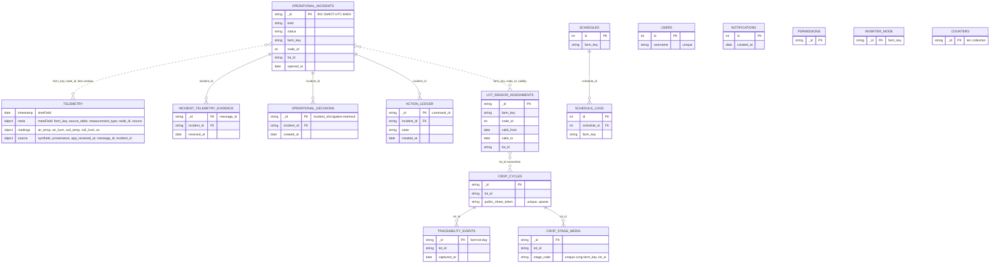
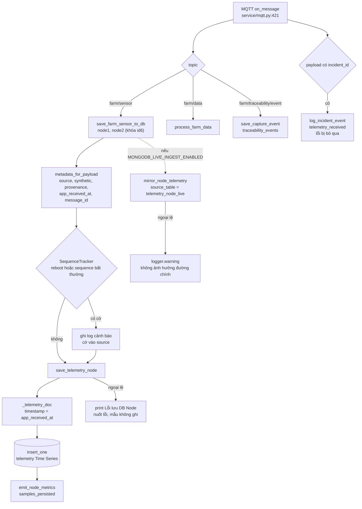
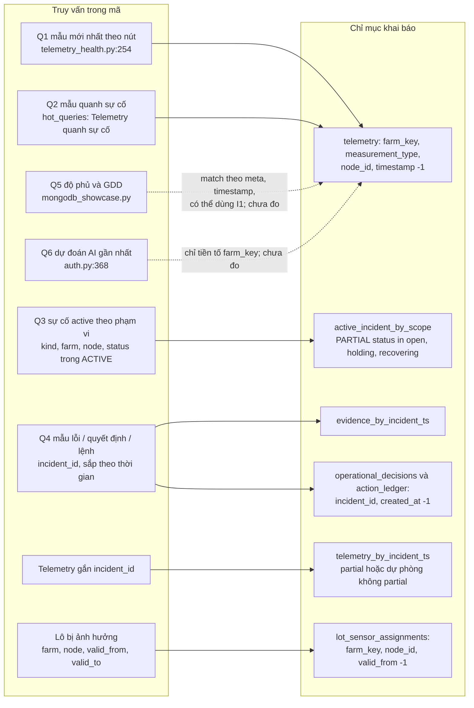
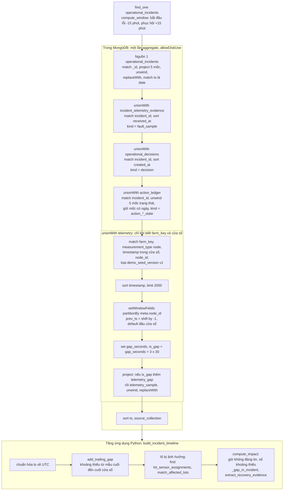
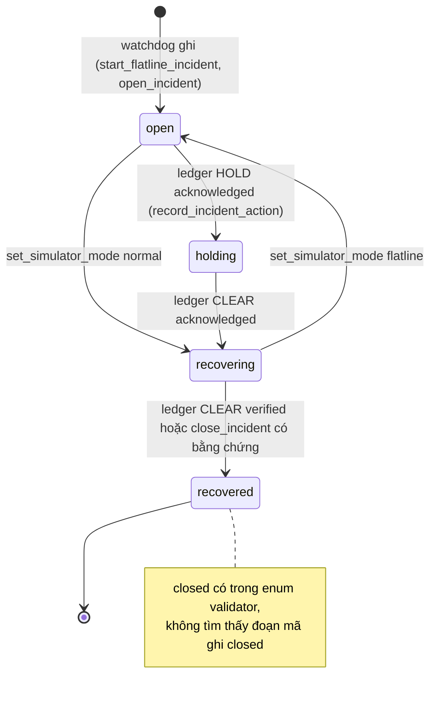
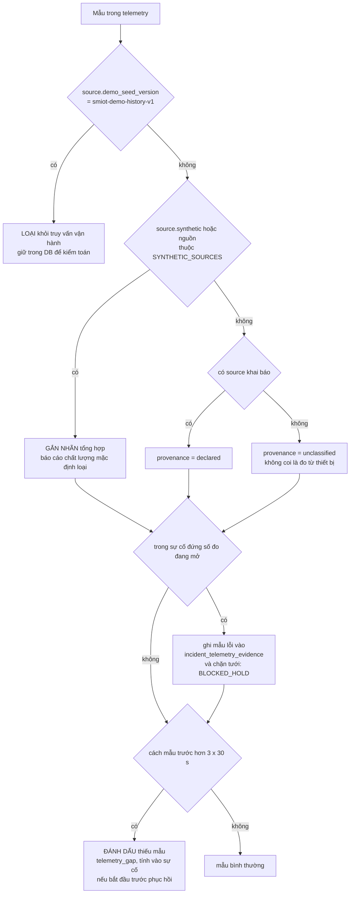
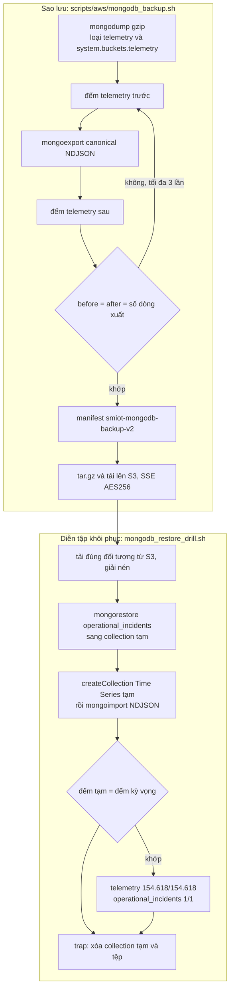

# Kiến trúc dữ liệu và data model trên MongoDB

## Tóm tắt

SMIOT Smart Farm ghi hai loại dữ liệu có đặc tính khác nhau vào cùng một cơ sở dữ liệu: chuỗi mẫu đo định kỳ 30 s và hồ sơ vòng đời sự cố gồm mốc, quyết định và lệnh. Nhóm dùng MongoDB Community 8.0 tự quản (self-managed), chạy standalone trên cùng một EC2 với ứng dụng, và chọn Time Series collection cho `telemetry`, chỉ mục phụ có điều kiện cho sự cố đang mở, cùng validator `$jsonSchema` ở chế độ cảnh báo (định nghĩa trong mã; chưa xác nhận trên máy chủ). Một aggregation duy nhất gộp năm nguồn thành dòng thời gian của sự cố, trong đó khoảng thiếu mẫu được đánh dấu ngay trong cơ sở dữ liệu bằng `$setWindowFields` và `$shift` [E-16]; việc sao lưu Time Series đi qua đường logic và lần diễn tập khôi phục ngày 03/11/2026 khớp 154.618/154.618 mẫu và 1/1 sự cố [E-42]. Đối chiếu chỉ đọc ngày 07/11/2026 (do người dùng báo lại, chưa được tác giả tài liệu tái lập) ghi nhận MongoDB 8.0.34 standalone trên EC2, `telemetry` là Time Series với khoảng 342.546 bản ghi ước tính, `operational_incidents` 7, `action_ledger` 25 và `incident_telemetry_evidence` 241. Kích thước lưu trữ, so sánh explain trước/sau và validator trên máy chủ vẫn chưa có bằng chứng. Toàn bộ dữ liệu cảm biến là luồng Wokwi hoặc dữ liệu tổng hợp (synthetic data), không phải số đo từ thiết bị vật lý.

## Mục đích hệ thống và vai trò của MongoDB

Mục tiêu chung của dự án được nêu ở Tài liệu 01 (mục Mục tiêu dự án). Trong mục tiêu đó, MongoDB là nơi lưu bằng chứng và đo tác động của sự cố; thiết kế dữ liệu dưới đây là đóng góp của nhóm.

SMIOT phục vụ hai mục đích. Toàn bộ dữ liệu cảm biến là dữ liệu tổng hợp (luồng Wokwi hoặc bộ phát mô phỏng) và bơm là PLC ảo (virtual PLC); hệ thống không điều khiển thiết bị vật lý.

1. **Quản lý nông trại và thiết bị** (quan sát, đề xuất của trợ lý AI, điều khiển bơm ảo, lập lịch tưới). MongoDB lưu telemetry trong `telemetry`, lịch tưới trong `schedules`, nhật ký chạy lịch trong `schedule_logs`, và đề xuất lượng nước của AI dưới dạng `readings.ai_water_suggest` trong `telemetry` (`service/auth.py:200-283, 341-348, 368-370`).
2. **Giám sát phần mềm và thiết bị** (phát hiện lỗi, điều tra, phục hồi). MongoDB lưu hồ sơ sự cố, sự kiện, mẫu lỗi và quyết định tưới bị chặn trong `operational_incidents`, `action_ledger`, `incident_telemetry_evidence`, `operational_decisions`, và đo tác động của sự cố bằng hộp đen (§6).

Mục đích thứ ba: «ĐANG BỔ SUNG: mục đích thứ ba».

## Đóng góp chính

- Một pipeline `operational_incidents.aggregate` hợp nhất mốc sự cố, mẫu lỗi, quyết định, lệnh và telemetry bằng bốn nhánh `$unionWith`, cho ra timeline sự cố có thứ tự thời gian [E-16].
- Khoảng thiếu mẫu (gap) được tính trong cơ sở dữ liệu bằng window function: `prev_ts = $shift(by −1)` theo `meta.node_id`, ngưỡng `gap_seconds > 3 × 30` [E-16].
- Chỉ mục một phần (partial index) `active_incident_by_scope` chỉ phủ sự cố ở trạng thái `open`, `holding`, `recovering`; chỉ mục theo `source.incident_id` có nhánh dự phòng khi phiên bản không chấp nhận điều kiện một phần [E-16].
- Validator `$jsonSchema` cho `operational_incidents` và `action_ledger` đặt `validationAction=warn`, `validationLevel=moderate`, nên kiểm tra chất lượng mà không chặn ghi khi vận hành [E-16]. Validator có hiệu lực khi `SMIOT_APPLY_VALIDATORS=true`; trạng thái trên máy chủ đang bổ sung (H.2-6).
- Sao lưu Time Series qua `mongoexport` canonical Extended JSON thay cho bucket nội bộ, kèm manifest và diễn tập khôi phục đếm khớp [E-28, E-42].

## Bảng 0. Đọc nhanh

| Mục | Nội dung |
|---|---|
| Phiên bản và chế độ | MongoDB Community, tự quản trên EC2 cùng ứng dụng; README ghi 8.0.34 [E-03]; đối chiếu chỉ đọc ngày 07/11 xác nhận 8.0.34 và chế độ standalone; cấu hình khởi tạo `mongod` không có khối replication (`scripts/aws/bootstrap_ubuntu.sh:61-78`) |
| Collection chính | `telemetry` (Time Series), `operational_incidents`, `incident_telemetry_evidence`, `operational_decisions`, `action_ledger`, `lot_sensor_assignments` |
| Tính năng sử dụng | Time Series collection; chỉ mục compound; partial index; `$jsonSchema` (warn/moderate); `$unionWith`; `$setWindowFields`; backup/restore logic |
| Lý do chọn | Một công cụ lưu cả chuỗi thời gian lẫn hồ sơ có cấu trúc linh hoạt; window function và `$unionWith` đủ để dựng timeline sự cố mà không cần dịch vụ ngoài; chi phí vận hành thấp cho một hệ thống demo |
| Không sử dụng | Giao dịch đa tài liệu; theo dõi thay đổi bằng cơ chế đẩy của cơ sở dữ liệu; dịch vụ đám mây mở rộng của nhà cung cấp (chi tiết ở §10) |
| Nhãn dữ liệu | Dữ liệu tổng hợp (synthetic); nhãn nằm trong từng document (`source.synthetic`, `meta.source`) [E-13] |
| Thứ tự đọc khuyến nghị | Tài liệu 01 → 05 (use case) → 04 → 02 → 03 |

**Mục lục.** Mục đích hệ thống · 1 Đặt vấn đề dữ liệu · 2 Triển khai · 3 Data model · 4 Time Series `telemetry` · 5 Chỉ mục và ràng buộc · 6 Aggregation · 7 MongoDB trong luồng sự cố · 8 Vận hành dữ liệu · 9 Đánh giá · 10 Hạn chế và phạm vi · 11 Kết luận · Phụ lục A (lệnh chỉ-đọc), B (tài liệu tham chiếu), C (mục cần bổ sung).

**Danh sách hình.** Hình 3.1 ER đầy đủ theo mã · Hình 4.1 luồng ghi telemetry · Hình 5.1 chỉ mục và đường truy vấn · Hình 6.1 pipeline hộp đen theo giai đoạn và tầng ứng dụng · Hình 7.1 vòng đời hồ sơ sự cố · Hình 7.2 cây quyết định độ tin cậy của mẫu · Hình 8.1 sao lưu và khôi phục.

## 1 Đặt vấn đề dữ liệu

### 1.1 Hai loại dữ liệu và đặc tính ghi/đọc

Loại thứ nhất là mẫu đo của các nút cảm biến (nhiệt độ, độ ẩm không khí, nhiệt độ đất, độ ẩm đất, độ dẫn điện) cùng các bản tin nước và lưu lượng. Dữ liệu này chỉ thêm vào cuối, phần lớn ghi theo chu kỳ khai báo 30 s cho luồng trực tiếp, và được đọc theo khoảng thời gian và theo nút. Mã tạo Time Series cho loại này với `timeField=timestamp`, `metaField=meta`, `granularity=seconds` [E-08].

Loại thứ hai là hồ sơ vòng đời sự cố: một document sự cố được cập nhật nhiều lần (mốc, trạng thái, bằng chứng), kèm các document nhỏ được ghi một lần (mẫu lỗi, quyết định) hoặc chuyển trạng thái theo máy trạng thái (lệnh) [E-15, E-21]. Khối lượng nhỏ nhưng yêu cầu truy vết chính xác và ghi lặp lại an toàn.

Hai loại này khác nhau về kích thước, chiều truy vấn và yêu cầu nhất quán, nhưng cùng được truy vấn chung trong một câu hỏi vận hành: dữ liệu quanh một sự cố còn đáng tin hay không. Đó là lý do cả hai nằm trong cùng một cơ sở dữ liệu và được nối bằng `farm_key`, `node_id` và cửa sổ thời gian.

### 1.2 Câu hỏi truy vấn

Bảng 1.1 liệt kê các câu hỏi truy vấn làm cơ sở cho thiết kế chỉ mục và pipeline. Cột cuối chỉ ra mục chứa lời giải; hiệu quả thực của từng chỉ mục chưa được đo (xem §5.4). Theo hiện trạng ngày 06/11/2026, trang `/chart` chỉ điều hướng sang Datadog và không còn đọc MongoDB để vẽ biểu đồ (`pages/chart.py:6`); các hàm `get_telemetry_node_history`, `get_telemetry_water_history`, `get_telemetry_flow_history` vẫn còn trong `service/auth.py:345-347` và được trang bảng dữ liệu (`pages/data_table.py`) cùng công cụ của trợ lý AI (`service/ai_tools.py:51`) gọi (Q7).

**Bảng 1.1. Câu hỏi truy vấn và ánh xạ thiết kế**

| Mã | Câu hỏi | Nơi dùng trong mã | Chỉ mục hoặc pipeline | Mục |
|---|---|---|---|---|
| Q1 | Mẫu mới nhất của một nút trong một farm là gì? | `_latest_node_row`, `service/telemetry_health.py:254-262` | Chỉ mục `meta.farm_key, meta.measurement_type, meta.node_id, timestamp(-1)` (`service/auth.py:77`) | §5.1 |
| Q2 | Các mẫu trong cửa sổ quanh một sự cố? | Nhánh telemetry, `service/incident_blackbox.py:243-289` | Cùng chỉ mục Q1 + điều kiện `timestamp` | §5.1, §6.2 |
| Q3 | Sự cố nào đang mở theo kind/farm/node? | `start_flatline_incident`, `open_incident`, `service/incident_lifecycle.py:53, 322` | Partial index `active_incident_by_scope` | §5.2 |
| Q4 | Timeline hợp nhất của một sự cố? | `build_incident_timeline`, `service/incident_blackbox.py:580-628` | Pipeline `$unionWith` bốn nhánh | §6.1 |
| Q5 | Độ phủ dữ liệu và GDD theo ngày? | `harvest_pipeline`, `service/mongodb_showcase.py:17-81` | `$setWindowFields` + `$group` | §6.3 |
| Q6 | Dự đoán lượng nước gần nhất của trợ lý AI cho một farm? | `get_latest_ai_water_suggest`, `service/auth.py:368-370`; thẻ AI trang chủ `pages/home.py:1078`; ghi bởi `save_ai_water_suggest` (`service/auth.py:348`) | `find_one` theo `meta.farm_key`, `meta.source_table = telemetry_sensor`, `readings.ai_water_suggest ≠ null`, sắp `timestamp` giảm dần; chỉ tiền tố `meta.farm_key` của chỉ mục Q1 có thể hỗ trợ (suy luận, chưa đo) | §5.1 |
| Q7 | Lịch sử mẫu theo ngày cho bảng dữ liệu và công cụ AI? | `_history`, `service/auth.py:305-329` | Lọc `meta.farm_key`, `meta.source_table`, `timestamp`, loại seed v1 | §4 |

## 2 Triển khai và hệ quả thiết kế

MongoDB chạy tự quản trên cùng một EC2 với ứng dụng. Tệp cấu hình khởi tạo đặt `bindIp` ở giao diện vòng lặp cục bộ, bật `authorization`, không có khối replication, và tạo hai người dùng: `smiot_app` với quyền `readWrite` trên cơ sở dữ liệu của ứng dụng, và một người dùng giám sát với quyền đọc cùng `clusterMonitor` (`scripts/aws/bootstrap_ubuntu.sh:61-87`). Ba hệ quả thiết kế được rút ra từ cấu hình này.

**(a) Không dùng giao dịch đa tài liệu.** Mã không gọi `start_session` hay `with_transaction` trong `service/`, `pages/`, `scripts/` (kết quả tìm kiếm ngày 06/11/2026). Thay vào đó, các thao tác ghi được thiết kế để lặp lại an toàn:

- Sổ hành động `action_ledger` dùng `command_id` làm `_id`. Mỗi chuyển trạng thái `requested → published → acknowledged → verified` (hoặc `failed`) có thứ tự trong bảng `ORDER`; bản tin phát lại bị bỏ nếu trạng thái đã giống hoặc đã tiến xa hơn. Lệnh cập nhật còn lọc theo trạng thái cũ (`query["state"] = old_state`), nên hai callback MQTT đồng thời không ghi chồng nhau; ngoại lệ khóa trùng được bắt và coi là đã có bản mới hơn (`service/operational_evidence.py:36-90`, [E-21]).
- Mẫu lỗi (`incident_telemetry_evidence`) dùng upsert với `$setOnInsert` theo `message_id`; bộ đếm `fault_sample_count` trên sự cố chỉ tăng khi upsert thực sự chèn mới (`service/incident_lifecycle.py:117-134`, [E-15]).
- Quyết định chặn tưới có `_id` cố định `<incident_id>:irrigation-interlock`, nên mỗi sự cố có tối đa một bản ghi `BLOCKED_HOLD` (`service/incident_lifecycle.py:137-172`, [E-15, E-40]).

Đánh đổi cần nêu rõ: cập nhật sổ hành động rồi cuộn lên tài liệu sự cố là hai thao tác riêng. Mã ghi sổ trước và bỏ qua lỗi cuộn lên, để bằng chứng lệnh không mất khi sự cố tạm thời không cập nhật được (`service/operational_evidence.py:91-112`).

**(b) Không dựa vào cơ chế đẩy sự kiện thay đổi của cơ sở dữ liệu.** Phát hiện sự cố dựa vào watchdog chạy định kỳ trong ứng dụng và probe ngoài ứng dụng đọc tuổi mẫu mới nhất [E-14, E-23]. Độ trễ phát hiện vì vậy phụ thuộc chu kỳ thăm dò, không phụ thuộc cơ sở dữ liệu.

**(c) Cùng một miền lỗi.** Ứng dụng và `mongod` chia sẻ một EC2, nên mất máy là mất cả hai. Biện pháp giảm nhẹ đã diễn tập là sao lưu logic ra S3 (xem §8) [E-42]; bản sao thứ hai, khôi phục theo thời điểm và khôi phục EBS nằm ngoài phạm vi hiện tại.

## 3 Data model

### 3.1 Quan hệ giữa các collection

Hình 3.1 (bên dưới) cho thấy `operational_incidents` là trung tâm. Ba collection `incident_telemetry_evidence`, `operational_decisions` và `action_ledger` tham chiếu sự cố trực tiếp bằng `incident_id` (cặp chỉ mục `incident_id` + thời gian ở `service/auth.py:84, 89` và `service/incident_blackbox.py:46-48`). `telemetry` không mang `incident_id` ở `meta`; nó được nối với sự cố qua `meta.farm_key`, `meta.node_id` và cửa sổ thời gian (`service/incident_blackbox.py:292-300`). Một số mẫu có thêm `source.incident_id` khi sự cố đang mở. `lot_sensor_assignments` nối lô với nút theo khoảng hiệu lực. `crop_cycles`, `traceability_events` và `crop_stage_media` gắn với lô qua `lot_id`; liên kết giữa `lot_sensor_assignments` và `crop_cycles` chỉ là quy ước giá trị, MongoDB không ràng buộc.



*Hình 3.1. ER đầy đủ theo mã: mọi collection được khởi tạo hoặc ghi trong `service/` và `scripts/seed_harvest_story.py`. Nét liền là tham chiếu; nét đứt là quan hệ suy ra từ `farm_key`, `node_id` và khoảng thời gian, không có khóa ngoại. Khóa chính (`PK`) là `_id` hoặc trường `id` do `_counters` cấp (`service/mongodb_store.py:37-41`); chỉ mục chi tiết ở Bảng 5.1.*

### 3.2 Các collection và nơi ghi

**Bảng 3.1. Collection, trường khóa và nơi ghi**

| Collection | Mục đích | Trường khóa | Trường chính | Nơi ghi (`file:dòng`) | Truy vấn chính |
|---|---|---|---|---|---|
| `telemetry` (Time Series) | Mẫu đo định kỳ | `timestamp`, `meta{farm_key, source_table, measurement_type, node_id, source}` | `readings{air_temp, air_hum, soil_temp, soil_hum, ec}`, `source{…}` | `service/auth.py:291-304, 341-342` | Q1, Q2, Q5, Q6, Q7 |
| `operational_incidents` | Hồ sơ vòng đời sự cố | `_id = incident_id` (`INC-SMIOT-<UTC>-<8HEX>`) | `kind`, `status`, `farm_key`, `node_id`, `opened_at`, `detected_at`, `safe_at`, `recovered_at`, `synthetic`, `evidence{…}`, `impact{…}`, `lot_id` | `service/incident_lifecycle.py:47-92, 311-339` | Q3, Q4 |
| `incident_telemetry_evidence` | Mẫu lỗi gắn sự cố | `_id = message_id`, `incident_id` | `value`, `received_at`, `synthetic` | `service/incident_lifecycle.py:117-134` | Q4 |
| `operational_decisions` | Quyết định vận hành bị chặn | `_id = <incident_id>:irrigation-interlock` | `proposed_action`, `applied_action` (`BLOCKED_HOLD`), `sensor_value_pct`, `reason` | `service/incident_lifecycle.py:137-172` | Q4, §6.4 |
| `action_ledger` | Sổ lệnh HOLD/CLEAR | `_id = command_id` | `action`, `state`, `requested_at … verified_at`, `workflow_id`, `execution_id`, `monitor_id`, `verification` | `service/operational_evidence.py:15-118` | Q4 |
| `lot_sensor_assignments` | Gắn lô với nút theo hiệu lực | `farm_key`, `node_id`, `valid_from`, `valid_to` | `lot_id`, `zone_id`, `mapping_source`, `synthetic` | `service/incident_lifecycle.py:24-44` | §3.5, §6.4 |
| `crop_cycles` | Chu kỳ cây trồng của lô | `public_share_token` (duy nhất, sparse) | `lot_id`, `fruit_set_at`, `harvest_days_min/max`, `synthetic` | `scripts/seed_harvest_story.py:68-91` | Q5 |
| `traceability_events` | Sự kiện truy xuất | `_id = <farm>:<lot>:<ngày>` | `stage`, `simulated_day`, `captured_at`, `is_synthetic` | `service/traceability.py:87-136` | Dòng thời gian lô |
| `crop_stage_media` | Metadata ảnh theo giai đoạn | `farm_key`, `lot_id`, `stage_code` (duy nhất) | `s3_key`, `image_sha256`, `is_synthetic` | `scripts/seed_harvest_story.py:94-120` | Hiển thị ảnh |
| `schedules`, `schedule_logs`, `notifications`, `users`, `permissions`, `inverter_mode`, `_counters` | Nghiệp vụ ứng dụng | Theo `service/auth.py:67-114`, `service/mongodb_store.py:37-47` | — | `service/auth.py` | Ngoài phạm vi tài liệu này |

Ảnh không nằm trong MongoDB: `crop_stage_media` chỉ giữ khóa đối tượng và mã băm, còn ảnh nằm trong kho đối tượng riêng tư và được truy cập bằng URL ký hạn tối đa 3.600 s (`service/traceability.py:38-44, 47-56`). Tên kho không được ghi trong tài liệu này.

### 3.3 Document mẫu

Hai document dưới đây được dựng theo mã, giá trị là ký hiệu giữ chỗ; chúng là minh họa theo mã, không phải trích từ cơ sở dữ liệu sống. «ĐANG BỔ SUNG: thay bằng kết quả lệnh H.2-8 (telemetry) và H.2-14 (sự cố) khi có.»

Mẫu `telemetry` (nút cảm biến, đường ghi chính của ứng dụng):

```javascript
{ timestamp: <app_received_at>,                    // auth.py:302-303
  meta: { farm_key: "greenhouse_a", source_table: "telemetry_node",
          measurement_type: "node", node_id: 2, source: "<tên nguồn khai báo>" },
  readings: { air_temp: <số>, air_hum: <số>, soil_temp: <số>, soil_hum: <số>, ec: <số> },
  source: { table: "telemetry_node", source: "<tên nguồn>", synthetic: true,
            provenance: "declared", app_received_at: <thời điểm>, reboot_state: "known|unknown",
            device_id, boot_id, sequence, message_id, device_measured_at,   // nếu bản tin có
            incident_id } }                                                 // chỉ khi gắn sự cố
```

Điểm cần lưu ý: `timestamp` lấy từ `source.app_received_at` nếu có, tức thời điểm ứng dụng nhận, không phải thời điểm thiết bị đo; thời điểm thiết bị khai báo được giữ riêng ở `source.device_measured_at` (`service/telemetry_provenance.py:134-139`) [E-12, E-13]. Khóa `readings` của nút là `soil_hum`, không phải `soil_humidity`.

Mẫu `operational_incidents` (sự cố đứng số đo, theo `start_flatline_incident`):

```javascript
{ _id: "INC-SMIOT-<UTC>-<8HEX>", incident_id: "<như _id>", kind: "soil_humidity_flatline",
  status: "open", farm_key: "greenhouse_a", node_id: 2, zone_id: "<zone>", lot_id: "<lot>",
  lot_mapping_id: "<assignment _id>", opened_at: <thời điểm>, detected_at: null, recovered_at: null,
  monitor_id: "<id>", workflow_id: "<id>", synthetic: true,
  observed_fault: { metric: "soil_humidity_pct", value: <số> },
  impact: { proposed_irrigation_decisions: 0, blocked_irrigation_decisions: 0 },
  evidence: { telemetry_message_ids: [], trace_ids: [], log_events: [], workflow_execution_ids: [], action_command_ids: [] } }
```

Sự cố mở bởi `open_incident` (hai kind còn lại) có hình dạng gọn hơn: `details` và mảng `timeline` nhỏ (`service/incident_lifecycle.py:329-332`).

### 3.4 Nhúng và tham chiếu

Quy tắc nhóm áp dụng: dữ liệu nhỏ, bị chặn kích thước, luôn đọc cùng sự cố thì nhúng; dữ liệu tăng theo thời gian hoặc có vòng đời riêng thì tham chiếu.

- **Nhúng:** mảng `evidence.*` chứa các mã tham chiếu (`trace_ids`, `workflow_execution_ids`, `action_command_ids`) và mảng `timeline` của sự cố mở bởi `open_incident`. Chúng chỉ là mã ngắn, được thêm bằng `$addToSet` nên không lặp.
- **Tham chiếu:** nội dung mẫu lỗi nằm ở `incident_telemetry_evidence`, không nhúng vào sự cố. Lý do: số mẫu lỗi tăng theo thời gian sự cố kéo dài, và từng mẫu cần truy vấn theo `received_at`. Mảng `evidence.telemetry_message_ids` vẫn lớn dần theo số mẫu lỗi; với giới hạn kích thước một document BSON, đây là điểm cần theo dõi nếu sự cố kéo dài rất lâu.- Quyết định và lệnh được tách thành collection riêng vì có vòng đời và khóa định danh riêng (`command_id`, `decision_id`).

### 3.5 Gắn lô theo hiệu lực thời gian

Hộp đen không suy lô từ tên farm hay nút. Nó chỉ nối khi cả ba yếu tố khớp: `farm_key`, `node_id` và khoảng thời gian. Điều kiện truy vấn là `valid_from ≤ cuối_khoảng` và (`valid_to` rỗng hoặc `valid_to ≥ đầu_khoảng`) (`affected_lots_filter`, `service/incident_blackbox.py:409-414`); hàm thuần `match_affected_lots` lặp lại kiểm tra này ở phía ứng dụng và trả danh sách rỗng khi thiếu bất kỳ yếu tố nào (`service/incident_blackbox.py:379-406`). Khi không có lô khớp, trạng thái hiển thị là «chưa xác định» thay vì đoán.

Bản gắn lô hiện có trong mã là một bản ghi cố định cho `greenhouse_a`/nút 2 với `mapping_source = "explicit_demo_fixture"` và `synthetic = true`, hiệu lực từ 01/10/2026 đến 31/12/2026 (`service/incident_lifecycle.py:24-44`). Đây là cấu hình trình diễn, không phải quan hệ lô–nút rút ra từ vận hành.

## 4 Time Series `telemetry`

**Tùy chọn tạo.** Tập lệnh di chuyển tạo collection với `timeField=timestamp`, `metaField=meta`, `granularity=seconds`, và từ chối chạy nếu collection `telemetry` đã tồn tại nhưng không phải Time Series hoặc khác `timeField`/`metaField` (`scripts/migrate_sqlite_telemetry_to_mongodb.py:115-139`, [E-08]). Hàm `init_db` của ứng dụng không tạo collection này; nó chỉ tạo chỉ mục (`service/auth.py:76-77`). Cấu hình của collection đang chạy vì vậy phải được xác nhận bằng «ĐANG BỔ SUNG: kết quả lệnh H.2-3 (`options.timeseries`)».

**Chiều `meta`.** `meta` gồm `farm_key`, `source_table`, `measurement_type`, `node_id` và, khi bản tin khai báo, `source`. Đó là các chiều được dùng làm bộ lọc ở hầu hết truy vấn, và `node_id` là khóa phân hoạch của window function (§6.2). Ngược lại, các định danh thay đổi theo từng mẫu như `message_id` hay `incident_id` được đặt trong `source`, không đặt vào `meta`, để không làm tăng số tổ hợp trong chiều siêu dữ liệu [E-12, E-13]. Việc chọn này nhất quán với quy ước chung của dự án là giữ định danh sự cố ở MongoDB, log và trace, không ở tag metric.

**Chỉ mục phụ.** Hai chỉ mục compound trên `meta.*` và `timestamp` được tạo ở `service/auth.py:76-77`. Hộp đen thêm chỉ mục `telemetry_by_incident_ts` trên `source.incident_id, timestamp` với điều kiện một phần `source.incident_id` tồn tại; nếu máy chủ từ chối, `ensure_incident_indexes` thử lại không có điều kiện một phần và ghi trạng thái `ok_fallback` (`service/incident_blackbox.py:55-59, 97-120`). Phiên bản nào thực sự được áp dụng trên máy chủ: «ĐANG BỔ SUNG: kết quả lệnh H.2-5».

**Lọc dữ liệu lịch sử gieo.** Các truy vấn vận hành loại các mẫu có `source.demo_seed_version = "smiot-demo-history-v1"`, vì bản gieo v1 giữ `greenhouse_a`/nút 2 ở một giá trị cố định cho cả 30 ngày; bản v1 vẫn được giữ lại để kiểm toán (`service/auth.py:306`, `service/incident_blackbox.py:32, 249`, `scripts/telemetry_quality_report.py:26-28`). Trang kế hoạch thu hoạch chỉ dùng bản `smiot-demo-history-v2` (`service/mongodb_showcase.py:24`).

**Nhãn tổng hợp.** Mỗi mẫu mang `source.synthetic` và tên nguồn ở `meta.source`; các nguồn được coi là tổng hợp là một tập khai báo trong mã (`service/telemetry_provenance.py:13-16`). Báo cáo chất lượng mặc định loại mẫu tổng hợp trừ khi có cờ `--include-synthetic` (`scripts/telemetry_quality_report.py:36-42`).

**Lưu giữ dữ liệu.** Mã tạo collection không đặt `expireAfterSeconds`, nên chính sách tự xóa theo thời gian không được cấu hình qua mã [E-08].

**Hệ quả với sao lưu.** Người dùng ứng dụng không đếm được collection bucket nội bộ `system.buckets.telemetry`, nên `mongodump` toàn bộ cơ sở dữ liệu từng thất bại. Cách xử lý đã triển khai là loại `telemetry` và bucket nội bộ khỏi `mongodump`, rồi xuất tài liệu logic bằng `mongoexport` (xem §8) [E-42]. Cấp quyền cho bucket nội bộ bị coi là hướng sai.

**Đường ghi phụ.** Mô-đun `service/mongodb_telemetry.py` có đường sao chép mẫu nút vào collection khi biến môi trường `MONGODB_LIVE_INGEST_ENABLED` bật; đường này ghi `source_table = "telemetry_node_live"` và không có `meta.source`. Hàm lịch sử đọc cả `<bảng>` lẫn `<bảng>_live` (`service/auth.py:306`). Việc đường này có bật trên máy chủ hay không: «ĐANG BỔ SUNG: xác nhận cấu hình».



*Hình 4.1. Luồng ghi telemetry. Nhánh lỗi nuốt ngoại lệ và chỉ in thông báo (`service/mqtt.py:395-417`), nên mẫu lỗi không ghi vẫn để lại khoảng thiếu mẫu cho hộp đen phát hiện. Mũi tên từ `save_farm_sensor_to_db` tới `mirror_node_telemetry` là suy luận: mã cho thấy hai đường ghi tách biệt, nhưng điểm gọi `mirror_node_telemetry` chưa được truy vết; trạng thái bật: «ĐANG BỔ SUNG». Việc `on_message` gọi `save_farm_sensor_to_db` qua `process_farm_sensor` cũng là suy luận từ tên hàm.*

## 5 Chỉ mục và ràng buộc

### 5.1 Bảng chỉ mục

**Bảng 5.1. Chỉ mục theo mã**

| Collection | Khóa | Loại / tên | Phục vụ | Nguồn |
|---|---|---|---|---|
| `telemetry` | `meta.farm_key, meta.measurement_type, timestamp(-1)` | compound | Truy vấn theo farm không chỉ định nút | `service/auth.py:76` |
| `telemetry` | `meta.farm_key, meta.measurement_type, meta.node_id, timestamp(-1)` | compound | Q1, Q2 | `service/auth.py:77` |
| `telemetry` | `source.incident_id, timestamp` | partial (`source.incident_id` tồn tại), `telemetry_by_incident_ts`, có dự phòng | Mẫu gắn sự cố | `service/incident_blackbox.py:55-59` |
| `operational_incidents` | `kind, farm_key, node_id, opened_at(-1)` | partial (`status ∈ open/holding/recovering`), `active_incident_by_scope` | Q3 | `service/incident_blackbox.py:41-44` |
| `operational_incidents` | `farm_key, node_id, status, opened_at(-1)` | compound | Truy vấn theo trạng thái | `service/auth.py:86` |
| `operational_incidents` | `farm_key, lot_id, opened_at(-1)` | compound | Sự cố theo lô | `service/auth.py:87` |
| `operational_incidents` | `opened_at(-1)` | `incidents_by_opened_at` | Danh sách sự cố mới nhất | `service/incident_blackbox.py:45` |
| `incident_telemetry_evidence` | `incident_id, received_at` | `evidence_by_incident_ts` | Q4 | `service/incident_blackbox.py:46` |
| `operational_decisions` | `incident_id, created_at(-1)` | compound | Q4 | `service/auth.py:89` |
| `action_ledger` | `incident_id, created_at(-1)` | compound | Q4 | `service/auth.py:84` |
| `action_ledger` | `state, updated_at(-1)` | compound | Lệnh theo trạng thái | `service/auth.py:85` |
| `lot_sensor_assignments` | `farm_key, node_id, valid_from(-1)` | compound | §3.5 | `service/auth.py:88` |
| `crop_cycles` | `public_share_token` | duy nhất, sparse | Tra cứu mã chia sẻ | `service/auth.py:81` |
| `crop_stage_media` | `farm_key, lot_id, stage_index`; `farm_key, lot_id, stage_code` | compound; compound duy nhất | Hiển thị ảnh | `service/auth.py:82-83` |
| `traceability_events` | ba chỉ mục theo `farm_key` + `simulated_day`/`lot_id`/`captured_at` | compound | Dòng thời gian lô | `service/auth.py:78-80` |
| `users`, `schedules`, `schedule_logs`, `notifications` | Theo `service/auth.py:71-75` | — | Nghiệp vụ ứng dụng | `service/auth.py` |

Danh sách chỉ mục của hộp đen được khai báo một lần trong `INCIDENT_INDEX_SPECS` và dùng chung cho `init_db` và script explain; các khai báo trùng khóa với `auth.py` dùng tên mặc định nên việc tạo lại là không có tác dụng thêm (`service/incident_blackbox.py:37-60`). Danh sách chỉ mục thực tế trên máy chủ: «ĐANG BỔ SUNG: kết quả lệnh H.2-5».

### 5.2 Partial index cho sự cố đang mở

`active_incident_by_scope` chỉ chứa các sự cố có `status` thuộc `ACTIVE_STATUSES = [open, holding, recovering]`. Sự cố đã `recovered` hoặc `closed` rời khỏi chỉ mục, nên kích thước chỉ mục phụ thuộc số sự cố đang mở, không phụ thuộc lịch sử. Truy vấn Q3 trong `hot_queries` dùng đúng điều kiện `status ∈ ACTIVE_STATUSES` để trình tối ưu có thể chọn chỉ mục này (`service/incident_blackbox.py:318-322`). Đây là thiết kế dự kiến phù hợp với khối lượng nhỏ của sự cố; lợi ích chưa đo (E-85).



*Hình 5.1. Ánh xạ truy vấn tới chỉ mục, chỉ gồm những gì khai báo trong mã (`service/auth.py:71-89`, `service/incident_blackbox.py:39-60`, `hot_queries` ở dòng 314-339). Đây là chỉ mục được thiết kế để phục vụ truy vấn; việc trình tối ưu chọn chúng chưa được xác nhận (kế hoạch `IXSCAN`/`COLLSCAN`: «ĐANG BỔ SUNG: E-85»). Partial index chỉ được dùng khi điều kiện truy vấn bao hàm điều kiện chỉ mục, tức `status ∈ [open, holding, recovering]` như Q3 trong `hot_queries`; truy vấn không lọc trạng thái này không thể dùng nó. Đường nét đứt của Q5 là suy luận.*

### 5.3 Validator `$jsonSchema` ở chế độ cảnh báo

Hai collection có schema khai báo:

- `operational_incidents` yêu cầu `incident_id`, `kind`, `status`, `opened_at`, `synthetic`; `kind` thuộc ba giá trị `soil_humidity_flatline`, `false_offline`, `service_down`; `status` thuộc năm giá trị `open`, `holding`, `recovering`, `recovered`, `closed`.
- `action_ledger` yêu cầu `command_id`, `action`, `state`, `synthetic`; `action ∈ {HOLD, CLEAR}`; `state ∈ {requested, published, acknowledged, failed, verified}`.

Validator được gắn bằng `collMod` hoặc `create_collection` với `validationLevel=moderate` và `validationAction=warn` (`service/incident_blackbox.py:123-148`). Với `warn`, tài liệu vi phạm vẫn được ghi và máy chủ chỉ ghi cảnh báo; với `moderate`, các tài liệu đã tồn tại và chưa hợp lệ không bị kiểm tra khi cập nhật. Lý do chọn: dự án ưu tiên không để lỗi schema làm mất bằng chứng sự cố trong lúc vận hành. Đánh đổi: schema chỉ phát hiện, không ngăn dữ liệu sai vào cơ sở dữ liệu.

Một điều kiện quan trọng khác: `init_db` chỉ gọi `apply_incident_validators` khi biến môi trường `SMIOT_APPLY_VALIDATORS` bằng `true`, mặc định là `false` (`service/auth.py:95-96`). Vì vậy trạng thái validator trên máy chủ được xác nhận bằng lệnh H.2-6.

### 5.4 Explain trước và sau

Phương pháp: `scripts/explain_before_after.py` nhận `--incident-id`, dựng danh sách truy vấn từ `hot_queries` (sáu truy vấn đại diện cho các nhánh pipeline) và chạy `explain` với `verbosity="executionStats"`. Từ kế hoạch thắng, script lấy chuỗi giai đoạn `COLLSCAN`/`IXSCAN`/`FETCH` cùng `totalDocsExamined`, `totalKeysExamined`, `nReturned`, `executionTimeMillis` (`scripts/explain_before_after.py:39-69`) [E-25]. Mặc định là dry-run chỉ đọc, không tạo hay xóa chỉ mục (`scripts/explain_before_after.py:102-137`); Phụ lục A chỉ liệt kê lệnh dry-run. Kết quả `COLLSCAN`/`IXSCAN` và số tài liệu phải duyệt của sáu truy vấn chưa có nên không được trình bày ở đây (xem Phụ lục C, mục E-85); tài liệu không đưa con số cải thiện hiệu năng nào. Dry-run chỉ cho trạng thái hiện tại; so sánh trước/sau cần chạy `--apply` trên bản sao hoặc trong khung giờ ít tải.

## 6 Aggregation

### 6.1 Hộp đen: một pipeline, bốn nhánh `$unionWith`

Trước khi chạy pipeline, `build_incident_timeline` đọc tiêu đề sự cố bằng `find_one` để biết cửa sổ thời gian. Cửa sổ là từ thời điểm bắt đầu lỗi trừ 15 phút đến thời điểm phục hồi (hoặc hiện tại) cộng 15 phút, không vượt quá hiện tại (`compute_window`, `service/incident_blackbox.py:367-376`). Sau đó một lần `aggregate` với `allowDiskUse=True` trả mọi sự kiện trong dạng chuẩn `{ts, kind, source_collection, summary, refs}` (`service/incident_blackbox.py:580-628`) [E-16]. Nhờ đó các nguồn rất khác nhau về hình dạng được đưa về một dòng thời gian mà không cần ghép ở phía ứng dụng.

**Bảng 6.1. Các giai đoạn của pipeline**

| Giai đoạn | Collection | Mục đích | Nguồn |
|---|---|---|---|
| `$match` + `$project` + `$unwind` + `$replaceWith` + `$match` | `operational_incidents` | Biến năm trường mốc (`opened_at`, `fault_started_at`, `detected_at`, `safe_at`, `recovered_at`) thành năm sự kiện, bỏ mốc không phải ngày | `service/incident_blackbox.py:170-194` |
| `$unionWith` | `incident_telemetry_evidence` | Mẫu lỗi, `kind = fault_sample` | `service/incident_blackbox.py:197-206` |
| `$unionWith` | `operational_decisions` | Quyết định, `kind = decision` | `service/incident_blackbox.py:209-219` |
| `$unionWith` + `$unwind` | `action_ledger` | Mỗi bản ghi lệnh tách thành một sự kiện cho từng mốc trạng thái có thời điểm | `service/incident_blackbox.py:222-240` |
| `$unionWith` + `$setWindowFields` | `telemetry` | Mẫu quanh sự cố và khoảng thiếu mẫu | `service/incident_blackbox.py:243-289` |
| `$sort` | — | Sắp theo `ts`, `source_collection` | `service/incident_blackbox.py:310` |

Theo mã, pipeline có 10 giai đoạn ở cấp ngoài khi có nhánh telemetry và 9 khi không có (trường `pipeline_stage_count`, `service/incident_blackbox.py:627`). Nhánh telemetry loại mẫu có `source.demo_seed_version = smiot-demo-history-v1` và giới hạn `MAX_TELEMETRY_SAMPLES = 2000` mẫu trước khi tính window; với chu kỳ 30 s, giới hạn tương ứng khoảng 16,7 giờ cửa sổ. Sau pipeline, ứng dụng còn tính các phần không thể diễn đạt bằng `$shift`: khoảng thiếu mẫu ở cuối cửa sổ, mốc tác động và đối chiếu lô (§6.2, §6.4).



*Hình 6.1. Các giai đoạn của hộp đen. Khối `DB` là một pipeline duy nhất trên `operational_incidents`; khối `APP` là phần không diễn đạt được bằng `$shift` hoặc cần so khớp lô. Nguồn: `service/incident_blackbox.py:170-311, 367-376, 417-529, 580-628`.*

### 6.2 Khoảng thiếu mẫu

Trong nhánh telemetry, `$setWindowFields` phân hoạch theo `meta.node_id`, sắp theo `timestamp`, và lấy `prev_ts` bằng `$shift` lùi một vị trí; mẫu đầu tiên so với đầu cửa sổ nhờ `default: window_start`. Hai giai đoạn `$set` tính `gap_seconds` và `is_gap` với ngưỡng `GAP_FACTOR × chu kỳ` = `3 × 30` s:

```python
{"$setWindowFields": {
    "partitionBy": "$meta.node_id",
    "sortBy": {"timestamp": 1},
    "output": {"prev_ts": {"$shift": {"output": "$timestamp", "by": -1,
                                      "default": window_start}}}}},
{"$set": {"gap_seconds": {"$divide": [{"$subtract": ["$timestamp", "$prev_ts"]}, 1000]}}},
{"$set": {"is_gap": {"$gt": ["$gap_seconds", gap_threshold]}}},
```

Khi `is_gap` đúng, giai đoạn `$project` phát thêm một sự kiện `telemetry_gap` với `gap_start = prev_ts`, `gap_end = timestamp` và `missing = true` ngay trước sự kiện mẫu (`service/incident_blackbox.py:263-289`) [E-16]. Công thức: `gap_seconds = (timestamp − prev_ts) / 1000`, đánh dấu khi `gap_seconds > 3 × 30`.

Giới hạn của kỹ thuật này, đã thể hiện trong mã: `$shift` chỉ thấy khoảng giữa hai mẫu có mặt. Khi dịch vụ dừng và không có mẫu nào sau đó, không có mẫu kế tiếp để so. Vì vậy hàm ứng dụng `add_trailing_gap` bổ sung khoảng thiếu từ mẫu cuối đến cuối cửa sổ (`service/incident_blackbox.py:417-437`). Nói cách khác, khoảng thiếu mẫu giữa các mẫu được tính trong cơ sở dữ liệu, còn khoảng thiếu ở cuối cửa sổ được tính trong ứng dụng.

Một khoảng thiếu chỉ được tính vào sự cố khi bắt đầu trước thời điểm phục hồi, vì cửa sổ lấy dữ liệu kéo dài thêm 15 phút sau phục hồi và một khoảng thiếu muộn hơn thuộc sự kiện khác (`_gap_in_incident`, `service/incident_blackbox.py:461-470`).

### 6.3 Độ phủ và GDD

`harvest_pipeline` (`service/mongodb_showcase.py:17-81`) tính độ phủ dữ liệu theo ngày và nhiệt tích lũy theo từng nút, tất cả trong MongoDB [E-18]:

1. `$match` farm, nút, khoảng thời gian, nhiệt độ không khí dạng số, bản gieo `smiot-demo-history-v2`.
2. `$setWindowFields` lấy `previous_sample_at` bằng `$shift`; `$set` tính `sample_gap_seconds`.
3. `$group` theo farm, nút và ngày UTC (`$dateTrunc`): số mẫu, mẫu đầu/cuối, nhiệt độ trung bình/nhỏ nhất/lớn nhất, số mẫu tổng hợp.
4. Cửa sổ thứ hai theo ngày tính `boundary_gap_seconds` giữa ngày liền kề, cộng `coverage_pct = min(100, samples / 24 × 100)`.
5. Quy tắc ngày đủ dữ liệu: `day_complete` đúng khi `coverage_pct ≥ 80` và phạm vi bổ sung lớn nhất, kể cả giữa hai ngày, không vượt 3 giờ (`MIN_COVERAGE = 0.80`, `MAX_GAP_SECONDS = 3 × 60 × 60`).
6. `GDD_ngày = max(0, T_tb − 10)` với `BASE_TEMP_C = 10.0`, chỉ cho ngày đủ dữ liệu; `cumulative_gdd_context` là tổng lũy kế và `rolling_7d_mean_temp_c` là trung bình trượt 7 ngày (`documents: [-6, current]`).

Cần nói rõ phạm vi: mã tự ghi `BASE_TEMP_C` là chỉ số ngữ cảnh, chưa cấu hình nông học theo giống; số mẫu kỳ vọng mỗi ngày (24) dựa trên nhịp gieo theo giờ của lịch sử v2; các mốc 33–45 ngày tham chiếu một nghiên cứu về một giống dưa lưới và chú thích trong mã nói rõ giống của lô trình diễn chưa được xác nhận (`service/mongodb_showcase.py:11-14, 180`). GDD vì vậy là chỉ số ngữ cảnh, chưa hiệu chuẩn nông học và không phải dự báo ngày thu hoạch.
### 6.4 Truy vấn tác động

Hộp đen tổng hợp tác động bằng hàm thuần `compute_impact` trên các sự kiện đã lấy (`service/incident_blackbox.py:473-529`). Giá trị `None` nghĩa là «chưa xác định», mã không đoán.

**Bảng 6.2. Giờ dữ liệu không đáng tin theo loại sự cố**

| `kind` | Cơ sở tính `unreliable_seconds` | Nguồn dữ liệu trong MongoDB |
|---|---|---|
| `soil_humidity_flatline` | Từ lúc bắt đầu đứng số đo đến phục hồi, hoặc đến mẫu lỗi cuối nếu chưa phục hồi | Mẫu lỗi, mốc sự cố |
| `service_down` | Tổng các khoảng thiếu mẫu thuộc sự cố | `telemetry_gap` từ §6.2 |
| `false_offline` | Từ lúc bắt đầu lỗi đến phục hồi; ghi rõ mẫu vẫn vào MongoDB trong thời gian này | Mốc sự cố |
| Có `unreliable_from/to` | Dùng đúng mốc đã ghi | `operational_incidents` |

Ba đại lượng còn lại trong phần tác động:

- **Lô bị ảnh hưởng:** truy vấn `lot_sensor_assignments` theo §3.5.
- **Đề xuất tưới bị chặn:** `operational_decisions` với `applied_action = BLOCKED_HOLD`; `impact.blocked_irrigation_decisions` tăng một lần khi quyết định mới được chèn, và `impact.proposed_irrigation_decisions` chỉ tăng khi hành động đề xuất là `IRRIGATE` (độ ẩm đất dưới 30%), tức khi đề xuất tưới đó bị chặn (`service/incident_lifecycle.py:137-172`) [E-40]. Quyết định này là bản ghi một lần cho mỗi sự cố; hàm không gửi lệnh bơm nào.
- **Số khoảng thiếu mẫu:** đếm các sự kiện `telemetry_gap` thỏa `_gap_in_incident`.

Trang `/incident` hiển thị các đại lượng này từ kết quả hộp đen (`pages/incident.py:523, 608`) [E-17]; ảnh chụp: Phụ lục C, mục E-83.

## 7 MongoDB trong luồng sự cố

Trong khung sáu câu của hồ sơ sự cố (xem Tài liệu 04, §1), MongoDB đảm nhận hai câu: phạm vi ảnh hưởng (câu 4) và bằng chứng phục hồi (câu 6). Vai trò: Datadog phát hiện và điều tra (xem Tài liệu 03), ứng dụng điều hướng qua trang `/incident` chỉ dành cho admin, MongoDB đo tác động và cung cấp dữ liệu đọc lại. Bối cảnh nghiệp vụ của từng tình huống nằm ở Tài liệu 05 (use case); diễn biến từng ca ở Tài liệu 04.

**Phạm vi ảnh hưởng.** Hộp đen trả lời bốn điều từ dữ liệu đã lưu: lô nào bị ảnh hưởng theo hiệu lực gắn lô (§3.5), bao nhiêu giờ dữ liệu không đáng tin (§6.4), có bao nhiêu khoảng thiếu mẫu (§6.2), và đề xuất tưới nào bị chặn (§6.4). Bản ghi sự cố Ca 3 ngày 06/11/2026 quan sát qua `/incident` đang bổ sung tệp bằng chứng trong repo (Phụ lục C, mục E-83).

**Bằng chứng phục hồi.** Phục hồi được định nghĩa bằng dữ liệu đọc lại từ MongoDB, không bằng việc lệnh chạy xong. Theo mã hiện tại, bộ xác minh CLEAR cần ít nhất 10 mẫu tươi gắn sự cố, mẫu mới nhất không quá 90 s và biên độ không dưới 0,5 [E-22]. Probe ngoài ứng dụng và guard phục hồi đọc tuổi mẫu mới nhất để quyết định mở sự cố hoặc kiểm tra sau khởi động [E-23, E-24]. Hàm `extract_recovery_evidence` lấy tối đa 5 mẫu sau thời điểm CLEAR để hiển thị (`service/incident_blackbox.py:440-458`). Số mẫu thực tế của từng lần chạy được ghi ở hồ sơ từng ca [E-40, E-41]; tài liệu này không lặp lại, và mốc thời gian ca lấy từ Tài liệu 04.

Chuyển trạng thái sự cố qua `record_incident_action`: lệnh HOLD được xác nhận đặt `status = holding`; lệnh CLEAR được xác nhận đặt `recovering`; chỉ CLEAR ở trạng thái `verified` mới đặt `recovered`, `recovered_at` và lưu `recovery_verification` (`service/incident_lifecycle.py:227-243`) [E-15].



*Hình 7.1. Vòng đời trường `status` của `operational_incidents`. Người ghi: watchdog mở sự cố; bộ phát dữ liệu thử đặt chế độ mô phỏng; sổ lệnh cuộn trạng thái HOLD/CLEAR lên sự cố; bộ xác minh gọi `close_flatline_incident`. Các trường khác được ghi theo giai đoạn: `detected_at` và `monitor_id`/`workflow_id` bởi `attach_monitor_and_workflow` (bên gọi cụ thể: chưa truy vết), `last_workflow_*` bởi `record_workflow_observation`, `evidence.*` bởi `$addToSet`, `impact.*` bởi `record_blocked_irrigation_decision`, `recovered_at` và `recovery_verification` khi phục hồi (`service/incident_lifecycle.py:47-367`) [E-15]. Mô tả `recovering → open` theo `set_simulator_mode`, chỉ áp dụng khi sự cố đang ở trạng thái hoạt động.*



*Hình 7.2. Cây quyết định độ tin cậy của mẫu. Từng nhánh có trong mã (bộ lọc v1: `service/incident_blackbox.py:249`; nhãn: `service/telemetry_provenance.py:13-16, 99-102`; mẫu lỗi và chặn tưới: `service/incident_lifecycle.py:117-172`; khoảng thiếu: §6.2). Mã không có một hàm duy nhất phân loại mẫu theo cây này; sơ đồ là tổng hợp (suy luận) của nhóm từ các đoạn mã rời. Quy tắc phát hiện đứng số đo (10 mẫu, chênh ≤ 0,01, 600 s) nằm ở watchdog, không vẽ ở đây [E-14].*

## 8 Vận hành dữ liệu

**Backup logic và restore drill.** Bản sao lưu gồm hai phần: kho lưu `mongodump` dạng gzip cho các collection thường (loại `telemetry` và bucket nội bộ) và tệp NDJSON từ `mongoexport` định dạng canonical cho Time Series. Script đếm `telemetry` trước và sau khi xuất, và chỉ chấp nhận bản mà số dòng xuất khớp cả hai lần đếm; thử lại tối đa ba lần nếu luồng ghi làm số đếm đổi. Gói gồm manifest (`format=smiot-mongodb-backup-v2`, thông số Time Series, số tài liệu), nén và tải lên S3 với mã hóa phía máy chủ AES-256 (`scripts/aws/mongodb_backup.sh:17-62`) [E-28]. Diễn tập khôi phục ngày 03/11/2026 tải đúng đối tượng đó về, nạp Time Series vào collection tạm và `operational_incidents` vào collection thường tạm, rồi so đếm: `telemetry` 154.618/154.618 và `operational_incidents` 1/1; collection nguồn không đổi và collection tạm được dọn (`scripts/aws/mongodb_restore_drill.sh:24-40`) [E-42].

Phạm vi của chứng minh này hẹp: nó cho thấy một bản sao lưu logic khôi phục được dữ liệu Time Series và collection sự cố, không phải khôi phục mọi collection vào máy chủ khác, không phải khôi phục theo thời điểm, và không phải khôi phục từ ảnh chụp EBS [E-42]. Bản sao lưu hằng ngày chạy bằng bộ hẹn giờ systemd theo tài liệu diễn tập, đã kiểm tra ngày 03/11/2026.



*Hình 8.1. Quy trình sao lưu và diễn tập khôi phục theo `docs/MONGODB_BACKUP_RESTORE_DRILL_20261103.md` và hai script (`scripts/aws/mongodb_backup.sh:17-62`, `scripts/aws/mongodb_restore_drill.sh:24-40`) [E-28, E-42]. Số 154.618/154.618 và 1/1 là kết quả lần chạy ngày 03/11/2026. Quy trình không gồm khôi phục theo thời điểm hay khôi phục EBS.*

**Quyền tối thiểu.** Ứng dụng dùng người dùng `readWrite` trên cơ sở dữ liệu của nó; người dùng giám sát chỉ có quyền đọc và `clusterMonitor` (`scripts/aws/bootstrap_ubuntu.sh:82`). Vai trò của EC2 chỉ được bổ sung quyền đọc đối tượng trong tiền tố sao lưu, giữ quyền ghi hiện có trên cùng tiền tố [E-42]. Cấu hình giám sát tắt thu thập schema (`collect_schemas: false`) để không phải cấp quyền đọc bucket nội bộ cho người dùng giám sát [E-03, E-42].

**Giám sát cơ sở dữ liệu.** Database Monitoring cho MongoDB Community đã bật theo README [E-03]; thiết kế tín hiệu, monitor và các widget MongoDB/EC2 trên dashboard (kết nối, thao tác mỗi giây, dung lượng lưu trữ) nằm ở Tài liệu 03.

## 9 Đánh giá

Đối chiếu chỉ đọc ngày 07/11/2026 đã có phiên bản, chế độ standalone, tùy chọn Time Series của `telemetry`, số bản ghi ước tính và một lần chạy explain. Kích thước lưu trữ, validator trên máy chủ, so sánh explain trước/sau và benchmark đang bổ sung; các mục này nằm ở Phụ lục C. Trong repo hiện chỉ có hai số đo MongoDB đã ghi: 154.618/154.618 mẫu và 1/1 sự cố của lần khôi phục ngày 03/11/2026 [E-42].

**Bảng 9.1. Tuyên bố – Bằng chứng – Trạng thái**

| # | Tuyên bố | Bằng chứng | Trạng thái |
|---|---|---|---|
| 1 | `telemetry` được tạo bởi tập lệnh di chuyển với `timeField=timestamp`, `metaField=meta`, `granularity=seconds` | E-08 (mã) | Đã kiểm chứng (mã) |
| 2 | Collection `telemetry` đang chạy là Time Series với `timeField=timestamp`, `metaField=meta` | E-80 (đối chiếu chỉ đọc 07/11) | Đã đối chiếu (granularity chưa ghi) |
| 3 | Hình dạng document telemetry: `meta{farm_key, source_table, measurement_type, node_id, source}`, `readings`, `source` | E-12, E-13 (mã) | Đã kiểm chứng (mã) |
| 4 | Hộp đen là một aggregation `$unionWith` bốn nhánh trên `operational_incidents` | E-16 | Đã kiểm chứng (mã) |
| 5 | Khoảng thiếu mẫu giữa hai mẫu tính bằng `$setWindowFields`/`$shift`, ngưỡng `3 × 30` s; khoảng cuối cửa sổ tính ở ứng dụng | E-16 | Đã kiểm chứng (mã) |
| 6 | Partial index `active_incident_by_scope` được khai báo cho sự cố `open/holding/recovering` | E-16 | Đã kiểm chứng (mã) |
| 7 | Chỉ mục này tồn tại trên máy chủ và được trình tối ưu chọn | E-80, E-85 | Đang bổ sung |
| 8 | Validator `$jsonSchema` `warn/moderate` được định nghĩa cho hai collection | E-16 | Đã kiểm chứng (mã) |
| 9 | Validator đang có hiệu lực trên máy chủ (cần `SMIOT_APPLY_VALIDATORS=true`) | E-80 (đối chiếu 07/11) | Đang bổ sung (H.2-6) |
| 10 | Mã không dùng giao dịch đa tài liệu; ghi lặp lại an toàn bằng `command_id` và máy trạng thái | E-21| Đã kiểm chứng (mã) |
| 11 | Sao lưu Time Series bằng `mongoexport` và khôi phục khớp 154.618/154.618 và 1/1 | E-28, E-42 | Đã kiểm chứng (tài liệu) |
| 12 | Khôi phục theo thời điểm và khôi phục EBS nằm ngoài phạm vi hiện tại | E-42 | Đã kiểm chứng (tài liệu) |
| 13 | Quy tắc ngày đủ dữ liệu (≥ 80%, phạm vi bổ sung ≤ 3 giờ) và `GDD_ngày = max(0, T_tb − 10)`; chưa hiệu chuẩn nông học | E-18 | Đã kiểm chứng (mã) |
| 14 | Chỉ mục giúp giảm tài liệu phải duyệt (`COLLSCAN` → `IXSCAN`) | E-85 | Một phần: explain chọn chỉ mục, 101 khóa và 101 tài liệu duyệt; so sánh trước/sau đang bổ sung |
| 15 | Dữ liệu cảm biến là luồng Wokwi/tổng hợp, có nhãn trong document | E-13, E-02 | Đã kiểm chứng (mã); khai báo đầy đủ: Đang bổ sung |
| 16 | Trang `/incident` hiển thị phần tác động từ MongoDB cho từng ca | E-17, E-83 | Đã kiểm chứng (mã); ảnh: Đang bổ sung |
| 17 | Phiên bản MongoDB 8.0.34, standalone | E-03, E-80 | Đã đối chiếu (chỉ đọc 07/11) |
| 18 | ER đầy đủ (Hình 3.1) và luồng ghi telemetry (Hình 4.1) phản ánh mã; điểm gọi đường ghi phụ chưa truy vết | E-12, E-13 (mã) | Đã kiểm chứng (mã); phần suy luận ghi trong chú thích hình |
| 19 | Sơ đồ chỉ mục–truy vấn (Hình 5.1) chỉ nêu chỉ mục khai báo; việc chọn chỉ mục đang bổ sung số đo | E-16, E-85 | Đang bổ sung |
| 20 | Vòng đời `status` (Hình 7.1) theo `incident_lifecycle.py`; `closed` chưa có nơi ghi trong mã | E-15 | Đã kiểm chứng (mã) |
| 21 | Cây độ tin cậy mẫu (Hình 7.2) là tổng hợp từ nhiều đoạn mã, không phải một hàm | E-13, E-15, E-16 | Đã kiểm chứng từng nhánh; tổng hợp là suy luận |
| 22 | Hình 8.1 khớp quy trình sao lưu/khôi phục ngày 03/11/2026 | E-28, E-42 | Đã kiểm chứng (tài liệu) |
| 23 | Trang `/chart` không còn đọc MongoDB; hàm lịch sử còn được trang bảng dữ liệu và công cụ AI gọi; thẻ AI đọc dự đoán gần nhất từ `readings.ai_water_suggest` | `pages/chart.py:6`, `pages/data_table.py`, `service/ai_tools.py:51, 81`, `pages/home.py:1078`, `service/auth.py:368-370` | Đã kiểm chứng (mã) |

## 10 Hạn chế và phạm vi trung thực

- **Standalone, một EC2.** Ứng dụng và cơ sở dữ liệu chung miền lỗi; không có bản sao thứ hai. Cấu hình standalone được đối chiếu chỉ đọc ngày 07/11 và khớp với mã khởi tạo; theo cấu hình này không có replica set nên giao dịch đa tài liệu và Change Streams không khả dụng.
- **Validator chỉ cảnh báo, và áp dụng có điều kiện.** `warn` không chặn dữ liệu sai; việc áp dụng phụ thuộc biến môi trường (§5.3), và trạng thái validator trên máy chủ đang bổ sung.
- **Số đo đang bổ sung.** Đã có số bản ghi ước tính; kích thước lưu trữ và so sánh explain trước/sau chưa có. Một lần explain chỉ cho biết chỉ mục nào được chọn; tài liệu không đưa con số cải thiện hiệu năng nào. Benchmark trong `scripts/mongo_timeseries_benchmark.py` chỉ so truy vấn thô với aggregation trên một cửa sổ, tự ghi là không phải tuyên bố hiệu năng chung; tệp kết quả gốc đang bổ sung trong repo [E-04, E-26].
- **Sao lưu.** Chỉ chứng minh sao lưu logic cho Time Series và `operational_incidents`; khôi phục theo thời điểm và khôi phục EBS nằm ngoài phạm vi hiện tại [E-42].
- **Dữ liệu tổng hợp.** Mọi mẫu cảm biến trong tài liệu là luồng Wokwi hoặc tổng hợp; hộp đen không chẩn đoán thiết bị vật lý. Nhãn nằm trong document, nhưng bản gieo lịch sử v1 vẫn nằm trong collection và được loại bằng bộ lọc (§4).
- **GDD chưa hiệu chuẩn.** Nhiệt độ nền 10 °C và 24 mẫu mỗi ngày là giả định ngữ cảnh (§6.3).
- **Giới hạn của hộp đen.** Nhánh telemetry bị chặn ở 2.000 mẫu; khoảng thiếu mẫu cuối cửa sổ tính ở ứng dụng; phép gắn lô dựa trên một bản ghi trình diễn (§3.5, §6.2).
- **Lưu giữ dữ liệu.** Không đặt `expireAfterSeconds` cho Time Series; dữ liệu được giữ đến khi chủ động xóa (§4).
- **Phạm vi tính năng.** Hệ thống không sử dụng các dịch vụ Atlas (Search, Vector Search, Triggers, Charts, Stream Processing), không dùng Change Streams và không dùng giao dịch đa tài liệu.

## 11 Kết luận

Thiết kế dữ liệu của SMIOT xoay quanh một câu hỏi vận hành: dữ liệu quanh một sự cố còn đáng tin đến mức nào. Time Series cho mẫu đo, collection hồ sơ nhỏ cho vòng đời sự cố, chỉ mục một phần cho sự cố đang mở và một aggregation `$unionWith` kèm window function cho timeline đều là các lựa chọn có thể kiểm tra trong mã. Phần chưa hoàn tất là phần đo trên máy chủ sống: phiên bản, chế độ, tùy chọn Time Series, chỉ mục, validator và explain. Phụ lục A liệt kê các lệnh chỉ-đọc cần chạy để điền các ô trống trước khi tài liệu được nộp.

## Phụ lục A. Lệnh chỉ-đọc cần chạy

Chạy bằng `mongosh` trên cơ sở dữ liệu của ứng dụng với người dùng chỉ đọc, không in chuỗi kết nối. Lưu kết quả vào `outputs/` và che thông tin nhạy cảm trước khi dán vào tài liệu. Cột kết quả để trống.

| Mã | Lệnh | Trả lời | Kết quả |
|---|---|---|---|
| H.2-1 | `db.version()` | Phiên bản | |
| H.2-2 | `db.hello()` | Không có `setName` nghĩa là standalone | |
| H.2-3 | `db.getCollectionInfos({name: "telemetry"})` | `options.timeseries`: `timeField`, `metaField`, `granularity` | |
| H.2-4 | `db.getCollectionNames().forEach(c => { if (!c.startsWith("system.")) print(c, db[c].estimatedDocumentCount()) })` | Số bản ghi từng collection (nếu lệnh lỗi trên Time Series, ghi lại thông báo lỗi) | |
| H.2-5 | `["telemetry","operational_incidents","incident_telemetry_evidence","operational_decisions","action_ledger","lot_sensor_assignments"].forEach(c => printjson({c, idx: db[c].getIndexes().map(i => ({name: i.name, key: i.key, partial: i.partialFilterExpression \|\| null, unique: !!i.unique}))}))` | Chỉ mục thực tế | |
| H.2-6 | `["operational_incidents","action_ledger"].forEach(c => printjson({c, v: db.getCollectionInfos({name: c})[0].options}))` | Validator và chế độ | |
| H.2-7 | `db.operational_incidents.aggregate([{$group: {_id: {kind: "$kind", status: "$status", synthetic: "$synthetic"}, n: {$sum: 1}}}])` | Phân bố sự cố | |
| H.2-8 | `db.telemetry.aggregate([{$sort: {timestamp: -1}}, {$limit: 1}, {$project: {_id: 0, timestamp: 1, meta: 1, readingKeys: {$objectToArray: "$readings"}, sourceKeys: {$objectToArray: "$source"}}}])` | Hình dạng document | |
| H.2-9 | `db.telemetry.aggregate([{$group: {_id: "$source.synthetic", n: {$sum: 1}}}])` | Tỷ lệ mẫu tổng hợp | |
| H.2-10 | `db.runCommand({collStats: "telemetry"})` (chỉ lấy `size`, `storageSize`, `totalIndexSize`, `timeseries.*`) | Kích thước | |
| H.2-11 | `db.action_ledger.aggregate([{$group: {_id: {action: "$action", state: "$state"}, n: {$sum: 1}}}])` | Phân bố sổ lệnh | |
| H.2-12 | `py -3.12 -X utf8 scripts/explain_before_after.py --incident-id <ID>` (mặc định dry-run; **không** thêm `--apply` hay `--drop-first`) | Explain hiện tại; lưu stdout vào `outputs/round2/explain_<ID>.txt` | |
| H.2-13 | `py -3.12 -X utf8 scripts/mongo_timeseries_benchmark.py --farm greenhouse_a --hours 1` (chỉ đọc theo mã: `find`, `aggregate`, `explain`) | Raw so với aggregation, một cửa sổ | |
| H.2-14 (đề xuất bổ sung, ngoài §H.2 của kế hoạch) | `db.operational_incidents.find({}, {evidence: 0}).sort({opened_at: -1}).limit(1)` | Document sự cố mẫu để thay §3.3 | |


## Phụ lục C. Mục cần bổ sung (ĐANG BỔ SUNG)

Các chỗ trống trong thân tài liệu được gom về đây; thân tài liệu chỉ giữ tham chiếu ngắn.

| Mục | Cần có | Lệnh hoặc bằng chứng | Thay vào |
|---|---|---|---|
| Phiên bản, chế độ standalone | Phiên bản máy chủ; không có `setName` | H.2-1, H.2-2 | Front matter, Bảng 0, §2 |
| Tùy chọn Time Series thực tế | `timeField`, `metaField`, `granularity` | H.2-3 | §4 |
| Chỉ mục thực tế, có `ok` hay `ok_fallback` | Danh sách chỉ mục | H.2-5 | §4, §5.1 |
| Validator có hiệu lực | `options.validator`, `validationAction`, `validationLevel` | H.2-6 | §5.3 |
| Số bản ghi, kích thước, phân bố | Đếm, `collStats`, phân bố sự cố/sổ lệnh/nhãn tổng hợp | H.2-4, H.2-7, H.2-9, H.2-10, H.2-11 | §9 |
| Document mẫu thật | Telemetry và sự cố | H.2-8, H.2-14 | §3.3 |
| Explain và benchmark | `COLLSCAN`/`IXSCAN`, `totalDocsExamined` | H.2-12, H.2-13 (E-85) | §5.4 |
| Đường ghi phụ có bật | `MONGODB_LIVE_INGEST_ENABLED` trên máy chủ | Xác nhận cấu hình | §4 |
| Ảnh `/incident` và bản ghi sự cố Ca 3 ngày 06/11/2026 | Ảnh và mã sự cố | E-83 | §6.4, §7 |
| URL tài liệu MongoDB chính thức | Xác nhận tại thời điểm nộp | — | Phụ lục B |

## Phụ lục B. Tham chiếu tài liệu MongoDB chính thức

Các trang cần trích khi hoàn thiện hồ sơ (chưa chèn đường dẫn đã kiểm tra; «ĐANG BỔ SUNG: xác nhận URL tại thời điểm nộp»):

- Time Series collections (tạo collection, `timeField`, `metaField`, `granularity`, giới hạn đối với chỉ mục và sao lưu).
- Toán tử `$setWindowFields` và toán tử cửa sổ `$shift`.
- Giai đoạn `$unionWith`.
- Partial indexes (`partialFilterExpression`).
- Schema validation: `$jsonSchema`, `validationLevel`, `validationAction`.
- Công cụ `mongodump`, `mongoexport`, `mongoimport`, `mongorestore`.
