# Kiến trúc observability trên Datadog

## Tóm tắt

SMIOT Smart Farm là hệ thống giám sát nhà kính dưa lưới chạy trên một máy EC2, nhận bản tin cảm biến tổng hợp (synthetic data) qua MQTT và lưu vào MongoDB. Bài toán quan sát gồm ba câu hỏi tách biệt: tiến trình có chạy, dữ liệu có tươi và biến thiên, giao diện có hiển thị đúng hay không. Nhóm gán mỗi câu hỏi một nhóm tín hiệu trên Datadog US1: metric DogStatsD, metric từ probe chạy ngoài tiến trình ứng dụng, log JSON có cấu trúc, trace APM, Database Monitoring cho MongoDB và Agent systemd. Sáu monitor SMIOT và ba workflow đã được xuất cấu hình và đối chiếu với mã nguồn [E-50, E-71]; hai lần diễn tập Ca 2 ngày 03/11 có hồ sơ đầy đủ về monitor, log và trace [E-40, E-41]. Các lần diễn tập ngày 06/11 còn thiếu một số bằng chứng (Ca 3 chưa có đầu ra lệnh trên EC2; Ca 1 có một lượt workflow ngày 06/11 [E-81]). Tài liệu không đưa chỉ số hiệu năng vận hành tổng quát và không tuyên bố mục tiêu mức dịch vụ đã đạt.

## Mục đích hệ thống và vai trò của Datadog

Mục tiêu chung của dự án được nêu ở Tài liệu 01 (mục Mục tiêu dự án). Trong mục tiêu đó, Datadog là nền tảng cảnh báo và điều tra; thiết kế quan sát, workflow có bảo vệ và luồng xác minh dưới đây là đóng góp của nhóm.

SMIOT phục vụ hai mục đích, và Datadog tham gia cả hai với vai trò khác nhau (mô tả hệ thống ở Tài liệu 01).

**Mục đích 1: quản lý nông trại và thiết bị**, gồm quan sát số đo, đề xuất của trợ lý AI, điều khiển bơm ảo trên PLC ảo và lập lịch tưới. Datadog hiển thị dashboard vận hành (§6), quan sát các lời gọi của trợ lý AI bằng LLM Observability mà không ghi nội dung (§8) và theo dõi trạng thái các thành phần bằng metric và monitor (§3, §4).

**Mục đích 2: giám sát phần mềm và thiết bị**, gồm phát hiện lỗi, điều tra và phục hồi. Datadog là nơi đặt monitor (§4), Workflow chạy hành động có guard (§5, §5A).

Hai mục đích này khớp với phân vai của hệ thống: Datadog điều tra, MongoDB lưu bằng chứng và đo tác động, ứng dụng điều hướng (xem §6, Tài liệu 02 §7). Mục đích thứ ba: «ĐANG BỔ SUNG: mục đích thứ ba».

## Đóng góp chính

1. **Tín hiệu thiết kế theo câu hỏi vận hành.** Ba câu hỏi (sống, tươi, hiển thị đúng) được ánh xạ tới ba nhóm metric riêng, trong đó metric `smiot.telemetry.status_mismatch` đo trực tiếp độ lệch giữa giao diện và dữ liệu MongoDB [E-14].
2. **Monitor đối chứng cho Ca 1.** Monitor `341409441` (lệch hiển thị) được thiết kế để chuyển Alert trong khi monitor `339977703` (dữ liệu cũ) vẫn OK, nên trạng thái monitor tự nó chứa bằng chứng "dữ liệu còn tươi" [E-50, E-55].
3. **Probe ngoài tiến trình ứng dụng.** Tiến trình riêng, timer 30 s, tiếp tục phát `smiot.external.*` khi ứng dụng dừng; timer được quan sát đang chạy trên EC2 ngày 06/11 [E-23, E-57].
4. **Workflow chỉ gọi hành động định nghĩa sẵn và dừng an toàn khi bằng chứng mơ hồ.** Hành động duy nhất trên máy chủ là `systemctl start smiot.service`, có allowlist, khóa, thời gian chờ 300 s và bước xác minh bằng dữ liệu đọc lại từ MongoDB [E-24, E-43].
5. **`incident_id` nằm ở log, trace và MongoDB, không nằm ở tag metric.** Cardinality metric thấp mà vẫn truy vết được từng sự cố; log có cấu trúc được sửa sau sự cố `D3B0F8A7` [E-40].

## Bảng 0. Đọc nhanh

| Mục | Nội dung |
|---|---|
| Site Datadog | US1 |
| Service, env | `smiot-smart-farm`, `demo` |
| Sản phẩm Datadog đã dùng | Infrastructure Agent, DogStatsD, Log Management, APM (`ddtrace`), Database Monitoring cho MongoDB, tích hợp systemd, Monitors, Workflow Automation, Private Action Runner, Dashboards, LLM Observability |
| Monitor SMIOT | `339977691`, `339977703`, `339990226`, `339990232`, `340356283`, `341409441` |
| Workflow | `e2835af0-63fc-48e0-9562-2a1ee4a351d3` (Ca 1), `18d1b008-fb24-4713-aa0b-a1432d84ea80` (Ca 2), `b83453ff-e122-4148-9519-e698f2effa7f` (Ca 3) |
| Dashboard | `nkc-685-vw8` (12 widget: 8 widget ban đầu và 4 widget hạ tầng, EC2 và MongoDB, do người dùng thêm trên giao diện; đọc ngày 06/11). Ô "EC2 RAM usable" đã đổi tiêu đề thành "percent of total RAM" (06/11); truy vấn vẫn trả phân số (0,438 lúc đọc), cần nhân 100 để khớp tiêu đề [ảnh `dashboard-ram-title-updated.png`] |
| Dữ liệu | Synthetic; không có thiết bị vật lý |
| Thứ tự đọc khuyến nghị | Tài liệu 01, 04, 05, 02, 03 (Tài liệu 05: use case, SMIOT-SUB-05) |

## Mục lục

0. Mục đích hệ thống và vai trò của Datadog
1. Đặt vấn đề quan sát
2. Kiến trúc thu thập (Hình 2.1, Hình 2.2)
3. Mô hình tín hiệu
4. Monitor
5. Workflow và hành động có guard (Hình 5.1)
5A. Cây quyết định xử lý sự cố (Hình 5A.1 đến Hình 5A.10)
6. Dashboard `nkc-685-vw8` và trang điều hướng `/chart`
7. Điều tra
8. LLM Observability cho trợ lý Gemini
9. Đánh giá
10. Hạn chế và phạm vi trung thực
11. Kết luận
Phụ lục A. Bảng ID và đường dẫn tương đối
Phụ lục B. Mục cần bổ sung

## Danh sách hình

| Hình | Nội dung | Mục |
|---|---|---|
| 2.1 | Luồng tín hiệu từ nguồn đến Datadog và workflow | §2.1 |
| 2.2 | Luồng metric, log, trace, LLM Observability theo vai Ứng dụng, Datadog, MongoDB | §2.1 |
| 5.1 | Cây quyết định guard của Ca 3 (G0 đến G7) | §5.3 |
| 5A.1 | Cây tổng: monitor Alert, workflow, nhánh theo ca, Recovery, Datadog không khả dụng | §5A.1 |
| 5A.2 | Cây Ca 1 | §5A.2 |
| 5A.3 | Cây Ca 2, phát hiện và HOLD | §5A.3 |
| 5A.4 | Cây Ca 2, xác minh và CLEAR | §5A.3 |
| 5A.5 | Cây Ca 3, ngoài guard và sau khởi động | §5A.4 |
| 5A.6 | Nhánh LLM Observability | §5A.5 |
| 5A.7 | Sơ đồ tuần tự Ca 1 | §5A.6 |
| 5A.8 | Sơ đồ tuần tự Ca 2 | §5A.6 |
| 5A.9 | Sơ đồ tuần tự Ca 3 | §5A.6 |
| 5A.10 | Máy trạng thái vòng đời sự cố | §5A.7 |

---

## 1 Đặt vấn đề quan sát

Một ứng dụng có thể "xanh" ở mọi chỉ báo hạ tầng nhưng vẫn đưa ra quyết định sai. Nhóm tách ba câu hỏi, mỗi câu có bản chất lỗi và phản ứng riêng (xem Tài liệu 01, §1.3; ca cụ thể ở Tài liệu 04; use case ở Tài liệu 05).

**Câu hỏi 1: tiến trình có sống không** (Ca 3, `smiot.service` dừng khi MongoDB và MQTT vẫn hoạt động). Cần trạng thái đơn vị systemd, phản hồi HTTP và tín hiệu độc lập với tiến trình ứng dụng, vì metric do ứng dụng phát sẽ ngừng khi ứng dụng dừng [E-23].

**Câu hỏi 2: dữ liệu có tươi và biến thiên không** (Ca 2, mẫu vẫn đến nhưng số đo đứng yên). Cần tuổi mẫu mới nhất đọc từ MongoDB và độ biến thiên của các mẫu gần nhất. Theo mã hiện tại, flatline là 10 mẫu liên tiếp, chênh lệch lớn nhất không quá 0,01, trong cửa sổ tối thiểu 600 s [E-14].

**Câu hỏi 3: giao diện có phản ánh đúng dữ liệu không** (Ca 1, giao diện báo OFFLINE trong khi MongoDB vẫn nhận mẫu). Lỗi không nằm ở luồng dữ liệu nên khởi động lại ứng dụng không phải phản ứng đúng; cần so sánh trực tiếp trạng thái hiển thị với trạng thái tính từ MongoDB [E-14].

Phân vai xuyên suốt bốn tài liệu: Datadog điều tra (phát hiện, nguyên nhân, workflow, log, trace), MongoDB lưu bằng chứng và đo tác động, ứng dụng điều hướng sang đúng liên kết Datadog (xem §6; Tài liệu 01, §2).

---

## 2 Kiến trúc thu thập

### 2.1 Các nguồn tín hiệu

Hình 2.1 mô tả luồng tín hiệu vào Datadog US1.

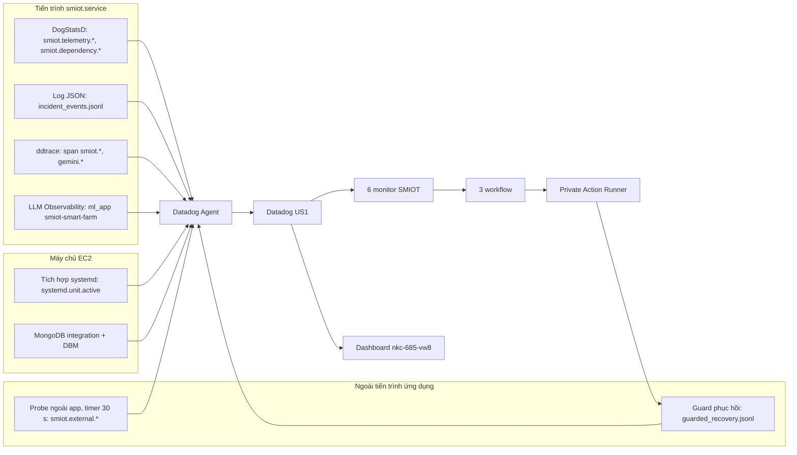

*Hình 2.1. Luồng tín hiệu từ ứng dụng, probe ngoài ứng dụng, máy chủ và MongoDB vào Datadog US1, đến monitor, workflow và Private Action Runner.*

Ứng dụng gửi metric qua DogStatsD, ghi log JSON ra tệp và gửi span qua `ddtrace` [E-20, E-11]; probe ngoài ứng dụng gửi metric bằng DogStatsD riêng. Tích hợp systemd của Agent theo dõi sáu đơn vị (`smiot`, `mongod`, `mosquitto`, `nginx`, `wokwi-bridge`, `datadog-agent`). Tích hợp MongoDB và Database Monitoring (DBM) dùng người dùng chỉ có quyền đọc cộng `clusterMonitor`, tắt thu thập schema để tránh lỗi quyền đọc bucket nội bộ của Time Series [E-03]. Guard phục hồi ghi mỗi nhánh quyết định thành một dòng JSON, Agent đọc với `source: smiot-recovery` [E-29, E-43].

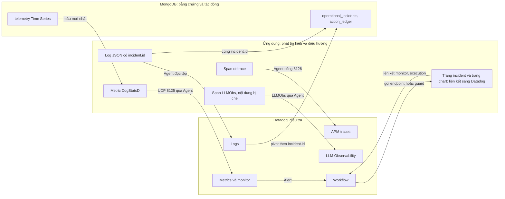

*Hình 2.2. Luồng metric, log, trace và LLM Observability theo vai: Datadog điều tra, MongoDB lưu bằng chứng và tác động, ứng dụng phát tín hiệu và điều hướng.*

Hình 2.2 nhấn mạnh phân vai: metric đọc từ mẫu mới nhất của MongoDB; log và span mang chung `incident.id` với bản ghi sự cố nên điều tra chuyển qua lại được; ứng dụng không tự kết luận nguyên nhân mà trỏ sang monitor, lượt chạy workflow và nhật ký liên quan.

### 2.2 Cấu hình thu log

`deploy/datadog/smiot-logs.yaml` khai báo hai luồng log với `service: smiot-smart-farm` [E-29]: `/opt/smiot/logs/incident_events.jsonl` (`source: python`, thuộc tính lồng `incident.id`, `farm.key`, `node.id`) và `/opt/smiot/logs/recovery/*.jsonl` (`source: smiot-recovery`, một dòng JSON cho mỗi nhánh của guard). Tệp gắn thêm tag `env:production` cho luồng thứ hai trong khi ứng dụng dùng `env:demo`; truy vấn theo `service` và `source` không bị ảnh hưởng, truy vấn theo `env` sẽ không khớp giữa hai luồng.

### 2.3 Lý do tách probe khỏi ứng dụng

Mô-đun `service/telemetry_health.py` chạy bên trong `main.py`: khi `smiot.service` dừng, các metric `smiot.telemetry.*` và `smiot.dependency.*` ngừng phát và monitor chỉ thấy "không có dữ liệu". Vì vậy `scripts/smiot_external_probe.py` chạy như tiến trình `oneshot` riêng, chỉ dùng thư viện chuẩn cộng `pymongo`, do timer systemd kích hoạt 30 s một lần (`OnBootSec=30s`, `OnUnitActiveSec=30s`) [E-23, E-44]. Tệp đơn vị trong repo là mẫu; bản đọc trạng thái trên EC2 ngày 06/11 cho thấy timer active và các dòng nhật ký gần nhất có `app_up=1`, `dry_run=false`, `incident_action=none` [E-57]. Probe có chế độ ghi sự cố tùy chọn (`SMIOT_PROBE_RECORD_INCIDENT=1`) mở `service_down` sau hai lần liên tiếp `app_up=0`.

Giới hạn: không monitor nào trong sáu monitor SMIOT truy vấn `smiot.external.*`. Monitor Ca 3 (`340356283`) dùng `systemd.unit.active`; monitor dựa trên `smiot.external.app_up` chỉ là bản nháp trong `deploy/datadog/drafts/`, chưa tạo trên Datadog [E-29]. Metric ngoài ứng dụng hiện phục vụ điều tra; phát hiện dựa trên các monitor khác.

---

## 3 Mô hình tín hiệu

### 3.1 Bảng metric

Bảng 3.1 liệt kê các metric đã đối chiếu trong mã. Cột "nguồn" là `file:dòng` tính ngày 06/11/2026.

| Metric | Kiểu | Tag | Nguồn | Câu hỏi trả lời |
|---|---|---|---|---|
| `smiot.telemetry.sensor_flatline` | gauge 0/1 | `farm`, `node`, `source` | `service/telemetry_health.py:489-495` | Số đo có đứng yên (10 mẫu, chênh ≤ 0,01) không (Câu 2) |
| `smiot.telemetry.status_mismatch` | gauge 0/1 | `farm`, `node`, `source` | `service/telemetry_health.py:333-336` | Trạng thái hiển thị có khác trạng thái tính từ MongoDB không (Câu 3) |
| `smiot.telemetry.sample_age_seconds` | gauge | `farm`, `node`, `source` | `service/telemetry_health.py:438` | Mẫu mới nhất trong MongoDB cũ bao nhiêu giây (Câu 2) |
| `smiot.telemetry.fresh` | gauge 0/1 | `farm`, `node`, `source` | `service/telemetry_health.py:439` | Node có ở trạng thái ONLINE theo tuổi mẫu không (Câu 2) |
| `smiot.telemetry.samples_persisted` | count | `farm`, `node`, `source` | `service/mqtt.py:307` | Bao nhiêu mẫu đã ghi thành công vào MongoDB (Câu 2) |
| `smiot.telemetry.ingest_lag_ms` | gauge | `farm`, `node`, `source` | `service/mqtt.py:330` | Độ trễ từ nguồn đến ứng dụng (Câu 2) |
| `smiot.dependency.mongo.up` | gauge 0/1 | `service`, `env` | `service/telemetry_health.py:399-402` | MongoDB trả lời lệnh `ping` không (Câu 1) |
| `smiot.dependency.mqtt.up` | gauge 0/1 | `service`, `env` | `service/telemetry_health.py:408-411` | Ứng dụng có đang kết nối broker không (Câu 1) |
| `smiot.external.app_up` | gauge 0/1 | `service`, `env`, `farm` | `scripts/smiot_external_probe.py:319` | Điểm cuối HTTP của ứng dụng có trả lời không, đo từ ngoài (Câu 1) |
| `smiot.external.sample_age_seconds` | gauge | `service`, `env`, `farm` | `scripts/smiot_external_probe.py:321` | Mẫu mới nhất cũ bao nhiêu giây, đo từ ngoài (Câu 2) |
| `smiot.external.mongo_up` | gauge 0/1 | `service`, `env` | `scripts/smiot_external_probe.py:322` | MongoDB có trả lời truy vấn của probe không (Câu 1) |
| `systemd.unit.active` | gauge | `host`, `unit` (từ Agent) | Cấu hình `scripts/aws/ssm_enable_systemd_checks.json`; truy vấn tại E-50 | Đơn vị `smiot.service` có active không (Câu 1) |
| `smiot.telemetry.air_temperature`, `air_humidity`, `soil_temperature`, `soil_humidity`, `soil_ec` | gauge | `farm`, `node`, `source` | `service/datadog_metrics.py:77-93` | Giá trị cảm biến tổng hợp theo node (biểu đồ dashboard) |
| `system.cpu.user`, `system.mem.pct_usable` | gauge (Agent) | `host` | Cấu hình widget dashboard, §6 | EC2 có đủ CPU và RAM không |
| `mongodb.connections.current`, `mongodb.opcounters.queryps`, `insertps`, `updateps`, `mongodb.stats.storagesize` | gauge (tích hợp MongoDB) | `database_instance` (theo tích hợp) | Cấu hình widget dashboard, §6 | MongoDB có bao nhiêu kết nối, thao tác mỗi giây và dung lượng lưu trữ |
| `mongodb.queries.count`, `mongodb.queries.time` | DBM | `database_instance` | README ngày 03/11 [E-03] | Thông lượng và thời gian thực thi truy vấn MongoDB |

*Bảng 3.1. Metric ứng dụng, probe ngoài ứng dụng và Agent.*

Ba lưu ý. Thứ nhất, `status_mismatch` chỉ được phát cho farm đang chọn trong trạng thái giao diện chính (`service/telemetry_health.py:444-446`, `:356-375`): phù hợp với Ca 1 (lệch hiển thị phát sinh ở giao diện đang mở) nhưng không phủ đồng thời bốn farm. Thứ hai, các metric `smiot.telemetry.*` đo từ MongoDB dùng chung vòng kiểm tra 30 s (`SMIOT_TELEMETRY_HEALTH_INTERVAL_SECONDS`). Thứ ba, `sensor_flatline` lấy `source` từ chính mẫu mới nhất, nên phát hiện dựa trên giá trị đã lưu chứ không dựa trên yêu cầu của người điều khiển kịch bản (`:468-495`) [E-14]. Các metric Agent và tích hợp MongoDB ở hai hàng cuối là cấu hình widget do người dùng thêm trên giao diện; chưa có ảnh dashboard sau cập nhật (Phụ lục B).

### 3.2 Quy tắc tag và cardinality

Hàm `metric_tags` chỉ cho phép ba chiều hữu hạn `farm`, `node`, `source`; `source` ngoài danh sách cho phép (`device`, `wokwi_synthetic`, `smiot_demo_stream`, `synthetic_unlabelled`, `device_unclassified`, `unknown`, `other`) bị gộp thành `other`, giá trị tag bị làm sạch và cắt tối đa 100 ký tự (`service/datadog_metrics.py:29-53`) [E-20]. Probe ngoài ứng dụng áp dụng cùng nguyên tắc và ghi trong mã rằng `incident_id`, `message_id` không được là tag (`scripts/smiot_external_probe.py:11-12`).

Mỗi sự cố sinh một `incident_id` mới; nếu là tag, số chuỗi thời gian tăng theo số sự cố và monitor nhóm theo tag đó mất ý nghĩa. Các định danh này nằm ở log, trace và MongoDB [E-40]. Hai lưu ý: metric phụ thuộc (`dependency.*.up`) chỉ mang `service`, `env` nên monitor `339990226` và `339990232` không tách được theo farm; `systemd.unit.active` mang tag `host`, được che trong Bảng 4.1.

### 3.3 Khóa tương quan giữa log, trace và MongoDB

Bốn khóa tương quan được dùng để chuyển từ monitor sang bằng chứng:

| Khóa | Nơi xuất hiện | Nguồn |
|---|---|---|
| `@incident.id` | Log JSON (`incident.id`), thẻ span (`incident.id`), `operational_incidents._id` | `service/logger.py:106-116`; `service/observability.py:182-183` |
| `@farm.key` | Log JSON (`farm.key`), thẻ span | `service/logger.py:113`; `service/observability.py:182` |
| `@node.id` | Log JSON (`node.id`) | `service/logger.py:114` |
| Trace ID | Span, trường `trace_id` trong log `smiot_trace_span`, bản ghi bằng chứng của sự cố | `service/observability.py:112-123, 186-189` |

*Bảng 3.2. Khóa tương quan.*

Bài học từ sự cố `INC-SMIOT-20261103T102822-D3B0F8A7`: trước khi sửa, truy vấn `@incident.id:<id>` trả 0 kết quả trong khi tìm theo chuỗi kèm mã sự cố trả 20 dòng log, vì các chiều chỉ nằm trong `message`. Sau sửa ngày 03/11, sự kiện được ghi thành JSON với `incident.id`, `farm.key`, `node.id` và truy vấn có cấu trúc trả bản ghi kiểm tra với đủ bốn facet; log cũ không được chuyển đổi hồi tố [E-40].

---

## 4 Monitor

### 4.1 Sáu monitor SMIOT

Bảng 4.1 chép query nguyên văn từ tệp xuất cấu hình ngày 06/11 [E-50]. Ở monitor `340356283`, định danh máy EC2 trong tệp xuất được thay bằng `<INSTANCE_ID>` theo quy tắc không ghi định danh hạ tầng; phần còn lại giữ nguyên.

| ID | Tên | Query | Cửa sổ, ngưỡng | Tag `scenario` | Workflow gắn kèm | Ca |
|---|---|---|---|---|---|---|
| `339977691` | SMIOT / greenhouse_a Node 2 soil humidity flatline (synthetic demo) | `max(last_2m):max:smiot.telemetry.sensor_flatline{farm:greenhouse_a,node:2,source:smiot_demo_stream} > 0` | 2 phút; critical > 0 | `flatline` | `@workflow-smiot-node-2-safe-mode-hold-and-verify` (workflow `18d1b008-fb24-4713-aa0b-a1432d84ea80`) | 2 |
| `339977703` | SMIOT / greenhouse_a telemetry stale | `max(last_5m):max:smiot.telemetry.sample_age_seconds{farm:greenhouse_a,source:smiot_demo_stream} by {node} > 120` | 5 phút; critical > 120 s | `stale-data` | Không | Đối chứng Ca 1 |
| `339990226` | SMIOT / MongoDB dependency unhealthy | `min(last_5m):min:smiot.dependency.mongo.up{*} < 1` | 5 phút; critical < 1 | Không (tag `component:mongodb`) | Không | Phụ thuộc |
| `339990232` | SMIOT / MQTT dependency unhealthy | `min(last_5m):min:smiot.dependency.mqtt.up{*} < 1` | 5 phút; critical < 1 | Không (tag `component:mqtt`) | Không | Phụ thuộc |
| `340356283` | SMIOT / EC2 app service inactive | `avg(last_5m):avg:systemd.unit.active{host:<INSTANCE_ID>,unit:smiot.service} <= 0` | 5 phút; critical ≤ 0 | Không | Workflow `b83453ff-e122-4148-9519-e698f2effa7f` qua tên xử lý trong thông điệp (tên hiển thị "SMIOT EC2 Guarded Web Recovery") | 3 |
| `341409441` | [SMIOT][Ca 1] UI báo OFFLINE nhưng mẫu vẫn vào MongoDB (status mismatch) | `max(last_5m):max:smiot.telemetry.status_mismatch{*} by {farm,node} > 0` | 5 phút; critical > 0 | `false-offline` | `@workflow-smiot-ca1-refuse-restart` (workflow `e2835af0-63fc-48e0-9562-2a1ee4a351d3`) | 1 |

*Bảng 4.1. Sáu monitor SMIOT, theo tệp xuất ngày 06/11/2026.*

Ba điểm cấu hình. Thứ nhất, `339977691` và `339977703` đặt `on_missing_data: show_and_notify_no_data`, nên khi ứng dụng dừng hai monitor này chuyển sang "không có dữ liệu" chứ không im lặng. Thứ hai, hai monitor phụ thuộc có `evaluation_delay` 60 s và thông điệp dặn không khởi động lại hay xóa dữ liệu tự động. Thứ ba, thông điệp monitor Ca 1 nêu quy tắc không khởi động lại `smiot.service` khi mẫu MongoDB còn mới và không dùng monitor này để kết luận về thiết bị vật lý [E-50]. Thông điệp phục hồi của monitor Ca 2 mô tả rằng bộ xác minh chỉ gửi CLEAR khi mọi kiểm tra đạt và rằng điều đó chứng minh telemetry phục hồi, không chứng minh sửa cảm biến vật lý [E-50].

### 4.2 Thiết kế đối chứng cho Ca 1

Ca 1 — Báo offline sai là ca duy nhất mà phản ứng đúng là không làm gì với hạ tầng. Để chứng minh điều đó bằng chính trạng thái monitor, nhóm dùng hai monitor đồng thời:

- `341409441` đo `smiot.telemetry.status_mismatch`, chuyển Alert khi trạng thái hiển thị khác trạng thái tính từ mẫu MongoDB mới nhất (`reconcile_display_status`, `service/telemetry_health.py:111-145`) [E-14].
- `339977703` đo `smiot.telemetry.sample_age_seconds` theo node, chuyển Alert khi mẫu cũ hơn 120 s.

Kịch bản thiết kế: `341409441` ở Alert trong khi `339977703` vẫn OK, nên người xem thấy cùng lúc giao diện sai và dữ liệu vẫn đến; khởi động lại không giải quyết được sự cố, và workflow `e2835af0-63fc-48e0-9562-2a1ee4a351d3` thể hiện điều đó bằng một bước ghi từ chối (xem §5.1, §5A.2). Cấu hình đã được xuất và đối chiếu [E-50, E-55]; Ca 1 chưa diễn tập nên chưa có ảnh timeline cho thấy hai monitor ở hai trạng thái khác nhau, và ảnh ngày 06/11 ghi Ca 1 đang bị tắt thông báo lúc kiểm tra [E-51]. Vì vậy mục này là thiết kế, kết quả diễn tập ở Phụ lục B.

### 4.3 Ba monitor APM nền

Ngoài sáu monitor SMIOT còn ba monitor APM nền (`339985452`, `339992812`, `339992811`); chúng không thuộc ca nào, không có workflow và không được dùng làm bằng chứng cho ca [E-75].

### 4.4 Lựa chọn cửa sổ đánh giá

Cửa sổ đánh giá là đánh đổi giữa tốc độ phát hiện và độ ổn định. Monitor flatline dùng `max(last_2m)` trên tín hiệu mà ứng dụng đã đệm bằng quy tắc 10 mẫu (khoảng 5 phút ở chu kỳ 30 s), nên cửa sổ ngắn không thêm báo động nhầm. Monitor systemd dùng `avg(last_5m)` với ngưỡng `<= 0`: làm chậm phát hiện vài phút, bù lại một lần khởi động lại ngắn do `Restart=on-failure` không làm monitor chuyển Alert; guard cũng chờ 5 s trước khi quyết định [E-43]. Tài liệu chỉ nêu đánh đổi, không đưa chỉ số thời gian phát hiện tổng quát vì chưa có phép đo lặp (§9.1).

---

## 5 Workflow và hành động có guard

### 5.1 Ba workflow

| Mục | Ca 1 | Ca 2 | Ca 3 |
|---|---|---|---|
| Workflow | `e2835af0-63fc-48e0-9562-2a1ee4a351d3` ("SMIOT / Ca 1 / Refuse restart when samples fresh") | `18d1b008-fb24-4713-aa0b-a1432d84ea80` ("SMIOT Node 2 Safe Mode - Hold and Verify") | `b83453ff-e122-4148-9519-e698f2effa7f` ("SMIOT EC2 Guarded Web Recovery") |
| Trigger | Monitor `341409441` chuyển Alert | Monitor `339977691` chuyển Alert | Monitor `340356283` chuyển Alert |
| Giới hạn tần suất | 1 lần / 300 s | Có; nhiều lượt chạy trước 03/11 báo "Rate limit exceeded" (xem §5.4) | Chi tiết đang bổ sung; thiết kế nháp ghi 1 / 60 s [E-29] |
| Bước | Ba bước: đọc hai metric tuổi mẫu, rẽ nhánh theo ngưỡng, Echo `REFUSED_RESTART` hoặc `ESCALATE_HUMAN` | Một bước gọi có xác thực tới điểm cuối recovery của ứng dụng (mô tả cấu hình không kèm thông tin xác thực) | Bước chạy script định nghĩa sẵn qua Private Action Runner |
| Tác động | Không tác động EC2; không truy vấn MongoDB trực tiếp (đọc metric tuổi mẫu qua Datadog) | Ứng dụng tự kiểm tra rồi HOLD hoặc CLEAR trên PLC ảo | `systemctl start smiot.service` nếu qua mọi guard |
| Bằng chứng | [E-55], lượt chạy ngày 06/11 [E-81] | [E-56, E-74] | [E-74]; lượt ngày 06/11: [E-81] |

*Bảng 5.1. Ba workflow.*

**Ca 1.** Tệp xuất JSON có đúng một bước `refuse_restart_on_status_mismatch` (`com.datadoghq.core.echo`, giá trị bắt đầu bằng `REFUSED_RESTART: status_mismatch monitor means UI is OFFLINE while Mongo samples remain fresh. No EC2 or device action. Synthetic demo.`), giới hạn một lần trong 300 s [E-55]. Workflow không đọc MongoDB và không có đường tới EC2; việc kiểm tra tính tươi nằm ở thiết kế hai monitor. Như mọi workflow trong tài liệu này, nó chạy khi monitor chuyển Alert, không chạy ở chuyển Recovery.

**Ca 2.** Workflow gọi có xác thực điểm cuối recovery của ứng dụng; ứng dụng quyết định HOLD hay CLEAR bằng verifier (`scripts/verify_and_clear_demo_safe_mode.py`), với các điều kiện ở Bảng 5A.3 [E-22]. Số mẫu quan sát được là 6 (39,5–40,6%) ở `D3B0F8A7` và 7 (39,3–41,0%) ở `BD19A22C`, thuộc phiên bản mã trước [E-40, E-41]. Cầu nối `scripts/wokwi_datadog_bridge.py` theo dõi monitor qua API Datadog và gửi HOLD dự phòng nếu monitor đã Alert; ở `D3B0F8A7` HOLD do cầu nối gửi và lượt chạy workflow sau đó bị khử trùng lặp, nên workflow không gây ra HOLD đầu tiên [E-40].

**Ca 3.** Workflow dùng Private Action Runner chạy `recover-smiot-web`, gọi `/usr/local/sbin/smiot-recover-guarded`, theo nguyên tắc script của Private Action Runner phải được định nghĩa trước và lệnh nâng quyền phải có allowlist hẹp [E-43].

Cấu trúc bước của workflow Ca 2 và Ca 3 dựa trên tài liệu thiết kế và mô tả của người vận hành, không dựa trên ảnh chụp (khung vẽ bước không hiển thị khi chụp) [E-53, E-54]; ảnh hoặc xuất cấu hình đã che thông tin xác thực ở Phụ lục B.

### 5.2 Allowlist trên máy chủ

Người dùng chạy của Private Action Runner (`dd-agent`) chỉ được cấp qua sudoers hai lệnh chính xác: `/usr/bin/systemctl start smiot.service` và `/usr/local/sbin/smiot-recovery-mongo-readback`; không có `restart`, shell hay tham số tùy ý. Helper không nhận đối số, chạy với quyền root và chỉ in dấu thời gian của mẫu mới nhất, nên `dd-agent` không cần đọc tệp bí mật (`scripts/aws/smiot-recovery-mongo-readback.py`) [E-24, E-43].

### 5.3 Cây quyết định của guard

Hình 5.1 mô tả thứ tự đánh giá trong `scripts/aws/smiot-recover-guarded.sh`.

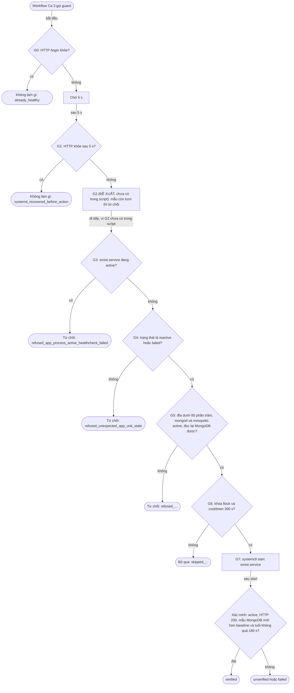

*Hình 5.1. Cây quyết định guard. Nhánh G2 là đề xuất, chưa có trong script.*

Mỗi nhánh ghi một dòng JSON `event: smiot.guarded_recovery` (`run_id`, `action`, `result`, `reason`) vào `guarded_recovery.jsonl` và nhật ký hệ thống (`scripts/aws/smiot-recover-guarded.sh:17-29`); truy vấn Logs: `service:smiot-smart-farm source:smiot-recovery event:smiot.guarded_recovery` [E-43].

Các nhánh G0, G1, G3 đến G7 và bước xác minh có trong script. Nhánh G2 (từ chối khi mẫu MongoDB còn tươi) chỉ có trong tệp nháp `deploy/datadog/drafts/workflow_guard_branches.md` và chưa được cài [E-29]; hiện tình huống "ứng dụng còn ghi mẫu nhưng giao diện sai" do workflow Ca 1 và nhánh G3 xử lý. Tệp cooldown được ghi trước khi gọi `systemctl start`, nên lần khởi động thất bại cũng kích hoạt thời gian chờ 300 s. Một lệnh `start` thành công chưa phải phục hồi: chỉ ghi `verified` khi unit active, HTTP 200 và có bản ghi telemetry mới hơn baseline với tuổi không quá 180 s [E-43].

### 5.4 Giới hạn tần suất và bài học lịch sử

Workflow Ca 2 hiện có giới hạn 1 lượt mỗi 60 s (cấu hình kiểm 06/11, trigger monitor). Lịch sử 15 lượt chạy của workflow Ca 2 gồm 10 lượt thành công và 4 lượt "Rate limit exceeded", cả 4 lỗi đều ngày 03/11; lượt chạy ngày 06/11 không gặp lỗi này [E-56]. Giới hạn tần suất phải đủ dài để khử trùng lặp thông báo của một sự cố và đủ ngắn để không bỏ lỡ sự cố kế tiếp: Ca 1 dùng 1 lần trong 300 s [E-55]; với guard, cooldown 300 s ở cấp host là lớp bảo vệ thứ hai.

---

## 5A Cây quyết định xử lý sự cố

Chương này vẽ mọi nhánh quyết định đã đọc thấy trong mã và trong cấu hình workflow. Quy ước: nút hình thoi là điều kiện; mọi cạnh mang nhãn điều kiện; lá cuối (hình sân vận động) ghi trạng thái kết thúc. Nhánh không có trong mã hoặc workflow đã đọc được đánh dấu "suy luận" trong bảng đi kèm. Nhãn trạng thái: Đã kiểm chứng, Đang bổ sung, Đang bổ sung; "Đã kiểm chứng (mã)" nghĩa là đã đọc trong mã, chưa nghĩa là đã chạy trên hệ thống sống.

### 5A.1 Cây tổng

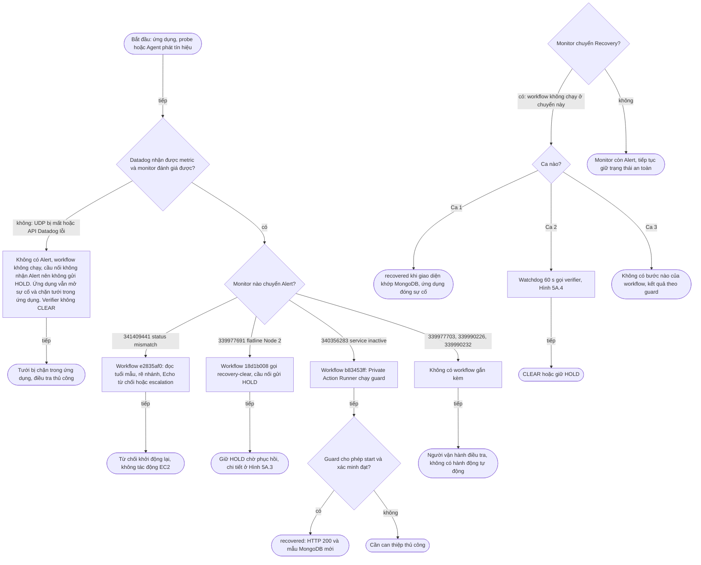

*Hình 5A.1. Cây tổng: tín hiệu, monitor Alert, workflow, nhánh theo ca, nhánh Recovery và nhánh Datadog không khả dụng.*

Hình 5A.1 có hai điểm khởi đầu: nhánh Alert (từ a0) và nhánh Recovery (nút a15). Workflow chạy khi monitor chuyển Alert, không chạy ở chuyển Recovery, nên phục hồi không phụ thuộc lượt chạy thứ hai: Ca 2 do watchdog trong ứng dụng, Ca 1 do logic đóng sự cố trong ứng dụng, Ca 3 do bước xác minh sau khởi động của guard.

| Nút | Điều kiện | Ngưỡng và hằng số | Nguồn mã | Nhãn trạng thái |
|---|---|---|---|---|
| a1 | Metric tới được Datadog | `_send_gauge` bỏ qua lỗi `OSError`, không làm gián đoạn ứng dụng | `service/datadog_metrics.py:34-46` | Đã kiểm chứng (mã) |
| a2 | Ứng dụng vẫn mở sự cố và chặn tưới khi Datadog không khả dụng | Sự cố do watchdog mở trong ứng dụng, không do Alert; bản ghi `BLOCKED_HOLD` có trước Alert ở `D3B0F8A7` | `service/telemetry_health.py:228-249`; hồ sơ [E-40] | Đã kiểm chứng (ca 03/11). Kịch bản "Datadog tắt" đang bổ sung diễn tập riêng |
| a4 | Chọn nhánh theo monitor | Ánh xạ ca trong ứng dụng | `service/incident_blackbox.py:551-561` | Đã kiểm chứng |
| a5 | Echo từ chối | Giới hạn 1 lần / 300 s | [E-55] | Đã kiểm chứng (cấu hình) |
| a6 | Gọi recovery-clear, cầu nối gửi HOLD | Cầu nối thăm dò mỗi 10 s | `scripts/wokwi_datadog_bridge.py:42, 464-527`; `main.py:194-241` | Đã kiểm chứng (mã) |
| a7 | Private Action Runner chạy guard | Xem Hình 5.1 | `scripts/aws/smiot-recover-guarded.sh` | Đã kiểm chứng (mã); tác nhân khởi động 06/11: workflow tự kích hoạt [E-82]; đầu ra EC2 đang bổ sung (B2) |
| a8 | Monitor không có workflow | Theo thông điệp trong tệp xuất | [E-50] | Đã kiểm chứng |
| a15, a16 | Recovery không chạy workflow | Quan sát cấu hình: workflow chạy ở Alert | [E-55, E-56] (lượt chạy sau phục hồi: không có) | Đã kiểm chứng (Ca 2 06/11) |
| a17 | Ca 1 đóng sự cố khi MongoDB ONLINE | `close_incident` khi hiển thị không còn lệch và trạng thái tính được là ONLINE | `service/telemetry_health.py:321-327` | Đã kiểm chứng (mã); quan sát một lần ngày 06/11 [E-81] |

*Bảng 5A.1. Nút của cây tổng.*

### 5A.2 Cây Ca 1: báo offline sai

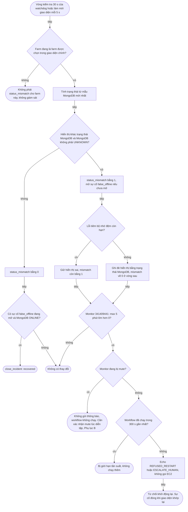

*Hình 5A.2. Cây quyết định Ca 1 — Báo offline sai.*

Hai điều ít hiển nhiên. Khi không có lỗi tiêm đang giữ, mã ghi đè hiển thị bằng trạng thái MongoDB ngay trong cùng vòng kiểm tra nên chỉ một vòng phát `status_mismatch=1`; cửa sổ `max(last_5m)` giữ monitor ở Alert tới 5 phút (suy luận từ mã và query, chưa quan sát). Workflow có nhánh kiểm tra tính tươi (đọc hai metric tuổi mẫu và so với ngưỡng); quyết định không khởi động lại nằm ở nhánh từ chối hoặc escalation, và không có đường tới EC2 [E-55].

| Nút | Điều kiện | Ngưỡng và hằng số | Nguồn mã | Nhãn trạng thái |
|---|---|---|---|---|
| b1 | Farm được chọn | `home_state["selected_farm"]` so với farm vòng lặp; chu kỳ 30 s (`SMIOT_TELEMETRY_HEALTH_INTERVAL_SECONDS`), làm mới giao diện tối thiểu 5 s (`SMIOT_NODE_STATUS_SYNC_SECONDS`) | `service/telemetry_health.py:442-446, 356-375, 528-535` | Đã kiểm chứng (mã) |
| b3 | Trạng thái từ mẫu MongoDB | ONLINE nếu tuổi ≤ 90 s; STALE nếu ≤ 300 s; OFFLINE nếu hơn; UNKNOWN nếu chưa có mẫu | `service/telemetry_health.py:61-86` | Đã kiểm chứng (mã) |
| b4 | Lệch hiển thị | `shown` khác `UNKNOWN` và khác `truth`, `truth` khác `UNKNOWN` | `service/telemetry_health.py:111-121` | Đã kiểm chứng (mã) |
| b9 | Mở sự cố `false_offline` | Mở ở lần chuyển sai sang đúng đầu tiên; có khóa chống trùng; gắn monitor `341409441` và workflow `e2835af0-63fc-48e0-9562-2a1ee4a351d3` | `service/telemetry_health.py:300-320` | Đã kiểm chứng (mã) |
| b10-b12 | Lỗi tiêm bộ nhớ đệm | Giữ đến `expires_at`, sau đó bỏ và ghi đè | `service/telemetry_health.py:125-145` | Đã kiểm chứng (mã) |
| b6-b7 | Đóng sự cố | Chỉ đóng khi trạng thái tính được là ONLINE, kèm bằng chứng mẫu mới nhất | `service/telemetry_health.py:321-327` | Đã kiểm chứng (mã) |
| b13 | Monitor Alert | `max(last_5m):max:smiot.telemetry.status_mismatch{*} by {farm,node} > 0`, trễ đánh giá 60 s | [E-50] | Đã kiểm chứng (cấu hình) |
| b14 | Mute | Ảnh 06/11 ghi Ca 1 đang mute khi kiểm tra giao diện | [E-51] | Đang bổ sung: E-81 |
| b16-b18 | Workflow | 1 lần / 300 s (trigger monitor); ba bước, hai nhánh | [E-55] | Đã kiểm chứng (cấu hình và lượt 06/11 [E-81]) |

*Bảng 5A.2. Nút của cây Ca 1.*

### 5A.3 Cây Ca 2: Độ ẩm đất Node 2 đứng yên

Cây Ca 2 gồm hai phần: phát hiện và HOLD (Hình 5A.3), xác minh và CLEAR (Hình 5A.4).

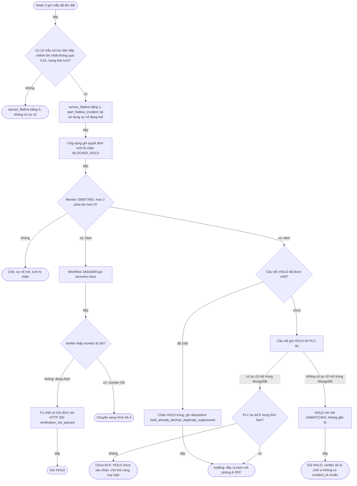

*Hình 5A.3. Cây Ca 2, phát hiện và HOLD.*

Ở nút c9, workflow gọi điểm cuối khi monitor đang Alert nên verifier có chủ đích từ chối (mã trả HTTP 200 cho từ chối theo chính sách, 503 cho lỗi hạ tầng). Lượt chạy `e09175ca-6eed-41a7-8dee-9066d3f366ef` ngày 06/11 có trạng thái tổng Success; từng bước chưa được đọc [E-56].

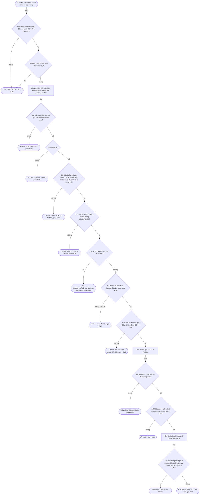

*Hình 5A.4. Cây Ca 2, xác minh và CLEAR; đường workflow và đường watchdog dùng chung một verifier.*

Mọi điều kiện thất bại trong Hình 5A.4 đều dẫn về giữ HOLD. Verifier có hai đường vào: điểm cuối `recovery-clear` (do workflow gọi, bearer token; thiếu cấu hình trả 503, sai token 401, đang chạy 409) và watchdog trong ứng dụng, thử mỗi 60 s mỗi node khi dữ liệu đã biến thiên trở lại. Ngưỡng số mẫu của cầu nối khi nhận sự kiện CLEAR là 6, còn verifier yêu cầu 10; verifier chặt hơn nên luôn đạt ngưỡng của cầu nối.

| Nút | Điều kiện | Ngưỡng và hằng số | Nguồn mã | Nhãn trạng thái |
|---|---|---|---|---|
| c1 | Flatline | 10 mẫu, chênh ≤ 0,01, cửa sổ tối thiểu 600 s hoặc 2 chu kỳ × 10 mẫu | `service/telemetry_health.py:35-37, 474-495` | Đã kiểm chứng (mã) |
| c3 | Mở sự cố | Chỉ cho `greenhouse_a` node 2; tái sử dụng sự cố đang mở | `service/telemetry_health.py:228-249`; `service/incident_lifecycle.py:47-70` | Đã kiểm chứng (mã) |
| c4 | Chặn tưới | Quyết định `BLOCKED_HOLD` khi có sự cố mở | `service/incident_lifecycle.py:137`; hồ sơ [E-40] | Đã kiểm chứng (ca 03/11) |
| c5 | Monitor | `max(last_2m):max:smiot.telemetry.sensor_flatline{farm:greenhouse_a,node:2,source:smiot_demo_stream} > 0` | [E-50] | Đã kiểm chứng |
| c7, c9, c10 | Workflow gọi điểm cuối khi Alert | Bearer token; khóa chống chạy trùng; thời hạn 55 s; từ chối theo chính sách trả 200, lỗi hạ tầng trả 503 | `main.py:194-241` | Đã kiểm chứng (mã) |
| c8, c12, c16 | Cầu nối chốt HOLD | Thăm dò 10 s; chặn HOLD trùng; HOLD dự phòng khi monitor Alert mà chưa chốt | `scripts/wokwi_datadog_bridge.py:42, 464-527, 475-503` | Đã kiểm chứng (mã và ca 03/11 [E-40]) |
| c13 | ACK PLC ảo | Chờ ACK qua `farm/command/ack` | `scripts/wokwi_datadog_bridge.py:272-310` | Đã kiểm chứng (mã). Nhánh không ACK: suy luận |
| c17 | Không có sự cố mở | `incident_id` dạng `UNMATCHED-<monitor>-<epoch>`, không gắn lô | `scripts/wokwi_datadog_bridge.py:276-281` | Đã kiểm chứng (mã) |
| d1, d3 | Watchdog gọi verifier | Khi flatline hết và 10 mẫu có chênh lớn hơn 0,01; cách nhau 60 s | `service/telemetry_health.py:162-179, 512-514` | Đã kiểm chứng (mã) |
| d5-d7 | Monitor OK | Đọc `overall_state` qua API; khác OK thì từ chối | `scripts/verify_and_clear_demo_safe_mode.py:34-44` | Đã kiểm chứng (mã) |
| d9 | HOLD đã ACK | HOLD của `datadog_safe_mode_workflow` ở trạng thái `acknowledged` sau thời điểm monitor trigger, hoặc HOLD gần nhất chưa bị CLEAR | `scripts/verify_and_clear_demo_safe_mode.py:64-97` | Đã kiểm chứng (mã) |
| d11 | incident_id chuẩn | Không rỗng, không bắt đầu bằng `UNMATCHED-` | `scripts/verify_and_clear_demo_safe_mode.py:98-101` | Đã kiểm chứng (mã) |
| d13 | Idempotent | Đã có CLEAR `verified` cho sự cố thì trả thành công | `scripts/verify_and_clear_demo_safe_mode.py:106-127` | Đã kiểm chứng (mã) |
| d15 | Đủ mẫu | ≥ 10 mẫu Node 2 khác 2,4; cửa sổ tối đa 6 phút kể từ HOLD ACK | `scripts/verify_and_clear_demo_safe_mode.py:129-148` | Đã kiểm chứng (mã) |
| d17 | Tươi và biến thiên | ≤ 90 s; biên độ ≥ 0,5 | `scripts/verify_and_clear_demo_safe_mode.py:149-159` | Đã kiểm chứng (mã) |
| d19-d22 | CLEAR và ACK PLC ảo | ACK trong 8 s; `safe_mode_active` phải là false; mọi đầu ra bằng 0 | `scripts/verify_and_clear_demo_safe_mode.py:197-221` | Đã kiểm chứng (mã) |
| d24 | Ghi trạng thái | `verified` thì sự cố thành `recovered` | `service/incident_lifecycle.py:227-243` | Đã kiểm chứng (mã) |
| d25 | Cầu nối nhả chốt | monitor OK, ≥ 6 mẫu, tươi ≤ 90 s, biên độ ≥ 0,5, đầu ra OFF | `scripts/wokwi_datadog_bridge.py:108-150` | Đã kiểm chứng (mã) |
| d4-d6 | Datadog API lỗi | `raise_for_status` làm verifier thoát lỗi; điểm cuối trả 503, watchdog ghi `not_verified` | `scripts/verify_and_clear_demo_safe_mode.py:34-40`; `main.py:227-237`; `service/telemetry_health.py:194-198` | Đã kiểm chứng (mã); diễn tập đang bổ sung |

*Bảng 5A.3. Nút của cây Ca 2.*

Phát hiện, HOLD, khử trùng lặp và CLEAR đã được quan sát đầy đủ ở hai sự cố ngày 03/11 [E-40, E-41]; ngày 06/11 chỉ có bằng chứng một phần (monitor, workflow Success, `/healthz`) [E-56].

### 5A.4 Cây Ca 3: `smiot.service` dừng

Bên trong guard, thứ tự G0 đến G7 được vẽ ở Hình 5.1. Hình 5A.5 vẽ phần bao quanh: nguồn tín hiệu, khả năng Private Action Runner, và kết cục sau khi khởi động.

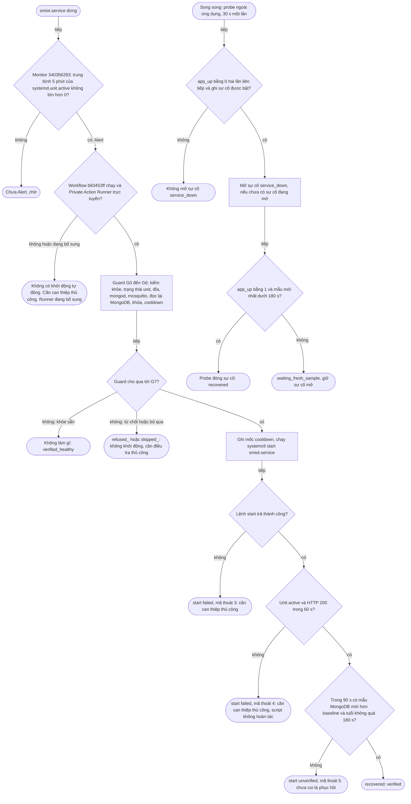

*Hình 5A.5. Cây Ca 3 ngoài guard và sau khởi động, cộng nhánh ghi sự cố của probe ngoài ứng dụng.*

Guard không có bước hoàn tác: nếu start thất bại hoặc không xác minh được, nó không khởi động lại MongoDB, Mosquitto, Datadog Agent hay máy EC2; "cần can thiệp thủ công" là hệ quả, quy trình thủ công cụ thể là suy luận.

| Nút | Điều kiện | Ngưỡng và hằng số | Nguồn mã | Nhãn trạng thái |
|---|---|---|---|---|
| e1 | Monitor Alert | `avg(last_5m):avg:systemd.unit.active{host:<INSTANCE_ID>,unit:smiot.service} <= 0` | [E-50] | Đã kiểm chứng (cấu hình) |
| e3 | Runner trực tuyến | Runner đang bổ sung khi kiểm tra sẵn sàng 06/11 | [E-57] | Đang bổ sung |
| e5-e8 | Guard G0 đến G6 | Chờ 5 s; đĩa dưới 85 phần trăm; unit inactive hoặc failed; khóa `flock`; cooldown 300 s | `scripts/aws/smiot-recover-guarded.sh:48-114` | Đã kiểm chứng (mã) |
| e9-e11 | Khởi động | Ghi mốc cooldown trước; `sudo -n systemctl start`; thất bại thoát mã 3 | `scripts/aws/smiot-recover-guarded.sh:114-118` | Đã kiểm chứng (mã) |
| e12-e13 | Sẵn sàng | Tối đa 30 lần × 2 s; thất bại thoát mã 4 | `scripts/aws/smiot-recover-guarded.sh:120-131` | Đã kiểm chứng (mã) |
| e14-e16 | Xác minh dữ liệu | Tối đa 18 lần × 5 s; mẫu mới hơn baseline; tuổi ≤ 180 000 ms; thất bại thoát mã 5 | `scripts/aws/smiot-recover-guarded.sh:133-148` | Đã kiểm chứng (mã); phục hồi 06/11: [E-59], tác nhân đang bổ sung |
| e4 | Thủ công | Không có mã; suy luận | không có | Suy luận |
| g1 | Mở `service_down` | 2 lần liên tiếp `app_up=0`; chỉ khi `SMIOT_PROBE_RECORD_INCIDENT=1` và có URI ghi | `scripts/smiot_external_probe.py:52, 209-250` | Đã kiểm chứng (mã) |
| g4 | Đóng sự cố | `app_up=1` và tuổi mẫu < 180 s | `scripts/smiot_external_probe.py:53, 251-278` | Đã kiểm chứng (mã) |
| g1 | Probe ghi sự cố đang bật trên EC2 | Bản đọc 06/11 ghi `incident_action=none` | [E-57] | Đã kiểm chứng (trạng thái 06/11) |

*Bảng 5A.4. Nút của cây Ca 3.*

### 5A.5 Nhánh LLM Observability

Nhánh này không nằm trên đường điều khiển: nó chỉ ghi span cho lời gọi mô hình của trợ lý AI và không quyết định HOLD, CLEAR hay khởi động.

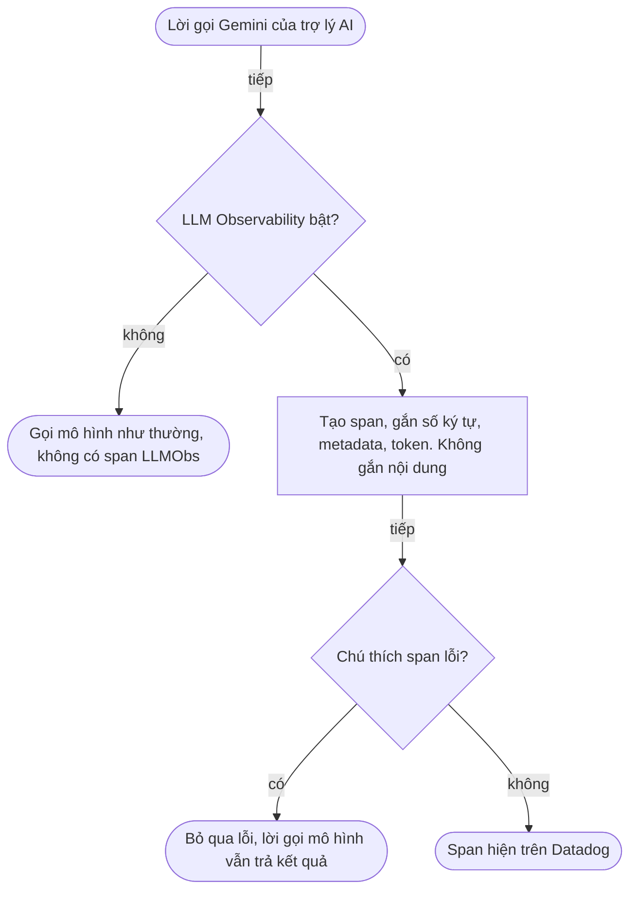

*Hình 5A.6. Nhánh LLM Observability.*

| Nút | Điều kiện | Ngưỡng và hằng số | Nguồn | Nhãn trạng thái |
|---|---|---|---|---|
| Nguồn xác nhận phục hồi | Verifier (Ca 2), guard (Ca 3), logic đóng sự cố (Ca 1) | [E-22, E-43] | Đã kiểm chứng (mã) |
| i1-i2 | LLMObs bật | `llm_observation` trả `None` khi tắt | `service/observability.py:72-82` | Đã kiểm chứng (mã và test) |
| i3-i5 | Chú thích | `content_redacted`, số ký tự; lỗi chỉ in tên ngoại lệ | `service/ai_service.py:229-267` | Đã kiểm chứng (mã); ảnh span: Đang bổ sung, E-84 |

*Bảng 5A.5. Nút của cây điều tra.*

### 5A.6 Sơ đồ tuần tự theo ca

Mỗi sơ đồ gắn nhãn vai: **Ứng dụng**, **Datadog** (điều tra), **MongoDB** (tác động và bằng chứng). Nguồn dữ liệu ở mọi ca là synthetic.

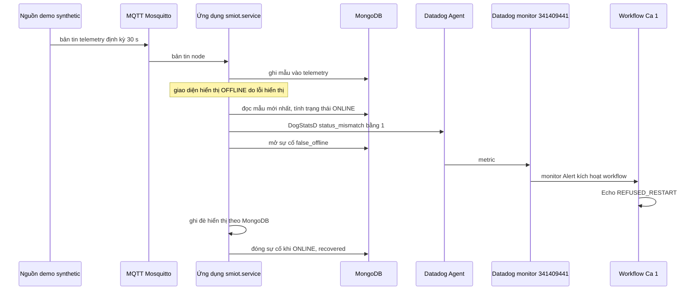

*Hình 5A.7. Tuần tự Ca 1: workflow chỉ ghi từ chối; ứng dụng tự đóng sự cố khi giao diện khớp lại. Ca 1 đã quan sát một lần ngày 06/11 [E-81].*

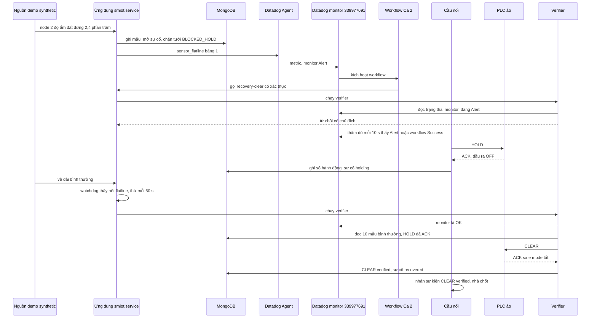

*Hình 5A.8. Tuần tự Ca 2: HOLD do cầu nối hoặc workflow; CLEAR chỉ do verifier sau khi monitor OK và mẫu MongoDB đạt. Quan sát đầy đủ ở hai sự cố 03/11 [E-40, E-41].*

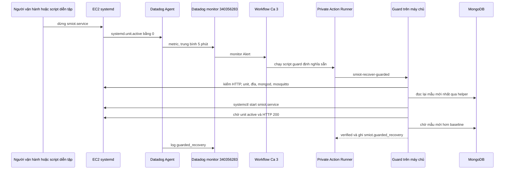

*Hình 5A.9. Tuần tự Ca 3 theo thiết kế. Ngày 06/11 phục hồi được xác minh bằng HTTP 200 và mẫu MongoDB mới sau 418 s, workflow tự kích hoạt lúc 03:12:43Z [E-82]; đầu ra EC2 đang bổ sung [E-59]; lượt chạy workflow Ca 3 ngày 04/11 được ghi nhận [E-74, E-60].*

### 5A.7 Máy trạng thái vòng đời sự cố

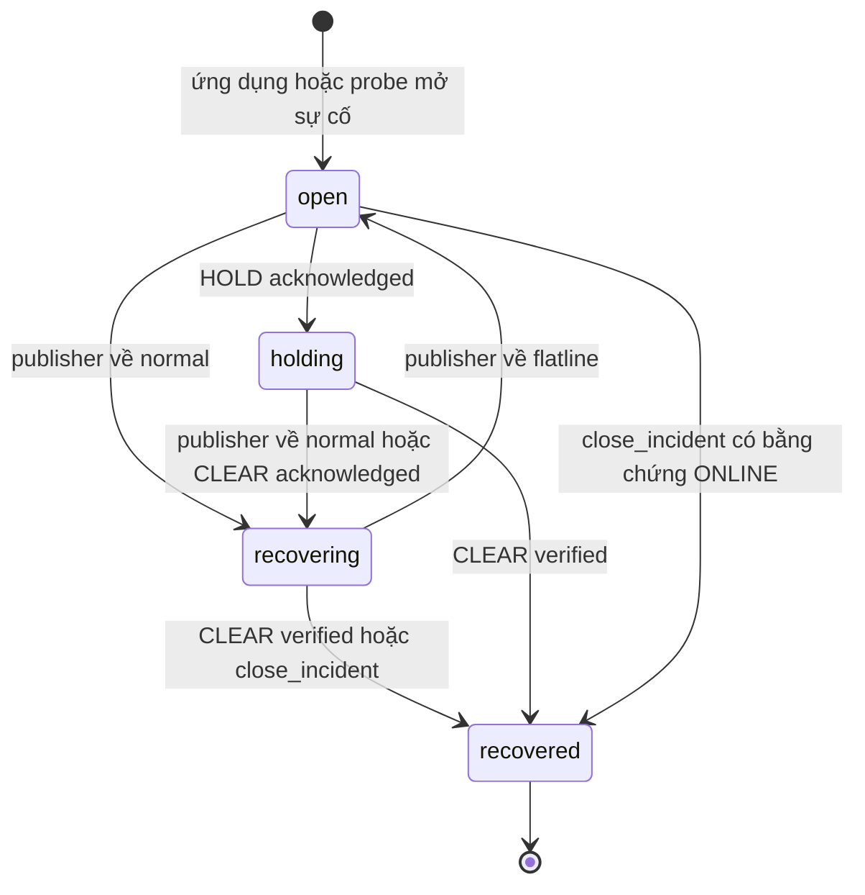

*Hình 5A.10. Máy trạng thái của `operational_incidents.status` với các trạng thái hoạt động `open`, `holding`, `recovering` và trạng thái kết thúc `recovered`.*

Các chuyển trạng thái trong Hình 5A.10 lấy từ hai hàm: `set_simulator_mode` (chuyển `recovering` khi về normal, `open` khi về flatline; `service/incident_lifecycle.py:102-114`) và `record_incident_action` (ACK thành `holding` hoặc `recovering`, CLEAR `verified` thành `recovered`; `:227-243`), cộng `close_incident` cho Ca 1 và Ca 3 (`:357-366`) [E-15]. Sự cố hoạt động được dùng làm khóa của chỉ mục một phần (xem Tài liệu 02, §5.2). Chuyển `open` sang `recovered` qua `close_incident` áp dụng cho `false_offline` và `service_down`; cho flatline, `close_flatline_incident` chỉ được gọi sau khi verifier đạt.

---

## 6 Dashboard `nkc-685-vw8` và trang điều hướng `/chart`

Dashboard "SMIOT | Farm Operations & Recovery" có bộ lọc `farm` (mặc định `greenhouse_a`) và **12 widget** theo bản đọc ngày 06/11: 8 widget ban đầu (đếm ngày 04/11 [E-03, E-52]) và 4 widget hạ tầng do người dùng thêm trên giao diện (tổ chức Datadog chặn ghi qua MCP).

| Nhóm | Widget | Câu hỏi trả lời |
|---|---|---|
| Chuỗi thời gian telemetry (3) | Độ ẩm đất theo node (gắn nhãn nguồn); nhiệt độ và độ ẩm không khí theo node; nhiệt độ đất, EC và độ tươi telemetry | Số đo tổng hợp biến thiên thế nào; độ tươi ra sao |
| MongoDB DBM (2) | Thông lượng truy vấn; tổng thời gian thực thi truy vấn theo `database_instance` | Tải truy vấn có bất thường quanh sự cố không |
| Giá trị truy vấn (2) | Phụ thuộc MongoDB; phụ thuộc MQTT | Hai phụ thuộc có khỏe tại thời điểm xem không (Câu 1) |
| SLO (1) | "Trusted telemetry availability (7d)" | Chưa đủ 7 ngày, xem dưới |
| EC2 (2, mới) | CPU user `avg:system.cpu.user{host:<INSTANCE_ID>}`; RAM khả dụng `avg:system.mem.pct_usable` | EC2 có đủ tài nguyên không |
| MongoDB (2, mới) | Kết nối và thao tác mỗi giây (`sum:mongodb.connections.current`, `opcounters.queryps`, `insertps`, `updateps`); dung lượng lưu trữ (`sum:mongodb.stats.storagesize`) | MongoDB có bao nhiêu kết nối, thao tác và dung lượng |

*Bảng 6.1. Mười hai widget của dashboard (4 widget cuối là widget mới).*

Widget SLO nằm trong cấu hình dashboard. SLO được tạo ngày 03/11 và chưa đủ 7 ngày dữ liệu để đánh giá [E-03]; số trên widget chưa dùng làm kết luận. Ảnh dashboard hiện có là ảnh ngày 04/11 (8 widget); ảnh sau cập nhật ở Phụ lục B.

**Trang `/chart`** nay là trang điều hướng ba thẻ, mỗi thẻ mở tab mới: Dashboard vận hành (`nkc-685-vw8`), Quan sát AI (danh sách ứng dụng LLM Observability) và Tất cả monitor. Cùng với `/incident` (admin; liên kết monitor và lượt chạy workflow), ứng dụng chỉ điều hướng, không tự vẽ biểu đồ hay kết luận nguyên nhân (quan sát ngày 06/11; use case ở Tài liệu 05).

---

## 7 Điều tra

### 7.1 Chuyển từ monitor sang log và trace theo `@incident.id`

Ở sự cố `INC-SMIOT-20261103T102822-D3B0F8A7`, monitor `339977691` chuyển Alert, thông điệp monitor chứa liên kết Logs theo `service`, `@farm.key`, `@node.id`, `@source`; truy vấn APM `service:smiot-smart-farm @incident.id:<id>` trả về 76 span và truy vấn Logs theo mã sự cố trả về 10 bản ghi, gồm cả các chuyển trạng thái hành động [E-40]. Ở `BD19A22C`, thông điệp monitor có thêm liên kết truy vấn Node 2 có cấu trúc ở cả nhánh Alert và Recovery; truy vấn trả về 10 bản ghi, gồm log telemetry sau phục hồi [E-41].

Hai giới hạn: khóa API của ứng dụng không đọc được API tìm kiếm (403) nên việc xác minh dùng giao diện Datadog [E-40]; liên kết từ monitor chỉ cải thiện điều hướng, không làm log tự có `incident.id` [E-41]. Trong MongoDB, sự cố lưu mẫu lỗi, mã trace và log, lượt chạy workflow, HOLD, CLEAR và mã các mẫu phục hồi (xem Tài liệu 02, §7) [E-40].

---

## 8 LLM Observability cho trợ lý Gemini

Trợ lý AI gọi mô hình Gemini qua `GenerateContent`; LLM Observability quan sát các lời gọi này mà không ghi nội dung.

**Khởi tạo.** Khi `DATADOG_APM_ENABLED` và `DATADOG_LLMOBS_ENABLED` bật, `initialize_tracing` gọi `LLMObs.enable(ml_app="smiot-smart-farm", integrations_enabled=False, agentless_enabled=False, …)` và ghi log "Datadog LLM Observability enabled for ml_app=smiot-smart-farm (inputs/outputs redacted)" (`service/observability.py:48-61`) [E-19].

**Span và dữ liệu đính kèm.** Mỗi lời gọi được bọc trong `llm_observation(model, "Gemini GenerateContent")`, nhà cung cấp `google` (`service/observability.py:72-82`; `service/ai_service.py:229`). Đầu vào chỉ gồm `content_redacted: True` và số ký tự prompt; đầu ra gồm `content_redacted: True`, số ký tự phản hồi, cờ gọi hàm, lý do kết thúc; siêu dữ liệu `model_name`, `provider`, `usage_reported` và số token nếu có (`service/ai_service.py:249-264`). Prompt, số đo trang trại và phản hồi cố ý không gắn vào span [E-19].

**An toàn khi lỗi.** Khối chú thích nằm trong `try/except`; lỗi Datadog chỉ in tên ngoại lệ và không làm gián đoạn lời gọi. `tests/test_llmobs.py` kiểm tra ba tình huống: LLMObs tắt, nội dung bị che, chú thích lỗi ("datadog down") [E-19, E-30].

**Quan sát ngày 06/11.** LLM Observability đã bật trên EC2 (`ddtrace` 4.16.1) và span "Gemini GenerateContent" (`ml_app` `smiot-smart-farm`, `env` `demo`, mô hình `gemini-3.5-flash-lite`) đã xuất hiện trên Datadog; siêu dữ liệu chỉ có model, provider, `usage_reported` và đầu vào trả về rỗng. Ảnh đang bổ sung (Phụ lục B, E-84).

---

## 9 Đánh giá

### 9.1 Quan sát từ các lần diễn tập

Mỗi số dưới đây chỉ có một mẫu, không phải chỉ số hiệu năng tổng quát; mốc thời gian đầy đủ của từng ca nằm ở Tài liệu 04.

**Ca 2 ngày 06/11.** Từ T0 `2026-11-06 02:36:40Z / 09:36:40 ICT`, monitor `339977691` chuyển Alert sau 311 s (`02:41:51Z`); lượt chạy workflow `e09175ca-6eed-41a7-8dee-9066d3f366ef` Success lúc 02:42:52Z đến 02:42:54Z; sau khi nguồn về normal (02:43:41Z), monitor về OK sau 206 s (`02:47:07Z`), `/healthz` trả 200. Trạng thái `recovered`, HOLD và CLEAR trong MongoDB đang bổ sung, cần phiên đăng nhập `/incident`; hiện có bằng chứng phục hồi một phần [E-56] (Phụ lục B, B3).

**Ca 3 ngày 06/11.** `smiot.service` dừng lúc `03:06:32Z / 10:06:32 ICT`; trong 418 s `mongod` và `mosquitto` active ở mọi lần quan sát, tuổi mẫu tăng từ 19 s đến 406,7 s; lúc 03:13:30Z unit active, HTTP 200, mẫu mới tuổi 6,6 s [E-59]. Thời điểm Alert và mã lượt chạy workflow đã có [E-82]; workflow là tác nhân khởi động, nhưng đầu ra lệnh trên EC2 chưa đọc được nên chưa xác nhận nội dung lệnh đã chạy (Phụ lục B, B2). Lần chạy guard đầu tiên ngày 04/11 (lượt `41135755-2edd-429b-9c0f-9e73ae7c43a1` [E-74]) từ chối vì `dd-agent` không đọc được tệp bí mật; helper không đối số được thêm sau đó [E-43].

### 9.2 Bảng tuyên bố, bằng chứng, trạng thái

| # | Tuyên bố | Bằng chứng | Trạng thái |
|---|---|---|---|
| 1 | Sáu monitor SMIOT có query, tag và ngưỡng như Bảng 4.1 | [E-50, E-70] | Đã kiểm chứng |
| 2 | Workflow Ca 1: ba bước: đọc tuổi mẫu từ hai metric Datadog (`smiot.telemetry.sample_age_seconds` và `smiot.external.sample_age_seconds`), rẽ nhánh theo `threshold_seconds` (mặc định 90 s), rồi ghi `REFUSED_RESTART` hoặc `ESCALATE_HUMAN`; không gọi EC2 và không tác động thiết bị; trigger monitor giới hạn 1 lượt mỗi 300 s | [E-55] | Đã kiểm chứng (cấu hình) |
| 3 | Workflow Ca 1 đã chạy thật khi monitor Alert | [E-55, E-81] | Đang bổ sung |
| 4 | Metric flatline, status mismatch, tuổi mẫu, phụ thuộc và probe ngoài có trong mã với tag hữu hạn | [E-14, E-20, E-23] | Đã kiểm chứng (mã) |
| 5 | Probe ngoài ứng dụng chạy theo timer 30 s trên EC2 ngày 06/11 | [E-57] | Đã kiểm chứng |
| 6 | Có monitor dùng metric `smiot.external.*` | Không có trong sáu monitor [E-50]; nháp [E-29] | Đang bổ sung |
| 7 | Log JSON có `incident.id`, `farm.key`, `node.id` truy vấn được sau sửa 03/11 | [E-40] | Đã kiểm chứng |
| 8 | Sự cố `D3B0F8A7` có 76 span và 10 log theo `@incident.id` | [E-40] | Đã kiểm chứng (tài liệu) |
| 12 | Guard chỉ chạy `systemctl start smiot.service`, có khóa, cooldown 300 s, kiểm đĩa và đọc lại MongoDB | [E-24, E-43] | Đã kiểm chứng (mã) |
| 13 | Nhánh G2 (từ chối khi mẫu còn tươi) có trong script | [E-29] | Đang bổ sung (chỉ là đề xuất) |
| 14 | Ca 3 ngày 06/11 phục hồi được xác minh bằng HTTP 200 và mẫu MongoDB mới sau 418 s | [E-59] | Đã kiểm chứng một phần |
| 15 | Workflow Ca 3 đã khởi động `smiot.service` ngày 06/11 | [E-82] | Đang bổ sung |
| 16 | Ca 2 ngày 06/11: monitor Alert sau 311 s, workflow Success, monitor OK sau 206 s (một lần quan sát) | [E-56] | Đã kiểm chứng một phần |
| 17 | Sự cố Ca 2 ngày 06/11 đã `recovered`, có HOLD và CLEAR trong sổ hành động | [E-86] | Đang bổ sung |
| 18 | LLM Observability: nội dung vào/ra bị che, lỗi Datadog không làm gián đoạn lời gọi | [E-19, E-30] | Đã kiểm chứng (mã và test) |
| 19 | Span Gemini hiện trên LLM Observability của Datadog | [E-84] | Đang bổ sung (ảnh) |
| 20 | Dashboard `nkc-685-vw8` có 8 widget ban đầu (đếm 04/11) | [E-03, E-52] | Đã kiểm chứng (ngày 04/11) |
| 21 | Dashboard nay có 12 widget, gồm 4 widget EC2 và MongoDB do người dùng thêm trên giao diện | — | Đã quan sát ngày 06/11; ảnh sau cập nhật: Đang bổ sung |
| 22 | SLO | SLO được tạo ngày 03/11 [E-03] | Chưa đủ 7 ngày |
| 23 | Các nhánh của Hình 5A.2 đến 5A.5 (Ca 1, Ca 2, Ca 3) có trong mã và cấu hình đã đọc | Bảng 5A.2 đến 5A.4; [E-14, E-15, E-22, E-24, E-50, E-55] | Đã kiểm chứng (mã); chạy trên hệ thống sống theo từng nhánh đang bổ sung |
| 24 | Workflow không chạy ở chuyển Recovery; phục hồi Ca 2 do watchdog và verifier đảm nhiệm | `service/telemetry_health.py:162-225`; `main.py:194-241`; [E-56] | Đã kiểm chứng (mã và ngày 06/11, một phần) |
| 25 | Khi Datadog không khả dụng, verifier không CLEAR và HOLD được giữ | `scripts/verify_and_clear_demo_safe_mode.py:34-44`; `main.py:227-237` | Đã kiểm chứng (mã); diễn tập đang bổ sung |
| 27 | Quy trình thủ công sau guard thất bại (start failed hoặc unverified) | Không có mô tả trong mã | Suy luận; Đang bổ sung |
| 28 | Trang `/chart` là trang điều hướng ba thẻ mở tab mới (Dashboard vận hành, Quan sát AI, Tất cả monitor) | Quan sát ngày 06/11; ảnh đang bổ sung | Đang bổ sung (ảnh) |

*Bảng 9.1. Tuyên bố, bằng chứng và trạng thái.*

---

## 10 Hạn chế và phạm vi trung thực

1. **Dữ liệu và thiết bị.** Toàn bộ telemetry là synthetic và PLC là PLC ảo; tài liệu không đưa ra kết luận về cảm biến hay bơm vật lý. Các monitor và phân tích thủ công chỉ xác định nguyên nhân của kịch bản mô phỏng [E-40].
2. **Thời hạn dùng thử.** Tài khoản Datadog ở giai đoạn dùng thử; bằng chứng đã xuất nằm trong `outputs/evidence/` và các tệp hồ sơ.
3. **Cách thay đổi cấu hình.** Tổ chức Datadog chặn ghi qua MCP; monitor, workflow và dashboard (kể cả bốn widget hạ tầng mới) được tạo hoặc sửa thủ công trên giao diện.
4. **Quyền của khóa API ứng dụng.** Khóa API của ứng dụng không đọc được API tìm kiếm metric, span, log (trả 403); việc xác minh dùng giao diện Datadog [E-40].
5. **SLO.** SLO chưa đủ 7 ngày dữ liệu [E-03].
7. **Workflow Ca 1.** Cấu hình hiện tại đọc tuổi mẫu từ metric Datadog và chỉ ghi từ chối hoặc escalation, không có đường tới EC2; lượt `a782b12c…` do monitor kích hoạt ghi nhánh REFUSED_RESTART [E-55, E-81]. Workflow Ca 2 lưu thông tin xác thực dạng văn bản trong định nghĩa; cần chuyển sang Connection và xoay khóa trước khi nộp.
8. **Tác nhân khởi động Ca 3 ngày 06/11.** Workflow `b83453ff…` được monitor kích hoạt lúc 03:12:43Z và chạy `recover-smiot-web` thành công; đầu ra lệnh trên EC2 đang bổ sung do giới hạn quyền AWS [E-82, E-59].
9. **Kiểm tra từ bên ngoài.** Kiểm tra HTTPS công khai từ bên ngoài hiện thực hiện thủ công; Synthetic định kỳ nằm ngoài phạm vi hiện tại [E-03].
10. **Phạm vi phát hiện của probe ngoài ứng dụng.** Metric `smiot.external.*` được thu thập để điều tra; monitor dựa trên chúng hiện là bản nháp [E-29].
11. **Phạm vi `status_mismatch`.** Metric chỉ được phát cho farm đang chọn trong trạng thái giao diện chính (xem §3.1).
12. **Mặc định tag của luồng log guard.** Cấu hình log gắn `env:production` cho luồng `smiot-recovery` trong khi ứng dụng dùng `env:demo` (xem §2.2).
13. **Bản nháp.** Các tệp trong `deploy/datadog/drafts/` (monitor Ca 1 và Ca 3 nháp, nhánh guard, ý tưởng widget tác động) là bản nháp, không phải cấu hình đã triển khai [E-29].
14. **Tag `managed_by:codex`.** Hai monitor phụ thuộc `339990226` và `339990232` mang tag này, giữ nguyên [E-50].
15. **Kiến trúc đơn điểm.** Ứng dụng, MongoDB, Agent và probe cùng chạy trên một EC2; sự cố cấp máy làm mất đồng thời cả nguồn tín hiệu lẫn thành phần cần quan sát (xem Tài liệu 01, §3.4).
16. **Nhánh suy luận trong cây quyết định.** Các nhánh "cần can thiệp thủ công", "điều tra thủ công", "HOLD chưa nhận ACK" và thời gian giữ trạng thái sau khi monitor Alert kéo dài (cửa sổ `max(last_5m)`) là suy luận từ mã, được đánh dấu trong bảng 5A.2 đến 5A.5; quan sát trên hệ thống sống đang bổ sung.
17. **Che định danh.** Tài liệu cố ý không ghi định danh tổ chức Datadog, định danh máy EC2, tài khoản AWS, địa chỉ mạng, hostname demo hay khóa; định danh máy trong query monitor Ca 3 được thay bằng `<INSTANCE_ID>`.

---

## 11 Kết luận

Kiến trúc observability của SMIOT dựa trên một nguyên tắc: mỗi loại lỗi cần một loại tín hiệu riêng và một phản ứng riêng. Tiến trình sống, dữ liệu tươi và hiển thị đúng được đo bằng ba nhóm metric khác nhau, với `incident_id` đặt ở log, trace và MongoDB để cardinality metric ở mức thấp. Ba workflow thể hiện ba phản ứng: ghi từ chối khi lỗi ở hiển thị (Ca 1), gọi bộ xác minh trong ứng dụng để giữ và gỡ trạng thái an toàn trên PLC ảo (Ca 2), và chỉ khởi động dịch vụ qua guard có kiểm tra trước và xác minh sau (Ca 3). Phục hồi luôn được định nghĩa bằng dữ liệu đọc lại từ MongoDB, không bằng việc một lệnh chạy xong.

Phạm vi bổ sung: Ca 1 đầu ra từng bước của lượt workflow đang bổ sung; Ca 3 ngày 06/11 đầu ra lệnh trên EC2 và log `smiot.guarded_recovery` đang bổ sung; Ca 2 ngày 06/11 bản ghi `recovered` đang bổ sung; SLO chưa đủ 7 ngày dữ liệu; ảnh dashboard đủ 12 widget đang bổ sung. Các phạm vi bổ sung được đánh dấu bằng nhãn trạng thái ở Bảng 9.1 và liệt kê ở Phụ lục B.

---

## Phụ lục A. Bảng ID và đường dẫn tương đối

| Đối tượng | ID | Đường dẫn tương đối trên Datadog US1 |
|---|---|---|
| Monitor Ca 2 | `339977691` | `/monitors/339977691` |
| Monitor đối chứng Ca 1 (dữ liệu cũ) | `339977703` | `/monitors/339977703` |
| Monitor phụ thuộc MongoDB | `339990226` | `/monitors/339990226` |
| Monitor phụ thuộc MQTT | `339990232` | `/monitors/339990232` |
| Monitor Ca 3 | `340356283` | `/monitors/340356283` |
| Monitor Ca 1 | `341409441` | `/monitors/341409441` |
| Monitor APM nền | `339985452`, `339992812`, `339992811` | `/monitors/<id>` |
| Workflow Ca 1 | `e2835af0-63fc-48e0-9562-2a1ee4a351d3` | `/workflow/e2835af0-63fc-48e0-9562-2a1ee4a351d3` |
| Workflow Ca 2 | `18d1b008-fb24-4713-aa0b-a1432d84ea80` | `/workflow/18d1b008-fb24-4713-aa0b-a1432d84ea80` |
| Workflow Ca 3 | `b83453ff-e122-4148-9519-e698f2effa7f` | `/workflow/b83453ff-e122-4148-9519-e698f2effa7f` |
| Lượt chạy workflow (mẫu đường dẫn) | `{execution_id}` | `/workflow/{workflow_id}?instance={execution_id}` |
| Lượt chạy Ca 2 ngày 06/11 | `e09175ca-6eed-41a7-8dee-9066d3f366ef` | `/workflow/18d1b008-fb24-4713-aa0b-a1432d84ea80?instance=e09175ca-6eed-41a7-8dee-9066d3f366ef` |
| Dashboard (12 widget) | `nkc-685-vw8` | `/dashboard/nkc-685-vw8` |
| Truy vấn log guard | — | Logs: `service:smiot-smart-farm source:smiot-recovery event:smiot.guarded_recovery` |
| Truy vấn log theo sự cố | — | Logs: `service:smiot-smart-farm @incident.id:<ID>` |

*Bảng A.1. ID và đường dẫn tương đối. Tên miền đầy đủ của site US1 được thêm phía trước đường dẫn.*

**Tài liệu tham khảo** (trích trong `docs/DATADOG_GUARDED_RECOVERY.md` [E-43]): `docs.datadoghq.com/actions/private_actions/run_script/`, `docs.datadoghq.com/monitors/notify/`, hướng dẫn `systemctl` của freedesktop.org.

---

## Phụ lục B. Mục cần bổ sung

Các mục dưới đây là chỗ đang bổ sung thông tin; thân tài liệu chỉ tham chiếu về đây.

| # | Mục | Cần | Bằng chứng liên quan |
|---|---|---|---|
| B1 | Ca 1 | Kết quả diễn tập: mã sự cố, mốc thời gian, lượt chạy workflow có `REFUSED_RESTART`, số lần khởi động lại bằng 0, trạng thái mute | E-81 |
| B2 | Ca 3 ngày 06/11 | Log `smiot.guarded_recovery` và đầu ra lệnh trên EC2 (thời điểm Alert và mã lượt đã có [E-82]); xác nhận Private Action Runner trực tuyến | E-82, E-57 |
| B3 | Ca 2 ngày 06/11 | Mã sự cố, trạng thái `recovered`, HOLD và CLEAR trong sổ hành động | E-86 |
| B4 | LLM Observability | Ảnh danh sách span `ml_app:smiot-smart-farm` cho thấy nội dung bị che | E-84 |
| B6 | Dashboard | Ảnh dashboard 12 widget sau cập nhật; ảnh `/chart` ba thẻ; cập nhật SLO sau khi đủ 7 ngày | E-52,  |
| B7 | Workflow Ca 2 và Ca 3 | Ảnh hoặc xuất cấu hình bước đã che thông tin xác thực | E-53, E-54,  |
| B9 | Mục đích hệ thống | Mục đích thứ ba (đoạn "Mục đích hệ thống và vai trò của Datadog") | Không có trong repo |
| B8 | Quy trình thủ công | Mô tả bước người vận hành khi guard trả `start failed` hoặc `unverified` | Không có trong mã |
