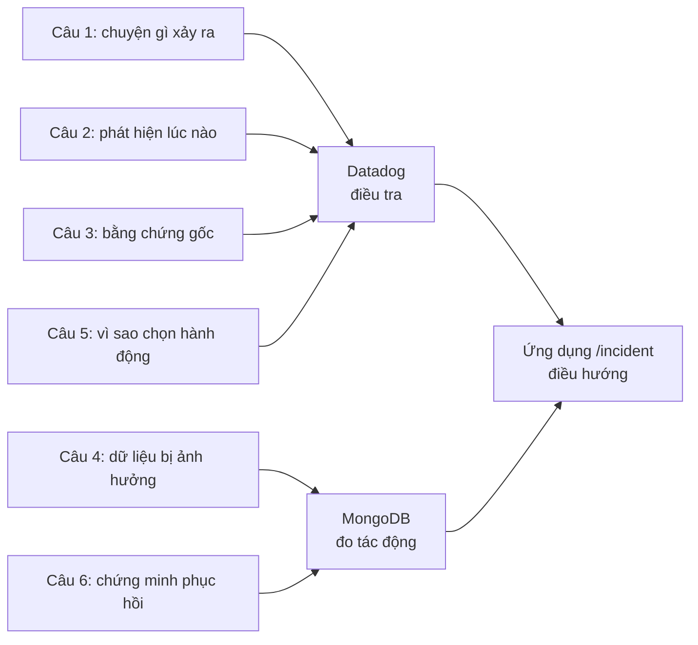
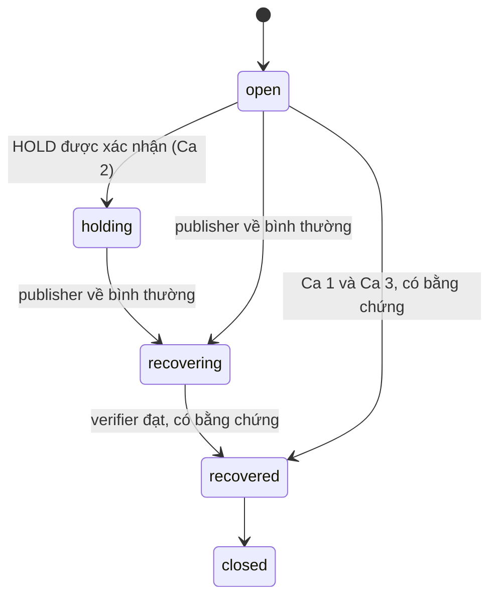
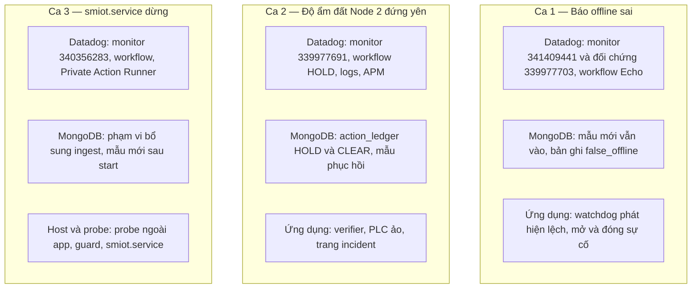
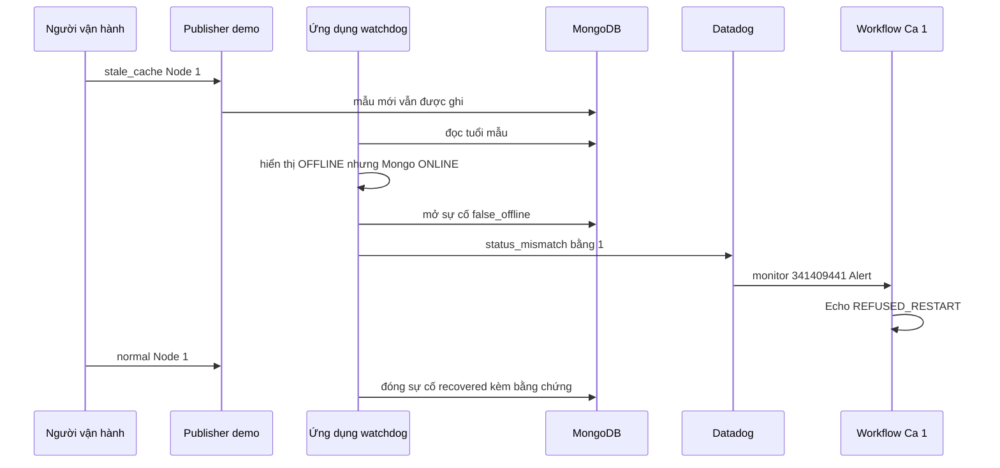
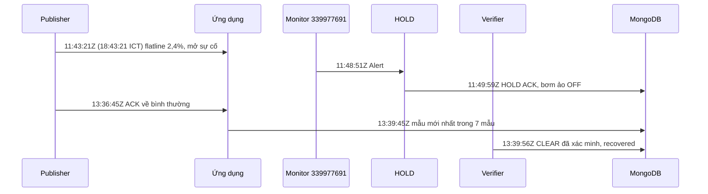
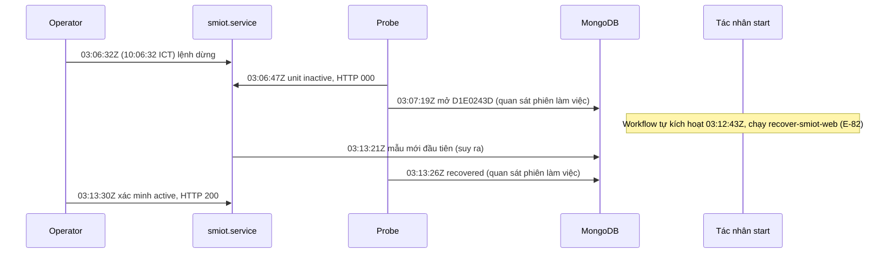
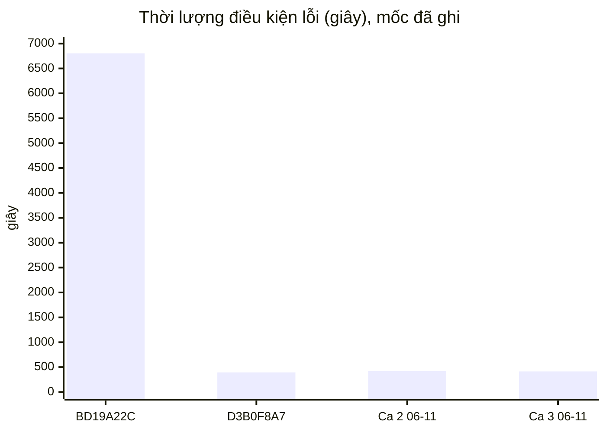

# Mô tả sự cố và tình huống vận hành được trình diễn

## Tóm tắt

Để việc quản lý nông trại (mục đích 1) dựa được vào dữ liệu, hệ thống phải giám sát phần mềm và thiết bị (mục đích 2): người vận hành cần biết dữ liệu nào còn đáng tin sau một sự cố. Nhóm trình bày ba tình huống như ba thí nghiệm có giả thuyết, quy trình, kết quả quan sát và giới hạn; mỗi tình huống được trả lời bằng cùng sáu câu hỏi, trong đó Datadog điều tra, MongoDB đo tác động và ứng dụng điều hướng. Ca 2 — Độ ẩm đất Node 2 đứng yên có hai hồ sơ đầy đủ ngày 03/11/2026, với 7 mẫu phục hồi dao động 39,3–41,0% trước khi gỡ trạng thái an toàn [E-40, E-41]. Ca 3 — `smiot.service` dừng có một lần dừng và phục hồi xác minh trong 418 s ngày 06/11/2026 [E-59], còn Ca 1 — Báo offline sai mới ở mức đã cấu hình và có sự cố ghi nhận chờ xác nhận [E-55]. Tất cả dữ liệu là tổng hợp; tác nhân start của Ca 3 ngày 06/11 và execution của Ca 1 đang bổ sung [E-81, E-82].

## Mục đích hệ thống

Ba ca diễn tập dưới đây là bằng chứng cho mục tiêu chung của dự án (Tài liệu 01): mỗi ca kiểm chứng một lớp lỗi và cách hệ thống phát hiện, điều tra và phục hồi có kiểm chứng.

SMIOT có hai mục đích đã xác định (chi tiết ở Tài liệu 01, mục "Mục đích hệ thống"). Mục đích 1 là quản lý nông trại và thiết bị: quan sát trạng thái farm, xem đề xuất AI, điều khiển bơm ảo và lập lịch tưới; bơm là PLC ảo, dữ liệu là luồng tổng hợp, và lịch tưới (UC-06) còn "đang bổ sung" (Tài liệu 05). Mục đích 2 là giám sát phần mềm và thiết bị: phát hiện lỗi, điều tra và phục hồi có kiểm chứng. Ba ca trong tài liệu này là ba minh họa cho mục đích 2. Mục đích thứ ba: «ĐANG BỔ SUNG: mục đích thứ ba».

## Đóng góp chính

1. **Không restart là kết quả đúng của Ca 1.** Khi mẫu vẫn đến MongoDB nhưng giao diện báo offline, workflow chỉ ghi lý do từ chối; monitor đối chứng về tuổi mẫu cho phép phân biệt "dữ liệu tươi" với "hiển thị sai" [E-55, E-50].
2. **HOLD trước, CLEAR chỉ sau verifier** trong Ca 2: bộ xác minh đọc mẫu MongoDB và đòi các điều kiện nêu ở §3.6 trước khi gỡ trạng thái an toàn [E-41, E-22].
3. **Một mã sự cố xuyên hai hệ thống.** `incident_id` nối log và trace trên Datadog với bản ghi sự cố, nhật ký hành động và mẫu telemetry trên MongoDB [E-40].
4. **Ca 3 đo được dependency khỏe trong lúc app dừng** (`mongod` và `mosquitto` active suốt) và xác minh phục hồi bằng mẫu MongoDB mới, không bằng việc lệnh chạy xong [E-59].

## Bảng 0. Tổng quan ba ca

| Ca | `kind` | Monitor | Workflow | Hành động mong đợi | Lần diễn tập có bằng chứng | Mức hoàn thiện bằng chứng |
|---|---|---|---|---|---|---|
| Ca 1 — Báo offline sai | `false_offline` | `341409441` (đối chứng `339977703`) | `e2835af0-63fc-48e0-9562-2a1ee4a351d3` | Từ chối restart (Echo `REFUSED_RESTART`) | Sự cố ghi nhận 06/11, kết thúc bằng mã C581C638 (quan sát phiên làm việc; mã đầy đủ: A-2) | Một phần: cấu hình [E-55]; lượt 06/11 [E-81]; đầu ra từng bước đang bổ sung |
| Ca 2 — Độ ẩm đất Node 2 đứng yên | `soil_humidity_flatline` | `339977691` | `18d1b008-fb24-4713-aa0b-a1432d84ea80` | HOLD; CLEAR sau xác minh | `INC-SMIOT-20261103T102822-D3B0F8A7`, `INC-SMIOT-20261103T114321-BD19A22C`; lần 06/11 [E-56] | Đầy đủ (hai hồ sơ 03/11) [E-40, E-41]; lần 06/11 một phần |
| Ca 3 — `smiot.service` dừng | `service_down` | `340356283` | `b83453ff-e122-4148-9519-e698f2effa7f` | Start đúng `smiot.service` sau guard | Execution `41135755…` (04/11) [E-74]; diễn tập 06/11, sự cố `INC-SMIOT-20261106T030719-D1E0243D` (quan sát phiên làm việc) [E-59] | Một phần: tác nhân start (A-4) |

Thứ tự đọc khuyến nghị: Tài liệu 01 → 05 (use case) → 04 → 02 → 03.

## Mục lục

Tóm tắt; Đóng góp chính; Bảng 0; 1 Phương pháp diễn tập; 2 Ca 1 — Báo offline sai; 3 Ca 2 — Độ ẩm đất Node 2 đứng yên; 4 Ca 3 — `smiot.service` dừng (mỗi ca có x.1 đến x.9); 5 So sánh ba ca và tác động trên dữ liệu; 6 Trình diễn trên `/incident`; 7 Đánh giá; 8 Hạn chế và phạm vi; 9 Kết luận; Phụ lục A (mục cần bổ sung).

## Danh sách hình

| Hình | Nội dung | Mục |
|---|---|---|
| 1.1 | Sáu câu hỏi và nguồn trả lời | §1.3 |
| 1.2 | Máy trạng thái vòng đời sự cố | §1.3 |
| 1.3 | Vai trò Datadog, MongoDB, ứng dụng theo ca | §1.3 |
| 2.1 | Trình tự Ca 1 theo thiết kế | §2.6 |
| 3.1 | Trình tự Ca 2 hồ sơ BD19A22C có mốc thời gian | §3.7 |
| 3.2 | Gantt Ca 2 hồ sơ BD19A22C | §3.7 |
| 4.1 | Trình tự Ca 3 ngày 06/11 có mốc thời gian | §4.7 |
| 4.2 | Gantt Ca 3 ngày 06/11 | §4.7 |
| 5.1 | Thời lượng điều kiện lỗi trên mốc đã ghi | §5.2 |
## 1. Phương pháp diễn tập

Ba ca đại diện cho ba lớp lỗi của mục đích 2: hiển thị sai (Ca 1), đứng số đo (Ca 2) và tiến trình app dừng (Ca 3).

### 1.1 Nguyên tắc chung

Cả ba ca theo cùng nguyên tắc [E-44]: mỗi lần chỉ chạy một ca và chỉ bắt đầu khi ca trước đã có hồ sơ; có snapshot ổ đĩa trong 24 giờ; chỉ mute hoặc ghi chú đúng monitor liên quan; mốc ghi theo UTC kèm ICT (UTC+7); dữ liệu là tổng hợp, không tạo bản ghi giả trong MongoDB bằng tay; không đọc hay in bí mật; nếu hai ca chồng nhau hoặc mẫu ngừng vào ngoài kịch bản thì dừng và kiểm tra bằng lệnh chỉ đọc.

### 1.2 Khung sáu câu hỏi

Mỗi ca được ghi theo sáu câu: (1) Chuyện gì xảy ra; (2) Phát hiện lúc nào; (3) Bằng chứng gốc là gì; (4) Lô hoặc khoảng dữ liệu nào bị ảnh hưởng; (5) Vì sao chọn hành động này; (6) Dữ liệu nào chứng minh đã phục hồi [E-44]. Khung này khớp với mẫu hồ sơ trong repo và với bảng "Hồ sơ 6 câu hỏi" trên trang `/incident` [E-17].

### 1.3 Chia vai Datadog, MongoDB, ứng dụng

*Hình 1.1. Khung sáu câu hỏi và chia vai.*

Câu 1, 2, 3 và 5 do Datadog trả lời qua monitor, log, trace và workflow execution. Câu 4 và 6 do MongoDB trả lời qua aggregation hợp nhất sự cố, quyết định, sổ hành động và telemetry [E-16]. Ứng dụng không tự suy luận thay hai bên mà hiển thị tóm tắt và dẫn liên kết [E-17]; biểu đồ vận hành và quan sát AI nằm trên Datadog, trang `/chart` chỉ dẫn đường. Bối cảnh người dùng của ba ca: Tài liệu 05.

*Hình 1.2. Vòng đời sự cố theo mã (`service/incident_lifecycle.py`, `ALL_STATUSES`); mã không có đường đặt `closed`.*

Ca 2 đi qua `holding` và `recovering`; Ca 1 và Ca 3 chuyển thẳng sang `recovered` khi có bằng chứng [E-15, E-16].

*Hình 1.3. Vai trò Datadog, MongoDB và ứng dụng trong từng ca.*

### 1.4 Tiêu chí "xong" cho từng ca

- **Ca 1:** hiển thị ONLINE khớp MongoDB; `status_mismatch` về 0; monitor Ca 1 Recovered; số lần restart bằng 0 trong cửa sổ ca; có mẫu MongoDB mới sau thời điểm khôi phục [E-44].
- **Ca 2:** CLEAR chỉ sau mẫu phục hồi đã xác minh; `action_ledger` có HOLD và CLEAR verified; sự cố ở trạng thái `recovered`; monitor OK; mọi bơm ảo OFF suốt ca [E-44].
- **Ca 3:** guard trả `result=verified` hoặc hệ thống đạt điều kiện tương đương; `app_up` bằng 1; có mẫu MongoDB mới sau thời điểm start; không restart `mongod`, `mosquitto`, Agent hay EC2 [E-44].

## 2. Ca 1 — Báo offline sai

### 2.1 Giả thuyết và kịch bản kích hoạt

*Giả thuyết:* nếu trạng thái hiển thị của Node 1 là OFFLINE trong khi MongoDB vẫn nhận mẫu mới, hệ thống phải phát hiện sự lệch này và không được restart ứng dụng. *Kích hoạt:* publisher demo đặt cache hiển thị cũ cho Node 1 bằng `set_demo_ui_fault.py stale_cache --node 1 --minutes 6`; hồi phục bằng `... normal --node 1` [E-27, E-44]. Dữ liệu cảm biến không bị thay đổi; chỉ trạng thái hiển thị bị lệch.

### 2.2 Phát hiện

Watchdog trong app so sánh trạng thái hiển thị với trạng thái tính từ MongoDB. Khi lệch, metric `smiot.telemetry.status_mismatch` bằng 1 theo `{farm, node}` và monitor `341409441` đánh giá `max(last_5m)` của metric này, cảnh báo khi lớn hơn 0 [E-14, E-50]. Cùng lúc, watchdog mở một sự cố `false_offline` cho node đó [E-14, E-15].

### 2.3 Điều tra

Điều tra dựa trên cặp monitor có chủ đích: `341409441` nói "hiển thị đang lệch"; monitor đối chứng `339977703` (`max(last_5m)` của `sample_age_seconds` theo `{node}`, ngưỡng 120 s) nói "dữ liệu đã cũ" [E-50]. Nếu chỉ monitor đầu Alert, bằng chứng chỉ ra hiển thị sai chứ không phải mất dữ liệu. Nhật ký JSON `smiot_status_mismatch` ghi `display_status`, `mongo_status`, `age_s` và `incident_id` [E-14]. Đây là kỳ vọng thiết kế; trạng thái quan sát thực của hai monitor trong lần chạy 06/11 chưa có (A-3).

### 2.4 Quyết định và hành động

Workflow `e2835af0-63fc-48e0-9562-2a1ee4a351d3` được gắn vào monitor `341409441`. Cấu hình kiểm ngày 06/11 có ba bước: đọc tuổi mẫu từ hai metric Datadog, rẽ nhánh theo ngưỡng (mặc định 90 s), rồi ghi `REFUSED_RESTART` hoặc `ESCALATE_HUMAN`; trigger monitor giới hạn 1 lượt mỗi 300 s [E-55]. Workflow không gọi MongoDB trực tiếp và không có hành động nào lên EC2.

*Lý do:* khi mẫu còn đến, app đang xử lý được bản tin; restart sẽ xóa phiên và bằng chứng mà không đổi dữ liệu.

*Phương án bị loại:*

- Restart `smiot.service`: làm mất phiên và bằng chứng, không sửa nguyên nhân hiển thị lệch.
- Restart `mongod` hay EC2: không liên quan, vì MongoDB đang nhận mẫu.

### 2.5 Tác động trên dữ liệu

Mẫu telemetry của Node 1 tiếp tục được ghi vào Time Series `telemetry` theo `meta.farm_key`, `meta.node_id` và `timestamp`, nên không có phạm vi bổ sung ingest nào do ca này gây ra (kỳ vọng theo thiết kế) [E-12]. Tác động nằm ở lớp hiển thị. Ánh xạ lô tổng hợp trong mã chỉ khai báo cho Node 2, nên Ca 1 không gắn với lô nào [E-15]. Số mẫu ghi nhận trong cửa sổ sự cố: A-7.

### 2.6 Phục hồi và bằng chứng

Khi trạng thái hiển thị khớp lại tính toán từ MongoDB và `computed.status` là ONLINE, watchdog gọi `close_incident` kèm bằng chứng gồm mốc nhận mẫu mới nhất, tuổi mẫu, trạng thái hiển thị và trạng thái tính toán; sự cố chuyển sang `recovered` [E-14, E-15]. Cơ chế đóng khác Ca 2: không có HOLD nên không cần verifier. Quan sát phiên làm việc 06/11: sự cố Ca 1 kết thúc bằng mã C581C638, phục hồi lúc 04:54:56Z (11:54:56 ICT); thời điểm mở và mã đầy đủ: A-2.

*Hình 2.1. Trình tự Ca 1 theo thiết kế; execution thực tế đang bổ sung.*

### 2.7 Dòng thời gian

Monitor `341409441` chuyển Alert lúc 04:49:21Z; workflow `e2835af0…` chạy lượt `a782b12c…` lúc 04:50:21Z, kết thúc Success [E-81]. Monitor chuyển OK lúc 05:00:21Z; lượt Recovered `9c014532…` chạy lúc 05:01:22Z [E-81]. Sự cố C581C638 trên `/incident` ghi `recovered` lúc 04:54:56Z (11:54:56 ICT) [quan sát phiên làm việc 06/11].

### 2.8 Bảng sáu câu

Bảng 2.2. Sáu câu hỏi cho Ca 1.

| Câu hỏi | Trả lời | Nguồn | Trạng thái |
|---|---|---|---|
| 1. Chuyện gì xảy ra | Giao diện báo Node 1 OFFLINE trong khi MongoDB vẫn nhận mẫu mới | E-14, E-44 | Thiết kế; quan sát chờ xác nhận |
| 2. Phát hiện lúc nào | Khi `status_mismatch` lớn hơn 0 trong cửa sổ 5 phút; Alert lúc 04:49:21Z | E-50, E-81 | Đã kiểm chứng (Datadog) |
| 3. Bằng chứng gốc | `status_mismatch`, `sample_age_seconds` thấp, monitor đối chứng OK, log `smiot_status_mismatch`, mẫu trong `telemetry` | E-14, E-50 | Đã kiểm chứng (mã và cấu hình) |
| 4. Lô hoặc dữ liệu bị ảnh hưởng | Không có khoảng thiếu mẫu dự kiến; không có lô gắn với Node 1 | E-12, E-15, E-81 | Đã kiểm chứng (cấu hình) |
| 5. Vì sao chọn hành động này | Từ chối restart vì dữ liệu còn đến; restart chỉ xóa bằng chứng | E-55 | Đã kiểm chứng (cấu hình) |
| 6. Dữ liệu chứng minh phục hồi | Hiển thị khớp trạng thái tính từ MongoDB, `status_mismatch` về 0, mẫu mới nhất kèm tuổi mẫu trong `recovery_verification` | E-14, E-15 | Mã đã kiểm chứng; lần chạy chờ xác nhận |

### 2.9 Giới hạn

- Lượt `a782b12c…` (04:50:21Z) ghi nhận nhánh REFUSED_RESTART: bước điều kiện trả `true`, bước Echo thành công; không có lệnh restart trong lượt này [E-81].
- Monitor Ca 1 đang mute theo ảnh chụp ngày 06/11 [E-51]; trạng thái mute tại lượt Recovered 05:01:22Z đang bổ sung.

## 3. Ca 2 — Độ ẩm đất Node 2 đứng yên

### 3.1 Giả thuyết và kịch bản kích hoạt

*Giả thuyết:* nếu số đo độ ẩm đất của Node 2 đứng yên trong khi mẫu vẫn đến, hệ thống phải đánh dấu dữ liệu không đáng tin, chặn quyết định tưới và chỉ gỡ chặn sau khi có mẫu biến thiên mới. *Kích hoạt:* `set_demo_sensor_fault.py flatline` đặt publisher gửi cố định 2,4% độ ẩm đất; `... normal` khôi phục [E-27, E-44]. Mô tả chính xác là "dữ liệu đứng phù hợp với giả thuyết flatline", không phải kết luận về một đầu dò vật lý.

### 3.2 Phát hiện

Theo mã hiện tại, watchdog coi là flatline khi có đủ 10 mẫu mới liên tiếp của node với chênh lệch nhỏ hơn hoặc bằng 0,01 trong cửa sổ 600 s, rồi phát `smiot.telemetry.sensor_flatline` bằng 1 và mở sự cố `soil_humidity_flatline` [E-14]. Monitor `339977691` có truy vấn `max(last_2m)` của metric này, cảnh báo khi lớn hơn 0 [E-50]. Ở hồ sơ BD19A22C, sự cố mở lúc 11:43:21Z và monitor Alert lúc 11:48:51Z, cách nhau 330 s [E-41].

### 3.3 Điều tra

Điều tra dùng Logs và APM theo `service:smiot-smart-farm @incident.id:<ID>`, [E-40, E-41]. Nguồn tổng hợp bắt đầu gửi giá trị cố định 2,4% [E-40]; số thứ tự mẫu vẫn tăng (14 sự kiện kiểm tra, dải 301–353) và log vẫn đến [E-41].

### 3.4 Quyết định và hành động

Quyết định là giữ trạng thái an toàn HOLD cho PLC ảo: mọi đầu ra bơm ảo ở OFF, dữ liệu Node 2 bị đánh dấu không đáng tin cho tới khi có mẫu phục hồi. Ở D3B0F8A7, bộ khóa liên động ghi một quyết định `BLOCKED_HOLD` lúc 10:28:25Z: quy tắc danh nghĩa sẽ yêu cầu tưới vì 2,4% thấp hơn 30%, nhưng sự cố chất lượng dữ liệu đang mở nên không có lệnh bơm nào được gửi [E-40].

*Lý do:* một số đo đứng ở 2,4% làm quyết định tưới dựa trên dữ liệu không đáng tin; HOLD chuyển hệ thống sang hướng thận trọng.

*Phương án bị loại:*

- CLEAR ngay khi monitor về OK: monitor OK chưa chứng minh có đủ mẫu biến thiên.
- Restart ứng dụng: ingest vẫn hoạt động nên restart không đổi số đo.
- Xóa hoặc chỉnh mẫu đứng trong MongoDB: phá hủy bằng chứng; hệ thống chỉ gắn nhãn sự cố.
- Đóng sự cố ngay khi số đo biến thiên trở lại: một cơ chế đóng tự động trước đây từng đóng sớm; mã hiện tại chỉ đóng khi verifier đạt [E-14].

### 3.5 Tác động trên dữ liệu

Mẫu 2,4% vẫn được ghi vào `telemetry` với số thứ tự tăng dần nên dữ liệu không mất; chúng được gắn nhãn thuộc sự cố. Ở D3B0F8A7, sự cố lưu 14 mẫu lỗi, mã trace và log, execution của workflow, một quyết định bị chặn, HOLD đã xác nhận, CLEAR đã xác minh và các mã mẫu phục hồi [E-40]. Lô gắn với sự cố là `melon-lot-local-demo-001` qua `lot_sensor_assignments` (nguồn `explicit_demo_fixture`); đây là ánh xạ tổng hợp, không khẳng định tác động lên lô cây trồng vật lý [E-40, E-41]. Giờ dữ liệu không đáng tin theo từng sự cố cần aggregation hộp đen (A-7).

### 3.6 Phục hồi và bằng chứng

CLEAR chỉ được gửi sau khi bộ xác minh phục hồi đạt. Theo mã hiện tại, bộ xác minh đòi: monitor Datadog ở OK; có HOLD đã xác nhận trong `action_ledger`; ít nhất 10 mẫu bình thường của Node 2 (khác 2,4%) trong cửa sổ không quá 6 phút kể từ HOLD; mẫu mới nhất trẻ hơn 90 s; biên độ độ ẩm không nhỏ hơn 0,5; PLC ảo xác nhận chế độ an toàn đã tắt và mọi đầu ra bơm ảo ở OFF [E-22]. Cách bộ xác minh được gọi: Tài liệu 01, §4.5. Số mẫu trong từng lần chạy theo hồ sơ lần đó:

- **BD19A22C:** 7 mẫu MongoDB mới, 39,3–41,0%, mẫu mới nhất lúc 13:39:45.903Z; verifier chấp nhận lúc 13:39:56.487Z, gửi CLEAR, nhận ACK từ PLC ảo, xác minh mọi bơm ảo OFF và đánh dấu sự cố `recovered` [E-41].
- **D3B0F8A7:** 6 mẫu, 39,5–40,6%, mẫu mới nhất lúc 10:37:55Z cách 23,4 s; CLEAR được chấp nhận sau ACK của PLC ảo [E-40].

Verifier từ chối CLEAR khi monitor còn Alert [E-22].

HOLD đi trước và CLEAR là bước cuối sau khi đọc lại MongoDB (Hình 3.1). Ở D3B0F8A7, HOLD thực tế do cầu nối gửi bằng đường dự phòng độ trễ thấp; execution `72ae7b55-0fab-46a8-92eb-7760baaf47ff` thành công nhưng thao tác lặp bị khử trùng lặp, nên workflow không gây ra HOLD đó [E-40].

### 3.7 Dòng thời gian

Bảng 3.1. Dòng thời gian Ca 2, hồ sơ chuẩn BD19A22C (2026-11-03).

| UTC | ICT | Sự kiện | Nguồn |
|---|---|---|---|
| 11:43:21 | 18:43:21 | Mở sự cố; publisher ACK flatline (T0) | E-41 |
| 11:48:51 | 18:48:51 | Monitor `339977691` Alert | E-41 |
| 11:49:59.805 | 18:49:59 | HOLD được xác nhận trong `action_ledger`; bơm ảo OFF | E-41 |
| 13:36:45 | 20:36:45 | Publisher ACK trở về bình thường; mẫu biến thiên đầu tiên 40,8% | E-41 |
| 13:39:45.903 | 20:39:45 | Mẫu mới nhất trong 7 mẫu phục hồi (39,3–41,0%) | E-41 |
| 13:39:56.487 | 20:39:56 | Monitor OK; verifier chấp nhận, CLEAR, ACK, sự cố `recovered` | E-41 |

Bảng 3.2. Dòng thời gian Ca 2, hồ sơ D3B0F8A7 (2026-11-03).

| UTC | ICT | Sự kiện | Nguồn |
|---|---|---|---|
| 10:28:22 | 17:28:22 | Mở sự cố cho Node 2, gắn ánh xạ lô tổng hợp | E-40 |
| 10:28:25 | 17:28:25 | Quyết định `BLOCKED_HOLD`, không gửi lệnh bơm | E-40 |
| 10:34:02 | 17:34:02 | Monitor Alert; HOLD do cầu nối gửi, ACK 10:34:02.401 | E-40 |
| 10:34:14 | 17:34:14 | Execution `72ae7b55…` thành công; thao tác HOLD lặp bị khử trùng lặp | E-40 |
| 10:34:55 và 10:35:46 | 17:34:55 và 17:35:46 | Publisher ACK trở về bình thường | E-40 |
| 10:38:19 | 17:38:19 | Monitor OK; 6 mẫu; CLEAR; sự cố `recovered` | E-40 |

Bảng 3.3. Lần diễn tập lại Ca 2 ngày 2026-11-06 (một lần quan sát).

| UTC | ICT | Sự kiện | Nguồn |
|---|---|---|---|
| 02:36:40 | 09:36:40 | Đặt flatline (T0); mẫu 2,4% đầu tiên lúc 02:37:07 | E-56 |
| 02:41:51 | 09:41:51 | Monitor `339977691` chuyển Alert, 311 s sau T0 | E-56 |
| 02:42:52–02:42:54 | 09:42:52–09:42:54 | Execution `e09175ca-6eed-41a7-8dee-9066d3f366ef` thành công | E-56, E-74 |
| 02:43:41 | 09:43:41 | Đặt trở về bình thường; mẫu 40,0% lúc 02:44:07 | E-56 |
| 02:47:07 | 09:47:07 | Monitor OK, 206 s sau khi đặt bình thường | E-56 |
| 02:47:45 | 09:47:45 | Cả 6 monitor SMIOT ở OK | E-56 |

Trong lần ngày 06/11, trạng thái `recovered` của sự cố và bản ghi HOLD, CLEAR trong `action_ledger` đang bổ sung; cần đăng nhập để đọc `/incident` (A-5). Các con số 311 s và 206 s là quan sát đơn lẻ.

Quan sát phiên làm việc 06/11: `/incident` ghi nhận nhiều sự cố Ca 2 trong ngày, gồm 164FBE41 (mở 02:57:55Z), F34F978C (04:26:19Z) và C548C847 (05:00:18Z); việc đối chiếu chúng với lần chạy trong Bảng 3.3 đang bổ sung.

*Hình 3.1. Trình tự Ca 2 hồ sơ BD19A22C với các mốc đã ghi trong hồ sơ [E-41].*

```mermaid
gantt
  title Ca 2 BD19A22C ngày 2026-11-03 UTC
  dateFormat HH:mm:ss
  axisFormat %H:%M
  section Sự cố
  Từ mở đến recovered :a1, 11:43:21, 13:39:56
  Số đo đứng yên T0 đến ACK bình thường :a2, 11:43:21, 13:36:45
  section Phát hiện và HOLD
  T0 đến monitor Alert :b1, 11:43:21, 11:48:51
  Alert đến HOLD ACK :b2, 11:48:51, 11:49:59
  section Phục hồi
  ACK bình thường đến CLEAR :c1, 13:36:45, 13:39:56
```

*Hình 3.2. Gantt Ca 2 hồ sơ BD19A22C dựng từ sáu mốc trong Bảng 3.1; không có số liệu ngoài bảng.*

### 3.8 Bảng sáu câu

Bảng 3.4. Sáu câu hỏi cho Ca 2, hồ sơ chuẩn BD19A22C.

| Câu hỏi | Trả lời | Nguồn | Trạng thái |
|---|---|---|---|
| 1. Chuyện gì xảy ra | Độ ẩm đất Node 2 gửi cố định 2,4% trong khi mẫu vẫn đến; đây là kịch bản tổng hợp | E-41 | Đã kiểm chứng |
| 2. Phát hiện lúc nào | Mở sự cố 11:43:21Z; monitor `339977691` Alert 11:48:51Z | E-41 | Đã kiểm chứng |
| 3. Bằng chứng gốc | Số thứ tự mẫu tăng (301–353 trong 14 sự kiện kiểm tra), log và trace theo `@incident.id`, monitor | E-41 | Đã kiểm chứng (tài liệu) |
| 4. Dữ liệu bị ảnh hưởng | Node 2 `greenhouse_a`, lô tổng hợp `melon-lot-local-demo-001`; số mẫu: A-7 | E-40, E-41 | Một phần |
| 5. Vì sao chọn hành động này | HOLD để chặn tưới trên số đo không đáng tin; CLEAR chỉ sau verifier; loại restart và CLEAR sớm | E-41, E-22 | Đã kiểm chứng |
| 6. Dữ liệu chứng minh phục hồi | 7 mẫu MongoDB mới 39,3–41,0%, mới nhất 13:39:45.903Z; monitor OK; ACK của PLC ảo, bơm ảo OFF; `recovered` | E-41 | Đã kiểm chứng |

### 3.9 Giới hạn

- Kết quả chứng minh đường dữ liệu tổng hợp và xử lý an toàn của ứng dụng, không chẩn đoán đầu dò vật lý [E-40, E-41].
- CLEAR chỉ áp dụng cho đầu ra của PLC ảo; mọi bơm ảo ở OFF suốt ca [E-41].
- Ngưỡng 10 mẫu là của mã hiện tại; hai hồ sơ 03/11 ghi 6 và 7 mẫu, theo ngưỡng lúc đó.
- Bản ghi `recovered` và `action_ledger` của lần 06/11 đang bổ sung (A-5). Workflow Ca 2 có một bước gọi endpoint khôi phục của ứng dụng bằng cơ chế gọi có xác thực, không mô tả ở đây.

## 4. Ca 3 — `smiot.service` dừng

### 4.1 Giả thuyết và kịch bản kích hoạt

*Giả thuyết:* khi chỉ `smiot.service` dừng và MongoDB cùng MQTT vẫn khỏe, hệ thống chỉ cần start đúng unit đó sau khi guard xác nhận an toàn; mọi dependency khác giữ nguyên. *Kích hoạt:* operator dừng đúng một unit bằng `drill_ca3_service_down.ps1`; mặc định là dry-run và chỉ dừng thật khi có `-Confirm` cùng xác nhận monitor đang OK và đã ghi chú mute [E-27, E-44]. Bước dừng là thao tác của operator, không phải sự cố tự nhiên.

### 4.2 Phát hiện

Probe ngoài app chạy chu kỳ 30 s; sau 2 lần liên tiếp `app_up` bằng 0, probe mở sự cố `service_down` với `farm_key` là `_system` [E-23]. Monitor `340356283` đánh giá `avg(last_5m)` của `systemd.unit.active` cho `smiot.service`, cảnh báo khi giá trị nhỏ hơn hoặc bằng 0 [E-50]. Trong lần 06/11, monitor chuyển Alert lúc 03:11:43Z và workflow tự kích hoạt lúc 03:12:43Z [E-82].

### 4.3 Điều tra

Bản ghi diễn tập cho thấy khi app dừng, `mongod` và `mosquitto` vẫn active ở cả 26 lần quan sát; HTTP trả 000; tuổi mẫu mới nhất tăng từ 19 s đến 406,7 s [E-59]. Dữ liệu này loại trừ giả thuyết dependency lỗi: nguyên nhân khu trú ở tiến trình ứng dụng. Metric của app (`smiot.*`) mất tín hiệu trong lúc dừng, do đó probe ngoài app là nguồn duy nhất còn quan sát được [E-23, E-44].
### 4.4 Quyết định và hành động

Theo thiết kế, hành động duy nhất được phép trên host là `systemctl start smiot.service`, do script guard chạy qua Private Action Runner. Guard kiểm theo thứ tự: nếu endpoint đã khỏe thì không làm gì; chờ 5 s cho cơ chế khởi động lại của systemd; từ chối nếu app đang active nhưng endpoint lỗi; từ chối nếu đĩa gốc từ 85% trở lên, `mongod` hoặc `mosquitto` không active, hoặc không đọc lại được MongoDB; dùng khóa chống chạy chồng; áp cooldown 300 s [E-24, E-43]. Sau start, guard yêu cầu unit active, HTTP 200 và mẫu MongoDB mới hơn mốc trước đó với tuổi không quá 180 s [E-24].

*Lý do:* `start` chỉ đưa unit đang dừng vào hàng đợi khởi động, ít gây gián đoạn nhất; mọi thành phần khác đang khỏe [E-43].

*Phương án bị loại:*

- Restart EC2: không cần khi chỉ một unit dừng, và làm mất cả MongoDB lẫn broker.
- Restart `mongod` hoặc `mosquitto`: chúng đang active, restart gây gián đoạn thêm.
- Restart app khi app đang active nhưng endpoint lỗi: nguyên nhân mơ hồ, guard từ chối [E-24].
- Bỏ qua kiểm tra sau start: một lệnh chạy xong không chứng minh dữ liệu trở lại [E-43].

### 4.5 Tác động trên dữ liệu

Từ mẫu cuối trước khi dừng (epoch 1793934386223 ms, khoảng 03:06:26.2Z) đến mẫu đầu tiên sau khi start (epoch 1793934801665 ms, khoảng 03:13:21.7Z), MongoDB không nhận mẫu mới; phạm vi bổ sung ingest suy ra xấp xỉ 415 s (suy ra từ hai giá trị `latest_sample_epoch_ms`, không phải phép đo riêng) [E-59]. Phạm vi bổ sung này có thể được hộp đen đánh dấu là thiếu mẫu khi vượt 3 lần chu kỳ 30 s [E-16]. Dữ liệu bị ảnh hưởng là toàn bộ luồng telemetry của hệ thống trong khoảng đó, nên sự cố `service_down` mang phạm vi `_system` và không gắn với lô cụ thể [E-23].

### 4.6 Phục hồi và bằng chứng

Phục hồi được định nghĩa bằng ba điều kiện cùng lúc: unit active, HTTP 200 và mẫu MongoDB mới có tuổi không quá 180 s [E-59, E-43]. Quan sát cuối cùng lúc 03:13:30.891Z ghi unit active, HTTP 200 và tuổi mẫu 6,6 s; bản ghi diễn tập có kết quả `recovered_verified_http_and_new_mongo_sample`, khoảng thời gian từ lệnh dừng đến xác minh 418 s (một lần quan sát) [E-59]. Quan sát phiên làm việc: sự cố D1E0243D chuyển `recovered` lúc 03:13:26Z, theo quy tắc probe đóng sự cố khi app trở lại và mẫu trẻ hơn 180 s [E-23].

**Tác nhân start.** Monitor `340356283` chuyển Alert lúc 03:11:43Z và kích hoạt workflow Ca 3 (`b83453ff-e122-4148-9519-e698f2effa7f`). Lượt `06cb1b46-e357-4ee1-94e1-fcbd4144fbd6` bắt đầu 03:12:43.914Z và chạy action `recover-smiot-web` thành công [E-82]. Đầu ra lệnh trên EC2 đang bổ sung: quyền `ssm:GetCommandInvocation` nằm ngoài tài khoản đọc hiện tại do SCP; trường `workflow_execution_id` của bản ghi diễn tập đang bổ sung [E-59].

### 4.7 Dòng thời gian

Bảng 4.1. Dòng thời gian Ca 3, diễn tập 2026-11-06.

| UTC | ICT | Sự kiện | Nguồn |
|---|---|---|---|
| 03:06:26.729 | 10:06:26 | Kiểm tra trước đạt: unit, `mongod`, `mosquitto` active, HTTP 200, tuổi mẫu 27,6 s | E-59 |
| 03:06:32.578 | 10:06:32 | Lệnh dừng `smiot.service` được phát | E-59 |
| 03:06:47.964 | 10:06:47 | Quan sát unit inactive, HTTP 000; `mongod`, `mosquitto` active | E-59 |
| 03:07:19 | 10:07:19 | Sự cố `INC-SMIOT-20261106T030719-D1E0243D` ghi trên `/incident` | Quan sát phiên làm việc 06/11 |
| 03:11:43 | 10:11:43 | Monitor `340356283` chuyển Alert | E-82 |
| 03:12:43 | 10:12:43 | Workflow Ca 3 chạy lượt `06cb1b46…`, action `recover-smiot-web` thành công | E-82 |
| 03:13:15.541 | 10:13:15 | Quan sát unit inactive cuối cùng, tuổi mẫu lớn nhất 406,7 s | E-59 |
| 03:13:26 | 10:13:26 | Sự cố D1E0243D chuyển `recovered` | Quan sát phiên làm việc 06/11 |
| 03:13:30.893 | 10:13:30 | Xác minh phục hồi: unit active, HTTP 200, mẫu mới 6,6 s | E-59 |

Execution ngày 04/11 `41135755-2edd-429b-9c0f-9e73ae7c43a1` được playbook ghi là đã start rồi verified, log dừng đối chiếu đang bổ sung [E-44, E-74]. Cùng ngày, lần chạy Datadog đầu tiên bị guard từ chối do người dùng chạy hành động không đọc được tệp bí mật; sau đó helper đọc lại thuộc root được thêm vào, và hồ sơ thiết kế yêu cầu diễn tập lại nhánh start trước khi gọi là đã chứng minh [E-43]. Quan hệ giữa hai ghi nhận: A-8.

*Hình 4.1. Trình tự Ca 3 ngày 06/11 theo [E-59]; các dòng ghi "suy ra" hoặc "quan sát phiên làm việc" không thuộc bằng chứng từ mã.*

```mermaid
gantt
  title Ca 3 ngày 2026-11-06 UTC
  dateFormat HH:mm:ss
  axisFormat %H:%M
  section Ghi trong bản ghi diễn tập
  Dừng đến xác minh 418 s :e1, 03:06:32, 03:13:30
  section Suy ra từ epoch mẫu
  Ingest ngừng khoảng 415 s :e2, 03:06:26, 03:13:21
  section Quan sát phiên làm việc
  Sự cố D1E0243D mở đến recovered :e3, 03:07:19, 03:13:26
```

*Hình 4.2. Gantt Ca 3; ba nhóm phân biệt mức chắc chắn của nguồn.*

Hình 4.1 và 4.2 bổ sung thời điểm Alert 03:11:43Z và lượt workflow 03:12:43Z theo [E-82].

### 4.8 Bảng sáu câu

Bảng 4.2. Sáu câu hỏi cho Ca 3 (diễn tập ngày 06/11/2026).

| Câu hỏi | Trả lời | Nguồn | Trạng thái |
|---|---|---|---|
| 1. Chuyện gì xảy ra | `smiot.service` bị dừng bởi operator; `mongod` và `mosquitto` active suốt; HTTP 000; mẫu mới ngừng vào | E-59 | Đã kiểm chứng |
| 2. Phát hiện lúc nào | Quan sát dừng 03:06:47.964Z; monitor Alert 03:11:43Z | E-59, E-82 | Đã kiểm chứng (Datadog) |
| 3. Bằng chứng gốc | `app_up`, `sample_age_seconds`, trạng thái unit, HTTP 000, log guard | E-59, E-23 | Một phần |
| 4. Dữ liệu bị ảnh hưởng | Phạm vi bổ sung ingest xấp xỉ 415 s toàn hệ thống (suy ra); không gắn lô | E-59, E-16 | Đã kiểm chứng (suy ra) |
| 5. Vì sao chọn hành động này | Chỉ start đúng một unit sau guard; loại restart EC2, `mongod`, `mosquitto` | E-24, E-43 | Đã kiểm chứng (mã và tài liệu) |
| 6. Dữ liệu chứng minh phục hồi | Unit active, HTTP 200, mẫu MongoDB mới 6,6 s; 418 s từ dừng đến xác minh | E-59 | Đã kiểm chứng một phần; workflow tự kích hoạt: E-82 |

### 4.9 Giới hạn

- Đầu ra lệnh recover trên EC2 đang bổ sung do giới hạn quyền AWS; hiệu quả được xác nhận qua Datadog và bản ghi diễn tập [E-82, E-59].
- Bước dừng là thao tác của operator; chỉ chứng minh đường guard cho một lần chạy [E-59].
- Khoảng 415 s lấy từ hai giá trị epoch mẫu; mốc 03:07:19Z và 03:13:26Z lấy từ quan sát `/incident`; đối chiếu với bản ghi trong Datadog Incident Response đang bổ sung.
- Trạng thái mute của monitor và xác nhận Private Action Runner online đang bổ sung trong lần kiểm tra sẵn sàng [E-57].

## 5. So sánh ba ca

Bảng 5.1. So sánh ba ca.

| Tiêu chí | Ca 1 — Báo offline sai | Ca 2 — Độ ẩm đất Node 2 đứng yên | Ca 3 — `smiot.service` dừng |
|---|---|---|---|
| Triệu chứng | Giao diện OFFLINE | Số đo cố định 2,4% | Không có HTTP, mẫu ngừng vào |
| Dữ liệu MongoDB còn vào | Có | Có (nhưng không đáng tin) | Không trong lúc dừng |
| Hành động đúng | Không restart | HOLD, rồi CLEAR sau verifier | Start một unit sau guard |
| Hành động sai bị loại | Restart oan | CLEAR sớm; xóa mẫu | Restart EC2, `mongod`, `mosquitto` |
| Bằng chứng phục hồi | Hiển thị khớp MongoDB | Mẫu biến thiên mới, ACK PLC ảo | HTTP 200 và mẫu mới ≤ 180 s |

Điểm chung của ba ca là không có hành động nào được xem là đúng chỉ vì nó chạy xong; mỗi ca có điều kiện đọc lại dữ liệu hoặc điều kiện từ chối. Điểm khác nhau là hành động: Ca 1 là không làm gì, Ca 2 là giữ trạng thái an toàn, Ca 3 là khởi động lại một tiến trình đã dừng.

### 5.2 Tác động trên dữ liệu

Bảng 5.2. Thời lượng điều kiện lỗi trên mốc đã ghi. Giá trị là hiệu hai mốc trong hồ sơ, không phải kết quả aggregation hộp đen.

| Lần | Điều kiện lỗi | Từ – đến (UTC) | Thời lượng (s) | Từ T0 đến xác minh (s) | Nguồn |
|---|---|---|---|---|---|
| Ca 2 BD19A22C | Số đo đứng yên | 11:43:21 – 13:36:45 | 6804 | 6995,5 (đến 13:39:56.487) | E-41 |
| Ca 2 D3B0F8A7 | Số đo đứng yên | 10:28:22 – 10:34:55 | 393 | 597 (đến 10:38:19) | E-40 |
| Ca 2 ngày 06/11 | Số đo đứng yên | 02:36:40 – 02:43:41 | 421 | đang bổ sung (A-5) | E-56 |
| Ca 3 ngày 06/11 | Ingest ngừng (suy ra từ epoch mẫu) | 03:06:26.2 – 03:13:21.7 | xấp xỉ 415 | 418 (từ lệnh dừng đến xác minh) | E-59 |
| Ca 1 | Hiển thị lệch | đang bổ sung | đang bổ sung | đang bổ sung (A-3) | — |

*Hình 5.1. Thời lượng điều kiện lỗi của bốn lần có mốc; Ca 1 đang bổ sung mốc đo nên không có cột.*

Cách dựng lại: lấy hai mốc UTC trong cột "Từ – đến" của Bảng 5.2 và trừ nhau. Hai cột đầu là số đo đứng yên, cột thứ tư là khoảng không có mẫu mới nên không cùng bản chất; hình chỉ giúp so độ lớn. "Giờ dữ liệu không đáng tin" và "số mẫu bị đánh dấu" theo từng sự cố cần chạy aggregation hộp đen (A-7).

## 6. Trình diễn trên `/incident`

Trang `/incident` chỉ dành cho tài khoản admin hoặc có quyền `manage_users` [E-17]; giám khảo truy cập qua `<URL_DEMO>` với tài khoản giám khảo (A-1). Kiến trúc trang: Tài liệu 01, §4.6. Theo mã hiện tại (`pages/incident.py`), người xem thấy: ba thẻ Ca 1/2/3 làm bộ lọc kèm dải ô theo lần diễn tập; bảng danh sách có cột "Xử lý trong"; trang chi tiết có khối "Metric của sự cố" (tên metric theo loại sự cố và liên kết mở Metrics Explorer hoặc dashboard Datadog theo khung giờ sự cố), "Hồ sơ 6 câu hỏi" (câu hỏi, trả lời ngắn, nguồn, mở), danh sách trace, liên kết Datadog (monitor, workflow, execution `?instance=`, logs, APM), biểu đồ "Chất lượng dữ liệu theo phút" và thanh tua dòng thời gian từ aggregation MongoDB [E-16, E-17]. Ảnh chụp: A-6.

Trang `/chart` nay chỉ có ba thẻ mở tab mới sang Datadog: Dashboard vận hành `nkc-685-vw8` (12 widget theo quan sát phiên làm việc 06/11; ảnh: A-9), Quan sát AI (LLM Observability) và Tất cả monitor; ứng dụng không còn bộ lọc ngày hay biểu đồ cảm biến.

## 7. Đánh giá

Bảng 7.1. Tuyên bố, bằng chứng và trạng thái.

| Tuyên bố | Bằng chứng | Trạng thái |
|---|---|---|
| Ca 2 ngày 03/11 (BD19A22C): HOLD đã xác nhận, 7 mẫu phục hồi 39,3–41,0%, CLEAR sau ACK của PLC ảo, sự cố `recovered` | E-41 | Đã kiểm chứng |
| Ca 2 ngày 03/11 (D3B0F8A7): `BLOCKED_HOLD`, HOLD do cầu nối gửi, workflow bị khử trùng lặp, 6 mẫu 39,5–40,6% | E-40 | Đã kiểm chứng |
| Ca 2 ngày 06/11: Alert 311 s sau T0, execution thành công, monitor OK 206 s sau khi đặt bình thường | E-56 | Đã kiểm chứng một phần |
| Ca 2 ngày 06/11: sự cố `recovered`, HOLD và CLEAR trong `action_ledger` | E-86 | Đang bổ sung |
| Verifier hiện tại đòi ≥ 10 mẫu, ≤ 90 s, biên độ ≥ 0,5 và monitor OK | E-22 | Đã kiểm chứng (mã) |
| Workflow Ca 1: ba bước: đọc tuổi mẫu từ hai metric Datadog (`smiot.telemetry.sample_age_seconds` và `smiot.external.sample_age_seconds`), rẽ nhánh theo `threshold_seconds` (mặc định 90 s), rồi ghi `REFUSED_RESTART` hoặc `ESCALATE_HUMAN`; không gọi EC2 và không tác động thiết bị; trigger monitor giới hạn 1 lượt mỗi 300 s | E-55,  | Đã kiểm chứng (cấu hình 06/11) |
| Ca 1 có execution `REFUSED_RESTART` và số lần restart bằng 0 | E-81 | Đang bổ sung |
| Ca 3 ngày 06/11: 418 s từ dừng đến xác minh; `mongod`, `mosquitto` active suốt; tuổi mẫu lớn nhất 406,7 s | E-59 | Đã kiểm chứng |
| Tác nhân start của Ca 3 ngày 06/11 là Workflow | E-82 | Đang bổ sung |
| Execution Ca 3 ngày 04/11 đã start rồi verified | E-44, E-74 | Đang bổ sung chi tiết (log dừng đối chiếu) |
| Sự cố D1E0243D mở 03:07:19Z, phục hồi 03:13:26Z | Quan sát phiên làm việc 06/11 | Ghi nhận theo `[E-xx]` |
| Trang `/incident` có thẻ ca, hồ sơ 6 câu hỏi và liên kết Datadog | E-17; ảnh E-83 | Mã đã kiểm chứng; ảnh đang bổ sung |
| Thời lượng điều kiện lỗi trong Bảng 5.2 (6804, 393, 421, 415 s) là hiệu các mốc đã ghi | E-41, E-40, E-56, E-59 | Đã kiểm chứng (phép trừ); 415 s là suy ra |
| "Giờ dữ liệu không đáng tin" và số mẫu bị đánh dấu theo sự cố | E-85 | Đang bổ sung |
| Vòng đời sự cố ở Hình 1.2 khớp mã | E-15, E-16 | Đã kiểm chứng (mã) |

## 8. Hạn chế và phạm vi

1. **Dữ liệu tổng hợp, một EC2, PLC ảo.** Mọi sự cố dùng dữ liệu do publisher demo tạo trên một EC2 duy nhất; không có kết luận về cảm biến, bơm hay lô cây trồng vật lý [E-40, E-41].
2. **Quan sát đơn lẻ.** Các khoảng 311 s, 206 s, 418 s và 415 s là một lần quan sát, không phải số trung bình hay chỉ số SLO; SLO chưa đủ 7 ngày dữ liệu [E-56, E-59].
3. **Mức chi tiết bằng chứng theo ca.** Ca 2 có hai hồ sơ đầy đủ; Ca 3 có tác nhân khởi động là workflow, đầu ra lệnh trên EC2 đang bổ sung [E-82]; Ca 1 có lượt chạy ngày 06/11, đầu ra từng bước đang bổ sung [E-81].
4. **Ngưỡng verifier thay đổi theo phiên bản.** Hai hồ sơ 03/11 ghi 6 và 7 mẫu; mã hiện tại đòi 10 mẫu [E-22].
5. **Số liệu quan sát phiên làm việc 06/11.** Mã sự cố, thời điểm mở và đóng của Ca 1, Ca 2, Ca 3 ngày 06/11, chờ người dùng xác nhận trên `/incident` và Datadog.
6. **Tính năng MongoDB không dùng.** Hệ thống không dùng cơ chế theo dõi thay đổi của MongoDB hay giao dịch đa tài liệu vì MongoDB chạy standalone; phát hiện dựa trên watchdog định kỳ.

## 9. Kết luận

Cả ba tình huống theo cùng một nguyên tắc: hành động được chọn theo lớp lỗi và chỉ được coi là hiệu quả khi dữ liệu đọc lại từ MongoDB xác nhận. Ca 2 có bằng chứng đầy đủ nhất (hai hồ sơ ngày 03/11); Ca 3 có một lần phục hồi đã xác minh, tác nhân khởi động là workflow [E-82]; Ca 1 có cấu hình và một lượt chạy ngày 06/11 [E-81]. Các khoảng thời gian là quan sát đơn lẻ trên dữ liệu tổng hợp.

## Phụ lục A. Mục cần bổ sung

| Mã | Mục cần bổ sung |
|---|---|
| A-1 | Tài khoản giám khảo cho `/incident`; quyết định ghi hostname demo (hiện dùng `<URL_DEMO>`) |
| A-2 | Mã đầy đủ các sự cố ngày 06/11 (Ca 1 C581C638; Ca 2 164FBE41, F34F978C, C548C847) |
| A-3 | Bản ghi diễn tập Ca 1: T0, monitor Alert, execution `REFUSED_RESTART`, số mẫu, trạng thái hai monitor (E-81) |
| A-4 | Ca 3 ngày 06/11: tác nhân start, thời điểm monitor Alert, execution, log `smiot.guarded_recovery`, trường `opened_by` của D1E0243D (E-82) |
| A-5 | Ca 2 ngày 06/11: mã sự cố, `recovered`, HOLD và CLEAR trong `action_ledger` (E-86) |
| A-6 | Ảnh `/incident` ba thẻ ca và chi tiết từng ca (E-83) |
| A-7 | Kết quả aggregation hộp đen: số mẫu bị đánh dấu, giờ dữ liệu không đáng tin, chuỗi `gap_seconds` (E-85) |
| A-8 | Quan hệ giữa execution `41135755…` và lần chạy bị guard từ chối ngày 04/11 |
| A-9 | Ảnh dashboard `nkc-685-vw8` sau khi có 12 widget |