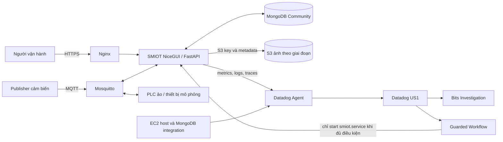
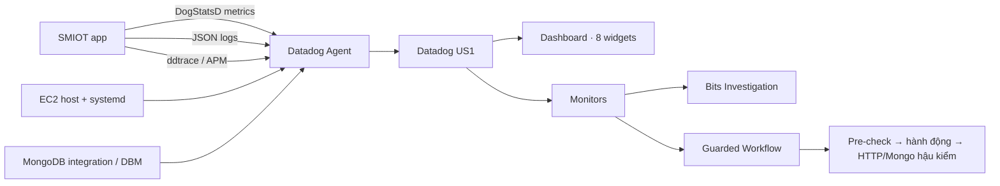
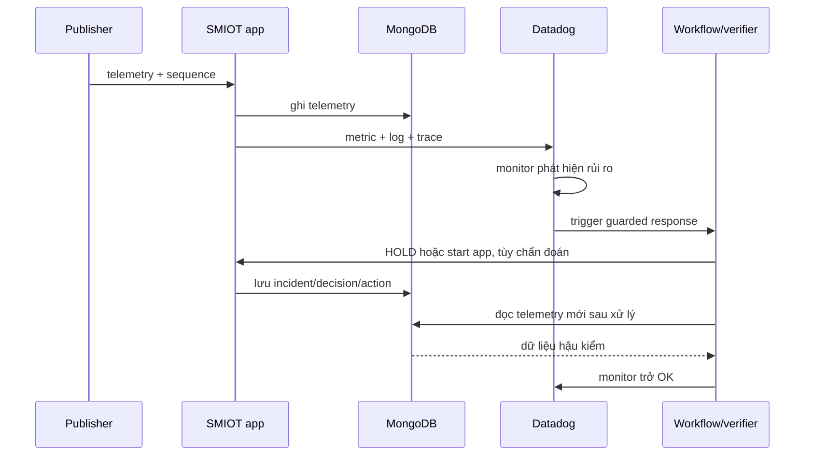

# Kiến trúc giải pháp SMIOT

**Ứng dụng · MongoDB · Datadog**  
Tài liệu kiến trúc phục vụ hồ sơ và thuyết trình Hackathon MUGVN 2026  
Phiên bản 1.0 · 04/11/2026

## Tóm tắt điều hành

SMIOT vận hành nhà kính dưa lưới: nhận telemetry cảm biến qua MQTT, lưu dữ liệu và hồ sơ vận hành trong MongoDB, phân tích độ đầy đủ dữ liệu cùng nhiệt tích lũy, rồi chuyển tín hiệu sức khỏe đến Datadog. Khi phát hiện bất thường, người vận hành lần từ monitor đến log, trace và incident. Workflow chọn hành động theo điều kiện và chỉ đánh dấu phục hồi sau khi có bằng chứng hậu kiểm.

MongoDB giữ dữ liệu thời gian và hồ sơ nghiệp vụ có thể truy vấn; Datadog kết nối tín hiệu ứng dụng, máy chủ, điều tra và phản ứng. Bản chạy hiện tại là MVP trên một EC2, chưa phải kiến trúc sẵn sàng cao.

## 1. Kiến trúc giải pháp và ứng dụng

### 1.1 Kiến trúc triển khai



Triển khai hiện được ghi trong README: EC2 `i-00bf2d3591d3ee0a2`, loại t3.small, vùng ap-southeast-2. Trên cùng instance chạy ứng dụng, MongoDB Community, Mosquitto, Nginx và Datadog Agent. URL HTTPS được cấu hình là `https://13-238-30-218.sslip.io/`. Một instance chứa nhiều dịch vụ tạo ra failure domain đơn, phù hợp MVP nhưng chưa đáp ứng HA.

| Thành phần | Vai trò |
|---|---|
| Nginx | Kết thúc HTTPS và chuyển yêu cầu đến ứng dụng. |
| SMIOT NiceGUI/FastAPI | Giao diện, xác thực/phân quyền, xử lý MQTT, incident và quyết định. |
| Mosquitto | Chuyển telemetry, lệnh điều khiển và ACK. |
| MongoDB Community | Kho dữ liệu vận hành chính. |
| Publisher / PLC ảo | Phát mẫu và ACK để diễn tập; không đại diện bơm vật lý. |
| S3 | Lưu ảnh riêng tư; MongoDB giữ metadata, key và checksum. |
| Datadog Agent / US1 | Thu host và app signals; cung cấp dashboard, monitors, Logs, APM, Bits và workflow. |

### 1.2 Luồng bình thường

1. Publisher gửi mẫu gồm farm, node, timestamp, readings, sequence và nguồn qua MQTT.
2. Ứng dụng kiểm tra rồi lưu vào MongoDB Time Series; logs và traces ghi lại xử lý.
3. DogStatsD gửi metrics có tag giới hạn; Agent chuyển metrics/logs/traces đến Datadog.
4. Giao diện truy vấn MongoDB để hiển thị cảm biến, lịch, phân tích và hồ sơ lô.

### 1.3 Hai kịch bản sự cố đã có bằng chứng

**Node 2 phát số đo đứng.** Publisher vẫn tăng sequence nhưng độ ẩm đất Node 2 giữ ở 2,4%. Monitor báo, Logs/APM được lọc theo incident ID, ứng dụng đặt PLC ảo vào HOLD. Khi publisher trở về bình thường, verifier chờ mẫu mới dao động, ACK và monitor OK rồi mới gửi CLEAR. MongoDB lưu incident, bằng chứng telemetry và action ledger.

**Ứng dụng trên EC2 ngừng chạy.** Monitor phát hiện `smiot.service` inactive. Workflow kiểm tra MongoDB, Mosquitto, disk và trạng thái dịch vụ; chỉ chạy `systemctl start smiot.service` khi điều kiện đạt. Hậu kiểm cần HTTP 200 và telemetry MongoDB mới. Ca này độc lập với Node 2; không restart toàn EC2, MongoDB hay MQTT.

## 2. Kiến trúc dữ liệu và data model MongoDB

### 2.1 Nguyên tắc

- Telemetry nhiều và có chiều thời gian được lưu trong Time Series Collection.
- Trường nhận diện ổn định nằm trong `meta`; thời điểm ở `timestamp`; số đo ở `readings`; nguồn và sequence ở `source`.
- Incident, quyết định, lịch và hành động nằm trong collection nghiệp vụ riêng để cập nhật theo vòng đời.
- Ảnh nhị phân ở S3; MongoDB giữ quan hệ ảnh với farm, lot, stage và checksum.
- Incident ID/command ID nằm trong logs, traces và MongoDB. Metric tags giới hạn ở farm/node/source để tránh cardinality cao.

### 2.2 Các collection chính

| Collection | Vai trò và trường tiêu biểu |
|---|---|
| `telemetry` (Time Series) | `timestamp`, `meta.{farm_key,node_id,measurement_type}`, `readings`, `source`; truy vấn theo farm/node/thời gian. |
| `operational_incidents` | Incident, farm/node, trạng thái, mốc mở/đóng, bằng chứng; `lot_id` chỉ khi có liên kết xác thực. |
| `incident_telemetry_evidence` | ID/sequence các mẫu và cửa sổ thời gian liên quan; tránh nhúng chuỗi raw lớn. |
| `operational_decisions` | Đầu vào, quyết định HOLD, lý do và thời điểm. |
| `action_ledger` | `command_id`, incident, action, state, timestamp từng bước; hỗ trợ idempotency. |
| `lot_sensor_assignments` | Farm, node, lot, `valid_from/valid_to`; nối node với lô theo thời gian hiệu lực. |
| `crop_cycles` | Lô, giống, mốc đậu quả, cửa sổ tham khảo, public token. |
| `traceability_events` | Sự kiện theo farm/lô/giai đoạn/thời gian và nguồn. |
| `crop_stage_media` | Metadata ảnh theo lô/giai đoạn và S3 bucket/key/checksum. |

Time Series được tạo với `timeField=timestamp`, `metaField=meta`, granularity seconds. Index được tạo cho các truy vấn: farm/measurement/time; farm/measurement/node/time; incident theo farm/node/status/opened hoặc farm/lot/opened; action theo incident/time và state/update; media theo farm/lot/stage. Username và public token có unique index phù hợp.

Ví dụ một mẫu:

```json
{
  "timestamp": "2026-11-04T12:00:00Z",
  "meta": {"farm_key": "greenhouse_a", "node_id": 2, "measurement_type": "node"},
  "readings": {"air_temp": 29.4, "soil_humidity": 41.2},
  "source": {"synthetic": true, "sequence": 804}
}
```

### 2.3 Aggregation gắn với bài toán trồng dưa lưới

Pipeline trong `service/mongodb_showcase.py`:

1. `$match` chọn farm, node, khoảng thời gian và mẫu nhiệt hợp lệ.
2. `$setWindowFields` cùng `$shift` tính khoảng cách giữa các mẫu liên tiếp.
3. `$group` gom theo node/ngày, tính số mẫu, nhiệt độ trung bình/min/max và khoảng trống lớn nhất.
4. `$set` đánh dấu ngày đủ dữ liệu: tối thiểu 80% mẫu giờ dự kiến và khoảng trống không quá 3 giờ. Ngày thiếu không được tính như ngày hợp lệ.
5. `$setWindowFields` tính GDD ngữ cảnh tích lũy và nhiệt độ trung bình trượt 7 ngày.

GDD dùng nhiệt nền 10°C và mốc tham khảo; mã nguồn ghi rõ chưa hiệu chuẩn cho giống và điều kiện nông học của lô. Vì vậy kết quả là cửa sổ kiểm tra thu hoạch, không phải ngày hái chính xác.

Benchmark một lần: raw trả 240 mẫu, 28.533 bytes, 23,701 ms; aggregation trả 2 dòng, 301 bytes, 2,712 ms. Payload trả về thấp hơn khoảng 98,9% trong lượt đo đó; documents examined đều là 4. Đây là minh họa giảm dữ liệu truyền, chưa phải kết luận hiệu năng tổng quát.

### 2.4 Backup và khôi phục

Backup logic lưu ở S3 đã được restore thử vào collection tạm: 154.618/154.618 mẫu Time Series và 1/1 incident. Chưa chứng minh point-in-time recovery hay phục hồi snapshot EBS. App và MongoDB cùng EC2 nên backup bảo vệ dữ liệu nhưng không loại bỏ failure domain đơn.

## 3. Kiến trúc observability Datadog

### 3.1 Tín hiệu và hành động



| Tín hiệu | Nguồn | Dùng để |
|---|---|---|
| Metrics | Host Agent, MongoDB integration/DBM, DogStatsD UDP 8125 | EC2, dịch vụ, MongoDB và chất lượng luồng telemetry. |
| Logs | App JSON logs và recovery JSONL | Tìm sự kiện theo incident, farm, node, command. |
| Traces | ddtrace và context propagation khi luồng hỗ trợ | Đo thời gian và lần theo các bước xử lý. |
| Monitors | Metric/systemd monitors | Phát hiện flatline và app service inactive. |
| Bits / Workflow | Datadog investigation và Private Action Runner | Hỗ trợ khoanh vùng; chạy phản ứng có guard và hậu kiểm. |

Incident ID/command ID không làm metric tags do cardinality cao. Chúng được dùng trong logs, traces và MongoDB để drill-down; metric tag giữ các chiều tổng hợp hữu hạn.

### 3.2 Luồng phát hiện–điều tra–phản ứng



Dashboard US1 `SMIOT | Farm Operations & Recovery (US)` được kiểm tra ngày 04/11/2026 và có 8 widgets gồm timeseries, query values và SLO. Dashboard: https://app.datadoghq.com/dashboard/nkc-685-vw8. Monitor Node 2: 339977691. Monitor app EC2: 340356283.

| Ca diễn tập | Bằng chứng | Giới hạn |
|---|---|---|
| Node 2 flatline | Incident `INC-SMIOT-20261103T114321-BD19A22C`; monitor; logs/APM theo ID; Bits investigation; HOLD ACK; 7 mẫu mới dao động 39,3–41,0%; verifier CLEAR; monitor OK. | Telemetry và PLC mô phỏng. Bits không phải nguồn xác nhận CLEAR. Mapping lô là dữ liệu demo. |
| EC2 app inactive | Monitor 340356283; workflow `SMIOT EC2 Guarded Web Recovery`; execution `41135755-2edd-429b-9c0f-9e73ae7c43a1`; HTTP 200 và Mongo telemetry mới. | Ca riêng với Node 2. Log success chưa xác nhận đã index trong Datadog Logs; workflow output và hậu kiểm là bằng chứng. |

## 4. Vì sao MongoDB và Datadog phù hợp

MongoDB phù hợp vì bài toán kết hợp telemetry thời gian lớn với hồ sơ linh hoạt theo vòng đời: farm, node, lô, giai đoạn, incident, quyết định và hành động. Time Series lưu dữ liệu cảm biến; aggregation tính độ phủ và xu hướng ngay trong DB; collection nghiệp vụ ghi trạng thái vận hành. Giá trị được trình diễn qua pipeline và benchmark thay vì chỉ nói “đã dùng MongoDB”.

Datadog phù hợp vì người vận hành cần thấy cùng lúc EC2, ứng dụng, broker, MongoDB và cảm biến. Monitor đưa đến logs/traces theo ngữ cảnh; workflow chọn hành động nhỏ nhất theo điều kiện rồi xác minh lại. MongoDB giữ hồ sơ nghiệp vụ; Datadog kết nối phát hiện và phản ứng.

## 5. Đối chiếu tiêu chí cuộc thi

Thể lệ chấm bài toán vận hành thực tế; kiến trúc/triển khai MongoDB; Datadog; luồng phát hiện, điều tra, xử lý; độ tin cậy/bảo trì; sáng tạo và AI hợp lý; tác động vận hành; MVP, tài liệu, video và thuyết trình. Hồ sơ cần nộp riêng kiến trúc giải pháp, data model MongoDB và observability Datadog. Nguồn: [thể lệ và tiêu chí chấm](https://mini-hackathon-sep-2026.mugvn.com/terms#judging).

| Tiêu chí | Tài liệu làm rõ | Trình chiếu |
|---|---|---|
| Bài toán vận hành | Độ tin cậy dữ liệu ảnh hưởng quyết định tưới. | Dashboard và Node 2. |
| MongoDB | Time Series, model, index, aggregation, backup/restore. | MongoDB Lab, pipeline, benchmark và giới hạn. |
| Datadog | Dashboard, monitors, Logs, APM, Bits, workflow. | Monitor → logs/APM → investigation → execution. |
| Phát hiện/điều tra/xử lý | Hai kịch bản riêng có hậu kiểm. | Node 2 rồi EC2 recovery. |
| Tin cậy/bảo trì | Idempotent ledger, pre-check, cooldown và post-check. | Action ledger và workflow. |
| Sáng tạo/tác động | Chặn tưới khi dữ liệu không đáng tin. | Nêu tác động dự kiến; không khẳng định lượng nước tiết kiệm nếu chưa đo. |
| AI hợp lý | Gemini instrumentation có trong app nhưng chưa xác minh đủ live. | Chỉ demo khi trace/LLMObs có bằng chứng. |
| MVP/tài liệu | App HTTPS, hai diễn tập, backup drill. | Mở ứng dụng và evidence. |

## 6. Giới hạn cần nói rõ

- Một EC2 là điểm lỗi đơn, chưa phải HA.
- Node 2 và PLC là mô phỏng; không gọi là đầu dò hỏng hoặc bơm thật đã sửa.
- Recovery được chứng minh bởi verifier, ACK, Mongo readback và monitor; Bits hỗ trợ điều tra.
- Ngày đậu quả/giống/GDD chưa hiệu chuẩn nông học; kết quả là cửa sổ tham khảo.
- Benchmark hiện là một lần chạy.
- Restore logic đã thử; EBS snapshot restore và PITR chưa được xác minh.
- SLO và chi phí thay đổi theo thời điểm; không trình bày estimate thành actual.

## 7. Lời trình bày kiến trúc

“SMIOT nối dữ liệu node cảm biến tới quyết định tưới. MongoDB lưu telemetry theo thời gian cùng hồ sơ incident, quyết định và hành động; aggregation tính độ đầy đủ và nhiệt tích lũy, đồng thời đánh dấu ngày thiếu dữ liệu thay vì điền số. Datadog nhận metrics, logs, traces và sức khỏe EC2/MongoDB. Khi Node 2 vẫn gửi nhưng số đo đứng, monitor báo; chúng tôi điều tra theo incident, đặt PLC ảo vào HOLD, rồi chỉ CLEAR khi ACK và mẫu mới xác nhận bình thường. Một ca EC2 riêng cho thấy workflow kiểm tra dependency, start đúng dịch vụ ứng dụng và xác minh bằng HTTP cùng dữ liệu MongoDB. MongoDB giữ bằng chứng vận hành; Datadog kết nối phát hiện, điều tra và phản ứng.”

## Phụ lục · nguồn kiểm tra

- `README.md` — triển khai và giới hạn cloud.
- `service/auth.py` — index MongoDB.
- `service/mongodb_showcase.py` — aggregation harvest/GDD.
- `service/observability.py` — APM và context propagation.
- `service/datadog_metrics.py` — DogStatsD và bounded tags.
- `service/operational_evidence.py` — action ledger.
- `docs/INC-SMIOT-20261103T114321-BD19A22C_EVIDENCE.md` — Node 2.
- `docs/DATADOG_GUARDED_RECOVERY.md` — guarded workflow.
- `docs/MONGODB_BACKUP_RESTORE_DRILL_20261103.md` — backup/restore.

Trước khi nộp, khai báo thư viện/framework, mã nguồn có sẵn, dữ liệu seed/synthetic và công cụ AI đã dùng. Không đưa credential vào repository hay video.
